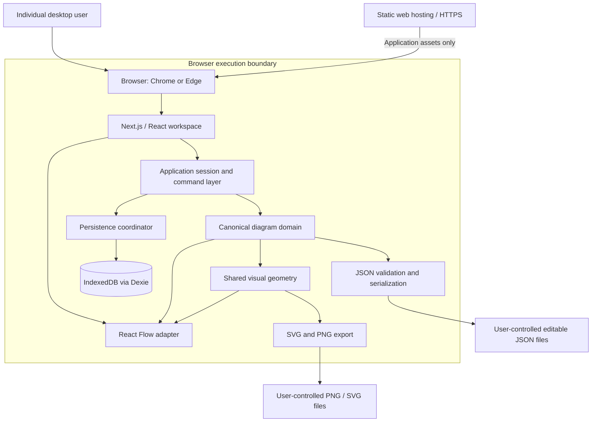
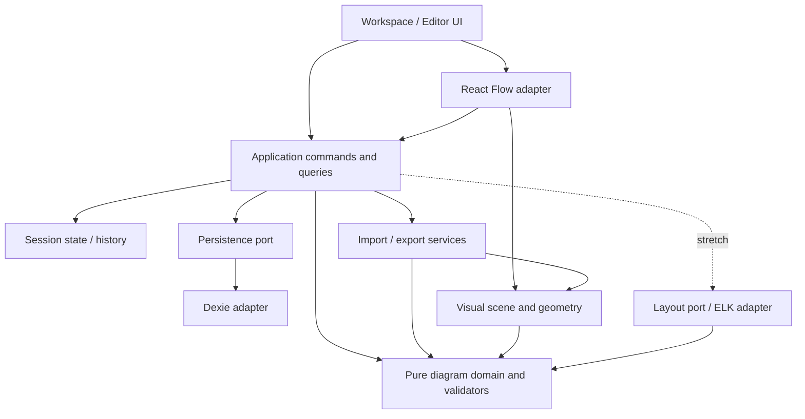
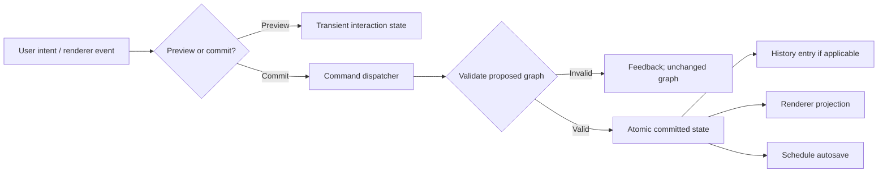
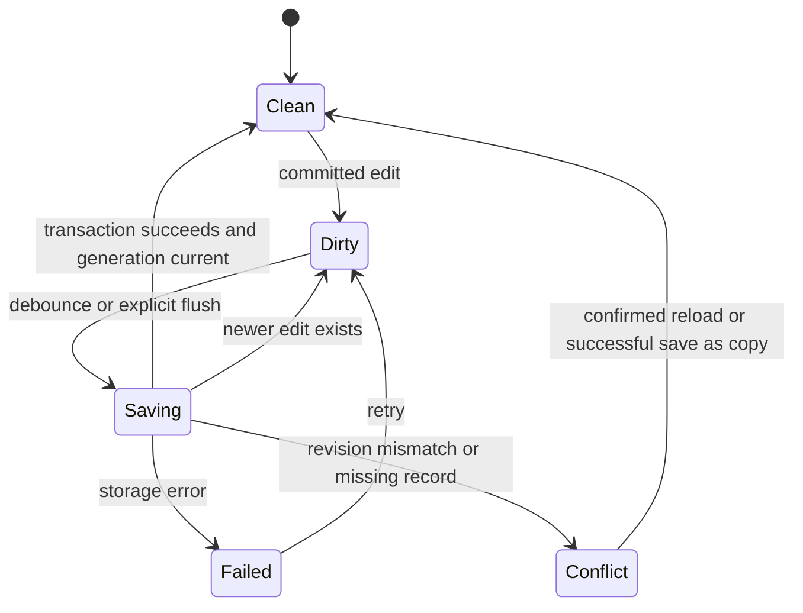
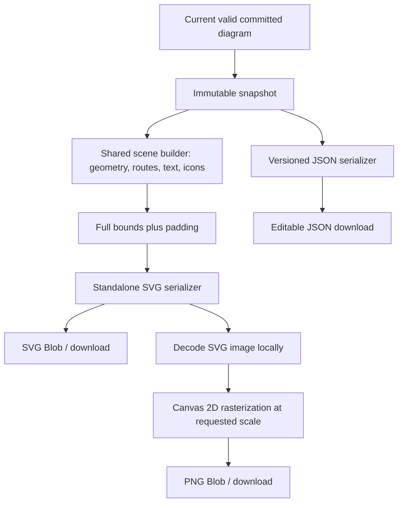

# DGS-03 — System Architecture & Technology Stack

| Document control | Details |
|---|---|
| Project | Diagramming System |
| Document ID | DGS-03 |
| Version | 0.1 |
| Status | Draft — pending technical validation |
| Date | 26 November 2026 |
| Parent specifications | DGS-01 v0.1; DGS-02 v0.1 |
| Target release | V0.2 — MVP |
| Owner | Product / Development |
| Audience | Developer, technical architect, QA, implementation agents |

## 1. Purpose and authority

Define the proposed architecture, technology choices, responsibilities, integration contracts and technical validation gates for the Diagramming System. This document is based on the actual DGS-01 and DGS-02 Markdown specifications. It preserves all 19 functional requirement IDs and the 15 Must / 3 Should / 1 Could prioritization, plus the eight non-functional requirements and eight parent release gates. DGS-02 remains authoritative for observable behavior; implementation convenience cannot override it. Later documents elaborate contracts, not silently change the product scope.

This is a technical design, not evidence of a built application. Public library documentation was reviewed for core capabilities and selected licenses. No packages have been installed, pinned, audited or executed; no feasibility tests or benchmarks have run. Exact compatible dependency versions and browser test versions will be established at project bootstrap.

## 2. Architectural principles and boundaries

1. **One structured editor:** all diagram categories use a shared node/edge/boundary model; templates and defaults differentiate use cases.
2. **Local-first:** application hosting distributes code; diagram content is edited and stored in the browser. No mandatory content upload, database server, sign-in or paid API.
3. **Canonical model first:** renderer state, DOM, CSS and library-specific data are not the persistent format.
4. **Atomic editing:** all committed mutations pass through a common command layer that preserves graph integrity and supports undo/redo.
5. **Shared geometry:** canvas and export use the same shape, anchor, route and text-layout semantics.
6. **Simple, replaceable boundaries:** one repository and deployable application, with adapters around rendering, persistence and optional layout. Avoid abstraction for hypothetical services.
7. **Explicit failure:** failed persistence, invalid imports, unsupported exports and conflicts must not masquerade as success.

Out of scope: NestJS or other application backend, PostgreSQL, cloud storage, OAuth/JWT, billing, realtime collaboration, AI integration, execution of depicted workflows, freehand editing, formal BPMN/UML validation, mobile editor, remote assets and third-party format imports. Do not introduce these dependencies in the MVP. Local-first does not promise a cold offline start; offline use after app load is required for built-in components. Installable PWA/offline shell caching is deferred unless separately approved.

## 3. System context and deployment topology



The diagram describes logical dependencies/data paths, not service-to-service network traffic. The hosting environment does not store or receive document contents in the proposed architecture. Network requests for app assets are expected; telemetry, remote fonts and remote icon lookups are not required. The origin (scheme/host/port and browser profile) defines the local storage namespace. Preview and production origins do not share diagrams, so JSON is the supported transfer path. Changing deployment domains requires a backup/migration notice.

### 3.1 Framework and routing decision

Use Next.js App Router with a client-side editor boundary (`'use client'`). Prefer static export (`output: 'export'`) and static hosting, with Vercel as an initial deployment candidate subject to current hosting terms and project eligibility. A plain static host is sufficient; no API routes or runtime server are required. Browser-only APIs must be initialized in the client lifecycle, not during build-time prerendering.

| Route | Responsibility |
|---|---|
| `/` | Local diagram library; empty state; create/open/duplicate/delete/import |
| `/editor/` | Statically generated editor shell; resolve `?id=<uuid>` on client |
| `/templates/` | Optional separate static route; may be a library dialog instead |

The proposed `/editor/?id=...` route replaces the earlier illustrative `/editor/[id]` route. Locally created IDs are unknown at static build time, so do not rely on dynamically generated server pages under static export. Use a Suspense boundary for client search-param reads as required by Next.js, or another build-compatible client router pattern. Confirm direct reload, deep links, invalid IDs and navigation warnings in the bootstrap spike. Missing documents show a non-destructive not-found state. A navigation controller must flush pending writes or offer stay/retry/discard on controlled navigation. Browser close/reload is best-effort; do not claim async writes can always finish in unload handlers.

Alternative: Vite + React would be simpler for a pure SPA. Next.js is preferred for developer familiarity and a potential later product shell, not because a server is needed. If static routing or build complexity proves disproportionate, review the framework choice before expanding implementation.

## 4. Technology evaluation and stack

### 4.1 Diagram engine alternatives

| Engine | Fit for MVP | Key trade-off | Decision |
|---|---|---|---|
| React Flow (`@xyflow/react`) | High: structured node/edge graph, custom nodes/edges, handles, viewport and subflows | Group management and portable SVG export require product logic | Preferred, conditional on spikes |
| Excalidraw | Strong for whiteboards and sketch-like diagrams; MIT | Product-specific structured properties and explicit hierarchical containment need evaluation | Fallback candidate if requirements shift toward freeform |
| tldraw | Strong general canvas and custom shapes | Additional SDK license terms; graph-specific behavior requires work | Deferred |
| Custom canvas/SVG engine | Maximum control | Must implement selection, pan/zoom, hit testing, resize, connections and accessibility | Rejected for MVP unless blocking requirements force review |

React Flow has documented node resizing, parent relationships, custom edge rendering, reconnection and screen-to-flow conversion [R1–R6]. The existence of a library example is not proof that our nested grouping, history, fit bounds or export requirements are satisfied. Some advanced sample implementations are offered as Pro examples; implement required behavior independently against the public APIs, retaining license notices. Do not copy proprietary example code without permission.

### 4.2 Proposed stack

| Layer | Technology | Adoption |
|---|---|---|
| Framework | Next.js App Router + React | Required baseline |
| Language | TypeScript strict mode | Required |
| Styling | Tailwind CSS | Required baseline |
| UI primitives | shadcn/ui source components, selectively installed | Preferred; no full component pack |
| Diagram interaction | `@xyflow/react` | Required, conditional |
| State | Zustand | Required baseline |
| Runtime schema | Zod + pure domain invariant checks | Required |
| Persistence | Dexie.js over native IndexedDB (local package only) | Required |
| Icons | Lucide React + shared trusted SVG icon definitions | Preferred; generic icons only |
| SVG export | Own vector serializer using shared scene geometry | Required |
| PNG export | Browser SVG image decode + Canvas 2D + `toBlob` | Required |
| JSON export/import | Native File/Blob APIs + Zod | Required |
| IDs | `crypto.randomUUID()` on supported secure context | Required baseline |
| Auto-layout | ELK.js, lazily loaded; worker if justified | FR-17 stretch only |
| Unit/integration | Vitest, Testing Library, fake-indexeddb (test only) | Required test baseline |
| E2E | Playwright using Chromium and actual supported Chrome/Edge channels | Required test baseline |
| Quality | ESLint, TypeScript checks, npm lockfile, GitHub Actions | Required baseline |
| Deployment | Static hosting via HTTPS | Required; provider provisional |

`html-to-image` is a useful comparison/prototype option for PNG, as demonstrated by React Flow [R7]. It is not the primary export dependency: DOM screenshot serialization can diverge from standalone vector output. Do not install it unless a spike justifies it. Avoid TanStack Query for synchronous local graph state, Prisma, server data frameworks and premature workers. Adopt extra dependencies only against an identified requirement.

### 4.3 Version and license policy

At bootstrap, choose maintained compatible stable releases, including a supported Node.js LTS compatible with the selected Next.js release; record actual versions and Node/package manager in README and lockfile. Use one package manager (npm proposed), `npm ci` in CI, a pinned Node major, and review dependency updates in isolated branches. No unverified exact version is prescribed by this document.

React Flow and Excalidraw repositories publish MIT terms [R1, R8]. tldraw has a distinct license [R9]; do not assume MIT or free production deployment. ELK.js package documentation lists EPL-2.0 OR GPL-3.0-or-later [R10]; if adopted, review distribution obligations under the chosen license and include required notices. Verify selected packages and transitive dependencies against installed license texts (including icons, UI snippets and any bundled fonts). Lucide's actual icon notices must be retained; avoid vendor trademarks/logos until DGS-06 approves usage. Record source, version, license SPDX where available, notice path and restrictions in `THIRD_PARTY_NOTICES.md` or equivalent. No complete dependency license audit or legal approval is claimed here.

## 5. Logical modules and dependency boundaries



| Module | Owns | Must not own |
|---|---|---|
| Workspace | Document library, navigation, empty/error states | Raw DB writes, graph edits |
| Editor UI | Toolbars, properties, interaction presentation | Persistent schema or direct mutations |
| React Flow adapter | Projection, pointer/keyboard integration, transient graph rendering | Canonical schema, direct persistence, domain decisions |
| Diagram domain | Types, IDs, invariants, pure geometry-independent rules | React, DOM, Dexie, Next.js |
| Command layer | Validate and apply logical graph operations | Library-specific events or storage implementation |
| Session/history | Active committed state, previews, history, revision counters | Cloud sync or multi-user logic |
| Component registry | Semantic types, supported properties, anchors, defaults, visual primitive factories | Arbitrary imported executable code |
| Visual scene | Resolve world geometry, text, routes, styles, layers and bounds | Save operations, editor chrome |
| Persistence | Repository interface, transactional adapter, save queue, conflicts/recovery | UI selection and graph mutation rules |
| Import/export | Parse/validate/remap, file serialization, SVG/PNG rendering | Changing current viewport or stored state during export |
| Templates | Versioned built-in diagram fixtures, instantiation | Mutating template sources |
| Layout | Optional layout adapter returning proposed positions | Direct graph commits or changing semantic relationships |

Dependencies flow toward the domain; adapter and framework imports stay outside the core. Use ports at the persistence and optional layout boundaries and plain functions elsewhere. Avoid a dependency-injection container, event bus or CQRS framework. The application layer may orchestrate multiple modules; it should not grow into a second domain implementation. Feature components invoke actions through explicit interfaces. Cross-feature operations use shared commands rather than importing sibling UI internals.

## 6. Canonical data and renderer integration

DGS-05 will define the exact schema. The architectural contract is a versioned JSON-serializable document, with stable document/node/edge/boundary IDs, title/category/timestamps, typed visual properties, status metadata, explicit parent references, geometry, edges with endpoint IDs and handle IDs, and document settings. Persist supported viewport separately as non-history view state (it may travel in JSON per DGS-05). Database record revisions and schema versions are distinct. Never persist React components, measured DOM elements, functions, selection handles, internal renderer caches, history or arbitrary HTML/CSS.

### 6.1 Canonical coordinates

Propose parent-relative positions with a top-left origin for nodes and boundaries. Root items have canvas/world coordinates. Absolute geometry is the sum of ancestor offsets. Registry definitions supply type-specific bounds and anchor positions. Reparent by computing old world position, subtracting the new parent's world origin, and applying the new local position atomically. Validate a single acyclic parent chain before calculating world coordinates. Group moves update the selected root group once, never every descendant independently. The canonical representation is a flat collection with explicit parent references; no redundant nested child arrays as a second authority.

React Flow projection maps boundaries to non-connectable parent nodes, ordinary components to custom nodes and logical edges to custom edge renderers. Parents must precede children in the projected list. The adapter maps local positions and `parentId` into the library format; group movement, resize, deletion and reparenting are domain commands, not default renderer mutations. Do not set parent extent indiscriminately: DGS-02 requires explicit membership and defined expansion when a child exits its boundary. Expansion on left/top must preserve other children's world positions by adjusting parent origin and child local offsets in one command, propagating to ancestors as necessary. Shrink operations cannot silently hide children. Boundaries themselves are not edge endpoints.

### 6.2 Renderer lifecycle and ownership

Keep React Flow controlled by projected application state, with stable `nodeTypes` and `edgeTypes` registries. Translate `onNodesChange`, `onEdgesChange`, connect/reconnect and resize events into transient previews or validated commands. Do not apply every callback blindly to the canonical model. Disable or intercept library deletion so domain deletion semantics (especially ungroup instead of recursive deletion) are preserved. Reconnection preserves original edge ID, style and label; invalid reconnect cancels without deleting the edge. Node resize uses registry minimums; update handle geometry when dimensions or anchor placement change. Use library viewport helpers for screen/world conversion [R5]; fit-to-view computes full scene bounds including labels and arrowheads, not just node rectangles. Zoom remains 25–200% provisionally; communicate when full fit cannot be achieved in range.

| State category | Owner | Examples | Persistent? |
|---|---|---|---|
| Canonical content | Diagram session | Nodes, edges, groups, styles, title/settings | Yes |
| Interaction preview | Editor session | Drag delta, resize preview, connection draft, text edit | No |
| View state | Editor session | Zoom, pan, selection, active tool | Viewport only, where supported |
| History | History module | Before/after committed graph snapshots | No |
| Persistence state | Save coordinator | Base DB revision, pending generation, saving/error/conflict | DB revision yes; UI flags no |
| Derived renderer state | React Flow adapter | Projected nodes/edges, measurements | No |

There must be one authoritative committed graph. Renderer internals and derived projections may cache for performance but cannot become an independent writable document copy. Preview state is discarded on cancellation, document switch or failed validation. Export reads a consistent committed in-memory snapshot; uncommitted gestures/text drafts must be completed or cancelled before export. DGS-07 will specify gesture and focus behavior.

## 7. Command processing, validation and history



Example command families: add/move/resize/delete/duplicate nodes; connect/reconnect/delete edge; set label/style/status; create/resize/reparent/ungroup boundary; nudge; apply preset; apply layout (if enabled). Document library create/duplicate/delete are repository operations outside diagram history. Clarify title and settings history eligibility in DGS-07. Every successful content command generates one monotonic in-memory generation, including undo/redo. No-op or invalid commands do not create history entries or mark content dirty.

Use discriminated command types and pure functions returning success with a valid next document or a structured validation error. Generate IDs before mutation and carry them as command payload where deterministic tests require it. Validate shape fields with Zod at import/load and typed command boundaries; validate graph invariants with domain code (uniqueness, endpoints, handles, containment, type capabilities, exact duplicate directed edges and no self-loops). Graph cycles between distinct nodes are allowed. Group hierarchy cycles are prohibited. Full validation on load/import and after complex operations; optimize hot-path checks only if profiling justifies it. Do not mutate the last valid state on failure.

History strategy: start with immutable before/after document-content snapshots (structural sharing where possible), a bounded session-local stack of at least 50 logical transactions, and undo/redo by restoring content while preserving document identity, current persistence revision and viewport. Coalesce one pointer gesture or text commit into one entry; do not record pointer moves, selection or pan/zoom. New edits after undo clear redo. Undo/redo schedule autosave with a new generation; they must never restore stale DB revision metadata. For large graphs, measure memory and consider patches only after profiling. A memory cap must not silently violate the required minimum of 50 transactions for the reference workload. Switching documents clears session history only after the navigation/save decision is resolved.

## 8. Local persistence and recovery architecture

Use Dexie transactions over IndexedDB [R11]. Store a complete validated document snapshot per record rather than normalizing nodes/edges into separate tables for MVP. Proposed `documents` table keyed by document ID, indexed by updated date (and category if useful), with content snapshot, schema version and monotonic DB revision. Optional lightweight viewport record or settings table may be separate to avoid content-revision conflicts on pan/zoom; DGS-05/DGS-08 finalize fields. Avoid writing heavy previews into the same transaction as critical graph saves.

Proposed port (illustrative, not final TypeScript):

```ts
interface DocumentRepository {
  list(): Promise<DocumentSummary[]>;
  load(id: string): Promise<StoredDocument | null>;
  create(document: DiagramDocument): Promise<StoredDocument>;
  save(document: DiagramDocument, expectedRevision: number): Promise<StoredDocument>;
  remove(id: string, expectedRevision: number): Promise<void>;
}
```

Create/import/duplicate use add-only semantics and fresh identities. A save is update-only: missing/deleted records must conflict, never be recreated implicitly. Validate snapshots before opening a transaction. Within a single read/write transaction, read existing record, compare expected DB revision, write complete validated snapshot with incremented revision, and await transaction completion. No unrelated network/async work inside the transaction. On mismatch, abort and keep in-memory work; offer reload (with discard confirmation) or save as independent copy. BroadcastChannel may notify other tabs of changes, but it is only a UX optimization; atomic compare-and-swap is the correctness mechanism. Deletion also checks revision so a stale tab cannot delete a newer record without resolution.

### 8.1 Autosave state machine



Use a single serialized save queue per active document. Capture immutable snapshot and generation when saving. On completion, update base DB revision; show saved only if the captured generation equals current generation and no newer content is pending. If edits occur mid-save, queue the latest snapshot after completion. Debounce up to one second as proposed in DGS-02; a sustained stream of committed edits should not indefinitely starve saves (define max-wait policy in DGS-08). Failure must retain the last successful DB record and current valid in-memory state where available. Do not automatically retry conflicts. Provide explicit retry and JSON backup. A user can export without working IndexedDB. A persistent storage request may be considered but can be denied and is not a guarantee against user clearing data. IndexedDB quotas and eviction vary by browser [R12]. Warn users about device/profile/origin dependence and private browsing.

Recovery: validate stored data on open; if corrupt or unsupported, do not silently overwrite it with blank data. Offer a clear recovery/error path and preserve raw stored record for inspection or safe download where feasible. In-app navigation waits for the save result or user choice; attach a dirty-only unload warning where supported, noting browsers may suppress it. Do not promise crash recovery of uncommitted or unsaved edits. DGS-08 specifies migrations, startup errors, quota handling, copy behavior and recovery UI.

## 9. Component registry and shared visual scene

A single built-in registry maps semantic type to defaults, size limits, property capabilities, label area, anchor definitions, status eligibility, icon key and visual primitive construction. Use generic trusted icon assets stored/bundled with the app. Diagram data references registry IDs, not imported arbitrary paths, CSS, HTML or remote URLs. DGS-06 owns inventory and exact geometry. Include all mandatory DGS-02 types; shapes may share a geometric primitive without sharing semantic identity.

Proposed scene builder resolves committed document into world-space layers: boundary backgrounds/titles behind descendants; edges and arrow markers with explicit stacking rules; node geometry and icon/text/status visuals; edge labels at suitable positions. DGS-07 will define layer precedence to preserve cross-boundary edge visibility. Use the same pure route generator and anchor calculations in interactive custom edges and export. Basic orthogonal routing uses deterministic right-angle segments with handle-direction offsets and an explicit label point; no global obstacle avoidance. For negative coordinates and nested groups, accumulate transforms exactly once. Include stroke extents, text extents, markers, group titles and labels in scene bounds. Maintain a common text layout policy: wrap line breaks and long labels, use the same font metrics and explicit line positions in canvas and SVG, and avoid silent clipping. If a label cannot fit at minimum font size, expand node or show validation feedback according to DGS-06/07. Use trusted font family choices; prototype portable output with common fallback font stacks or properly licensed embedded fonts if needed. System-font substitution can alter independent-viewer text appearance, so exact cross-platform parity is unproven; test the supported typography and resolve before release.

## 10. Import, JSON and visual export

### 10.1 Editable JSON

Check file size (proposed 10 MiB) before reading; parse JSON in a guarded boundary; validate envelope/schema version, shape fields, bounded strings/numbers, supported types, identifiers, handle references, group hierarchy and resource budgets. Reject unknown unsupported fields or apply explicit tested migrations; do not silently drop data. Reject arbitrary remote assets and executable markup semantics; labels remain inert text even when containing markup characters. Avoid unsafe recursive object merge or prototype-key handling. Limit graph item counts, nesting depth and numeric coordinate range in DGS-05 to protect against resource exhaustion. A file size cap alone is insufficient.

Remap document and internal identifiers in a two-pass operation when importing/duplicating; preserve all relationships by reference map. Validate again, create independent record atomically, and only then navigate to it. A failed import must not change the active diagram or library. Export canonical JSON from current valid snapshot independently of storage, omit transient UI/history and DB revision, preserve schema version and view settings according to DGS-05. Provide safe filename sanitization and Blob download with object URL cleanup. JSON is the native editable format; SVG is not imported as an editable graph.

### 10.2 Standalone SVG and PNG pipeline (FR-13)



Use a controlled serializer that writes only supported SVG tags/attributes (`rect`, `ellipse`, `path`, `line`, `polyline`, `g`, `text`, `tspan`, safe internal marker definitions etc.), explicit visual styles, namespace and viewBox; use safe XML text/attribute escaping and deterministic internal IDs. No scripts, event attributes, `foreignObject`, remote references, external CSS or editor DOM. Built-in icon paths come from trusted registry and are rendered as vectors. Background defaults to neutral as specified. Do not generate an SVG containing only a raster image. Full scene bounds include negative coordinates; viewport zoom does not affect output. Neutral background, padding and export scale are defined by DGS-08 (2x PNG proposed).

PNG rasterizes the same self-contained SVG via a Blob URL/image decode (or tested equivalent) onto a Canvas 2D surface sized from full bounds and scale; use `toBlob('image/png')`, handle decode errors, null Blob, resource limits and cleanup [R13–R14]. Apply maximum width, height and total pixel area before allocation; final limits require browser/device tests. A transparent background is optional. Empty content shows no-content error. Failed export does not mutate graph, viewport, save state or report success. Explicitly test text, icon paths, cross-boundary arrows, labels and clipping in independent viewers. If this pipeline fails to meet fidelity, investigate a separate Canvas renderer consuming the same scene; do not substitute screenshots for standalone SVG or lower acceptance without approval.

## 11. Security, privacy and trust boundaries

Threat model: malicious or malformed imported JSON, oversized documents, injected text/XML, dependency vulnerabilities, inadvertent network transfer, cross-tab writes and browser storage failure. No authentication boundary exists because this is local single-user software; anyone with access to the same browser profile may access documents. IndexedDB is not application-level encrypted storage. Avoid claiming confidential multi-user isolation, guaranteed offline operation or secure deletion. Third-party scripts on the same origin would share significant browser privileges; do not introduce unnecessary scripts or analytics.

| Control | Architecture response |
|---|---|
| Input validation | Strict schema plus cross-field invariants and bounded resource usage |
| XSS/XML injection | React text nodes, controlled SVG serialization, no `dangerouslySetInnerHTML` for user input |
| Remote asset leakage | Bundle icons and fonts or use system fonts; reject arbitrary imported URLs |
| Content privacy | No document upload/telemetry; inspect network in QA; hosting may log asset requests |
| Origin safety | HTTPS, review CSP and other headers with actual static host; test Blob/image needs and framework styles |
| Dependency security | Lockfile, audit and review advisories/licenses; no unchecked package installation by agents |
| Failure logging | Local technical errors without dumping labels/document contents by default |
| Conflict/data loss | Revision-checked atomic writes, explicit failures and editable backup |

CSP should be restrictive but tested against the selected Next.js/static hosting configuration; do not promise a specific nonce policy for static export. No secrets or API keys in client code. Treat future AI or cloud transmission as separate consent/security decisions (DGS-11).

## 12. Performance, accessibility and observability

Reference graph: 100 nodes / 150 edges, including nested boundaries, label text, status and mixed connector styles. Optimize by stable component registrations, memoized node components, Zustand selectors scoped to the relevant slice, stable references for unchanged objects, and transient gesture updates without full-document serialization at pointer frequency. Compute derived geometry for affected elements where practical; avoid O(n²) work on every interaction. Debounce persistence after commits, not previews. Lazy load export features if bundle measurement justifies it; ELK only if FR-17 is selected. Any worker should exchange serializable snapshots and discard stale results by generation. Start with main-thread simple geometry, measure before adding complexity.

Record benchmark device, browser, fixture, build mode and timings for drag/resize, pan/zoom, command latency, autosave, SVG/PNG generation and memory. DGS-10 sets quantitative thresholds before release testing. Do not claim performance from library demos. Keyboard focus and visible actions must work independently of pointer controls: scope keyboard shortcuts to canvas focus, never delete nodes during text input, support accessible insert actions, provide meaningful focus/labels and text statuses. A keyboard-only flow may need alternate connection controls depending on accessibility testing; evaluate during DGS-04/07 without asserting formal conformance. UI controls should not depend on color alone.

Observability: save state and recovery messages for users, a bounded developer console/error boundary for local diagnostics, no remote telemetry by default. Add performance marks only around relevant operations and avoid logging user content. An error boundary must allow reopening the last valid snapshot or navigating safely; no auto-reset destructive behavior. Any future telemetry needs separate review.

## 13. Optional capabilities and future evolution

FR-16 mini-map/alignment/distribution/presets: use React Flow MiniMap if scheduled; alignment/distribution are pure commands with one undo entry. FR-17 automatic layout: propose ELK.js behind a layout port; convert canonical nodes, hierarchy, dimensions and ports to layout input. Compute proposed positions without mutating the document. Validate output, preserve edge identities and hierarchy, show preview or explicit apply, discard stale result if content generation changed, and commit once. Do not add worker or ELK dependency before the feature is scheduled and license reviewed. FR-18 additional templates: static fixture data using same registry. FR-19 optional metadata/search/styles: schema-versioned bounded fields, registry filter and reusable presets; no separate service.

Future cloud repository may implement the same domain contract but will require new identity, sync, conflict, access control and migration designs. Local revision checks are not a collaboration algorithm. AI output must be validated structured graph data via the same schema/command/import boundary; no generated scripts or raster-only result as native diagram. DGS-11 handles those decisions. Do not build placeholder server endpoints, account models or sync abstractions beyond the simple repository port now.

## 14. Proposed repository layout

```text
diagramming-system/
  src/
    app/
      layout.tsx
      page.tsx
      editor/page.tsx
    components/ui/
    features/
      workspace/
      editor/{canvas,nodes,edges,toolbar,properties,interactions}/
      shape-library/
      templates/
      export/
    core/
      diagram/{types,ids,invariants}/
      schemas/
      commands/
      geometry/{anchors,routes,bounds,text}/
      registry/
      scene/
    application/
      session/
      history/
      documents/
      import-export/
      ports/
    infrastructure/
      rendering/react-flow/
      persistence/indexeddb/
      export/{svg,png,json}/
      layout/                 # only if FR-17 scheduled
    stores/                  # Zustand bindings to application session
    lib/
  tests/{unit,integration,e2e,fixtures}/
  docs/
    01-product/
    02-architecture/
    03-design/
    04-development/
    05-roadmap/
  public/
  .github/workflows/ci.yml
  AGENTS.md
  README.md
  THIRD_PARTY_NOTICES.md
  package.json
  package-lock.json
```

This is a proposed responsibility map, not a requirement to create empty folders upfront. Keep module public entrypoints small, co-locate related UI code and avoid premature monorepo packages. `core/` must not import React Flow, React, Dexie or Next.js. `application/` orchestrates pure operations and ports; `stores/` binds UI to session state, not a second graph authority. Export serializers consume scene data; editor features use adapter APIs rather than duplicate geometry. Test fixtures include golden diagram JSON shared across tests.

## 15. Implementation checkpoints and technical spikes

Run these before committing to the full implementation roadmap in DGS-09. Spikes are disposable experiments or small reusable proof modules; passing requires recorded evidence, not just a visually plausible screenshot. All are Not run.

| Spike ID | Experiment | Required evidence / pass condition | Related requirements |
|---|---|---|---|
| SP-01 | Bootstrap static Next.js/React Flow shell | Production build succeeds; direct `/editor/?id=...` reload resolves local fixture; no browser API during prerender | FR-01/02, NFR-06 |
| SP-02 | Nested groups and coordinate transforms | Two boundary levels; move parent exactly once, reparent/ungroup preserving world positions, shrink/expand and undo; cross-boundary edges intact | FR-03/08/10 |
| SP-03 | Connections and geometry | Straight/orthogonal edges, four-way anchors as supported, resize, invalid reconnect cancellation, stable ID, negative coordinates, full scene fit | FR-02/06/07 |
| SP-04 | Portable SVG/PNG | Native vector shapes, icons, multiline labels, nested boundaries, arrowheads/status; inspect SVG XML and independent browser/viewer; no clipping or UI | FR-05/07/08/09/13, NFR-08 |
| SP-05 | Persistence and stale tabs | Atomic compare-and-swap with two actual browser pages; quota/failure simulation; edit during save; stale deletion cannot resurrect record | FR-01/11/12, NFR-03 |
| SP-06 | Command/history integrity | Duplicate grouped nodes/internal edges; delete and undo; 50 transactions; new edit clears redo; invalid commands leave no mutation | FR-03/06/08/10 |
| SP-07 | Keyboard and editing | Canvas focus vs input/dialog; visible alternatives; resize/connection accessibility evaluation; no accidental deletion | FR-03/05/14, NFR-05 |
| SP-08 | Reference graph/performance | Production build with 100 nodes/150 edges; record interaction, save/export and memory baselines; define thresholds with DGS-10 | NFR-02/06/08 |

Prioritize SP-02, SP-03 and SP-04 immediately after shell setup. Failure triggers a documented technical decision: adapt projection/grouping, improve geometry, change engine or formally request a scope revision. No Must feature may be removed silently. For SVG failure, prototype independent serializer/Canvas strategy first; for group failure, investigate controlled projection/domain transforms before switching engines. Use actual desktop Chrome and Edge for critical browser tests. Unit tests with fake-indexeddb cannot prove multi-tab or real quota behavior.

## 16. Requirement-to-module traceability

| DGS-02 ID | Primary implementation | Key verification |
|---|---|---|
| FR-01 | Workspace, repository, navigation coordinator | Create/open/rename/duplicate/delete, failure path |
| FR-02 | React Flow adapter, viewport, scene bounds | Pan/zoom/world drop/fit |
| FR-03 | Commands, session, custom nodes | Move/resize/multi-select/duplicate/delete |
| FR-04 | Registry, shape library, custom nodes | All mandatory types, local assets |
| FR-05 | Properties, registry, text layout, validation | Multiline/style/inert text |
| FR-06 | Edge commands, anchor geometry | Branching/cycles/invalid endpoints |
| FR-07 | Edge renderer, routing, reconnect command | Routes/labels/arrowheads/reconnect |
| FR-08 | Containment domain, adapter, boundary commands | Nested group transforms/ungroup |
| FR-09 | Registry, status property, scene | Manual labels/colors round-trip |
| FR-10 | Command/history/session | Atomic undo/redo and 50 transactions |
| FR-11 | Save coordinator/Dexie repository | Reload/conflict/error handling |
| FR-12 | Schema, migrations, import/export service | Round-trip and invalid import |
| FR-13 | Scene, SVG serializer, PNG rasterizer | Native vector and full bounds |
| FR-14 | Canvas interaction controller | Grid/shortcuts/focus |
| FR-15 | Built-in templates and instantiation | Two independent editable templates |
| FR-16 | Productivity actions, mini-map | Stretch only; command integrity |
| FR-17 | Layout adapter | Stretch only; explicit apply |
| FR-18 | Template registry | Stretch only; valid fixtures |
| FR-19 | Registry/settings/schema | Optional; metadata/presets/search |

NFR-01 usability → DGS-04/07 and pilot test; NFR-02 performance → SP-08/DGS-10; NFR-03 reliability → SP-05 and history tests; NFR-04 privacy/security → import, SVG and network tests; NFR-05 accessibility → SP-07; NFR-06 compatibility → SP-01/08, browser matrix; NFR-07 maintainability → module boundaries, migrations and tests; NFR-08 fidelity → SP-04. Parent AC-01–08 remain unchanged; DGS-10 maps feature tests to executable evidence.

## 17. Build, testing and release engineering

Use one Git repository with small reviewable commits; CI runs clean install, lint, typecheck, unit/integration tests and production static build. E2E tests run against served production output; browser installation/pinning and actual Chrome/Edge release verification are documented. Proposed scripts: `dev`, `build`, `lint`, `typecheck`, `test`, `test:e2e`. Static preview and production are different origins; preview documents are not production data. Deploy only tested builds and retain prior artifact or reproducible commit for rollback. Schema compatibility matters: a code rollback after a database migration may not read newer data; test upgrade paths and never silently wipe data. DGS-08 defines version/migration handling and DGS-10 defines release gates.

Test pure graph operations, transforms, route/bounds, schema and serializer independently of UI. Integration tests cover command/store interactions and repository conflicts. Browser tests cover actual pointer, resize, focus, reload, local files, multi-tab and export. Golden fixtures compare semantic JSON equivalence after remapping IDs, inspect SVG for forbidden tags/attributes and validate independent-viewer rendering. Screenshot tests may supplement but do not replace correctness assertions. Use synthetic diagrams, not private client architecture documents, in repository/CI fixtures. No coverage percentage is asserted or required without DGS-10 approval.

## 18. Architecture decisions and risks register

| ADR | Decision | Status / consequence |
|---|---|---|
| ADR-01 | One client-side modular monolith | Proposed; no mandatory backend |
| ADR-02 | Next.js static export with query-based editor route | Proposed; SP-01; replaces illustrative dynamic route |
| ADR-03 | React Flow controlled adapter | Conditional; SP-02/03/04; custom domain behavior |
| ADR-04 | Canonical versioned schema independent of renderer | Proposed; DGS-05 contract |
| ADR-05 | Parent-relative coordinates and explicit membership | Proposed; SP-02; DGS-07 details |
| ADR-06 | Zustand session + pure commands; bounded snapshot history | Proposed; SP-06/08; profile memory |
| ADR-07 | Dexie snapshot repository, transactional revision checks | Proposed; SP-05; local storage limits |
| ADR-08 | Shared visual scene + native SVG serializer; PNG rasterized from SVG | Conditional; SP-04; avoid DOM capture as primary |
| ADR-09 | Generic bundled vector icons, controlled typography | Proposed; DGS-06; viewer font fidelity risk |
| ADR-10 | ELK optional only, license review before adoption | Deferred stretch; FR-17 |
| ADR-11 | Static HTTPS deployment, no mandatory telemetry | Proposed; provider/headers TBD |
| ADR-12 | Version pinning and repeatable CI before development | Proposed; exact versions TBD |

| Risk | Severity | Mitigation / owner |
|---|---|---|
| Nested-group transform or deletion mismatch | High | SP-02; domain commands and controlled projection; DGS-07 |
| SVG/PNG parity and fonts | High | SP-04; shared geometry, text measurement, independent viewers; DGS-06/08 |
| Stale-tab overwrite or lost save | High | SP-05; transactional revision compare, generation tracking; DGS-08 |
| Storage eviction/device change | High | JSON backup, truthful local-only messaging; cannot guarantee recovery |
| Inaccurate edge geometry/fit | Medium–high | SP-03; shared anchor/route/bounds functions |
| History memory or drag latency | Medium | SP-06/08; snapshot sharing and profile before optimizing |
| Package compatibility/license changes | Medium | Pin selected versions, review notices, audit at bootstrap |
| Browser keyboard conflicts | Medium | SP-07; focused actions, visible alternatives |
| Static-route hosting mismatch | Medium | SP-01; direct reload and origin checks |

Decisions are provisional; technical validation is the main blocker. No application code, prototypes, exact version compatibility checks or complete licensing audit have been performed. The design does not change MVP priority or guarantee that every technical choice passes the spikes. Escalate a failed mandatory capability rather than masking it. Record changes as a versioned ADR and reconcile with parent specs.

## 19. Handoffs and document control

| Document | DGS-03 input / expected refinement |
|---|---|
| DGS-04 | Static workspace/editor route concept, save/error states, toolbars, accessibility and desktop layout |
| DGS-05 | Canonical schema, parent-relative transforms, IDs, resource limits, version/migration and revision separation |
| DGS-06 | Registry catalog, geometry, anchors, text layout, local icon assets/notices, templates |
| DGS-07 | Controlled adapter interactions, group expansion, edge routing, history transaction semantics, fit bounds |
| DGS-08 | Dexie tables/transactions, autosave generation state, import/export format, PNG limits, recovery |
| DGS-09 | Build phases, risk spikes before full implementation, dependency sequencing |
| DGS-10 | Test matrix, measured thresholds, acceptance evidence, browser versions and defect severity |
| DGS-11 | Cloud/AI/collaboration evolution without premature implementation |

Recommended repository path: `docs/02-architecture/DGS-03_System_Architecture.md`. Keep DGS-01/02/03 versioned together. Implementation agents must follow mandatory requirements, use the canonical model, and report blockers and deviations. Do not install optional layout or cloud services simply because they are mentioned in a roadmap. Suggested sequence: DGS-04 next; complete schema and registry contracts before full editor construction; run early feasibility spikes at the beginning of DGS-09 implementation rather than waiting until release testing.

## 20. Public technical references

Reviewed for this draft on 26 November 2026. These sources establish documented capabilities or published terms, not proof of our implementation. Verify installed versions and terms at bootstrap.

- R1 — React Flow / xyflow repository, MIT and library overview: https://github.com/xyflow/xyflow
- R2 — React Flow node type and parent relationships: https://reactflow.dev/api-reference/types/node
- R3 — React Flow NodeResizer: https://reactflow.dev/api-reference/components/node-resizer
- R4 — React Flow reconnection example: https://reactflow.dev/examples/edges/reconnect-edge
- R5 — React Flow instance viewport conversion: https://reactflow.dev/api-reference/types/react-flow-instance
- R6 — React Flow custom edges: https://reactflow.dev/learn/customization/custom-edges
- R7 — React Flow image download example: https://reactflow.dev/examples/misc/download-image
- R8 — Excalidraw license: https://github.com/excalidraw/excalidraw/blob/master/LICENSE
- R9 — tldraw license: https://github.com/tldraw/tldraw/blob/main/LICENSE.md
- R10 — ELK.js repository and package license: https://github.com/kieler/elkjs ; https://www.npmjs.com/package/elkjs
- R11 — Dexie transaction API: https://dexie.org/docs/Dexie/Dexie.transaction%28%29
- R12 — MDN browser storage quotas/eviction: https://developer.mozilla.org/en-US/docs/Web/API/Storage_API/Storage_quotas_and_eviction_criteria
- R13 — MDN SVG as image restrictions: https://developer.mozilla.org/en-US/docs/Web/SVG/Guides/SVG_as_an_image
- R14 — MDN Canvas toBlob: https://developer.mozilla.org/en-US/docs/Web/API/HTMLCanvasElement/toBlob
- R15 — Next.js static export and client components: https://nextjs.org/docs/app/guides/static-exports ; https://nextjs.org/docs/app/getting-started/server-and-client-components

## Revision history

| Version | Date | Change | Status |
|---|---|---|---|
| 0.1 | 26 November 2026 | Initial architecture, dependency choices, module contracts, persistence/export design, ADRs, feasibility spikes and requirements traceability | Draft |

**Next:** DGS-04 — UI/UX Design & Workspace Specification.
