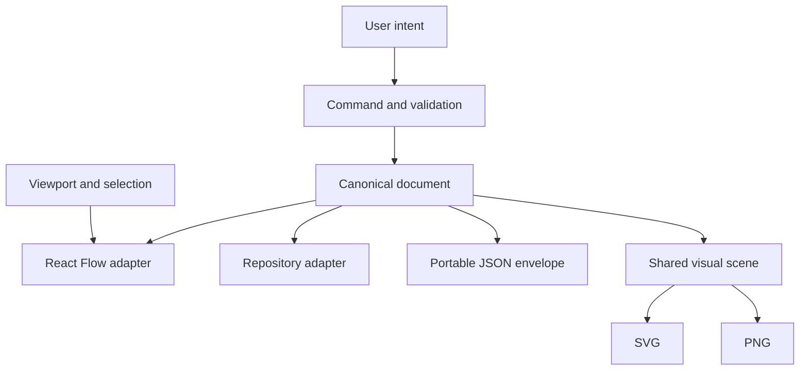
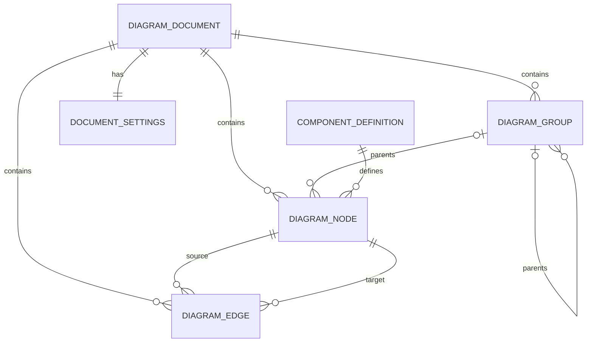

# DGS-05 — Diagram Data Model & Schema

| Document control | Details |
|---|---|
| Project | Diagramming System |
| Document ID | DGS-05 |
| Version | 0.1 |
| Status | Draft — pending technical validation |
| Date | 27 November 2026 |
| Parent specifications | DGS-01, DGS-02, DGS-03, DGS-04 (all v0.1) |
| Target release | V0.2 — MVP |
| Portable schema version | 1 (proposed) |
| Audience | Developer, technical architect, QA, Codex |

## 1. Purpose, authority and companion artifacts

Define the canonical diagram format, identity, relationships, geometry, style, validation, persistence boundaries, versioning and command invariants. This is a design specification, not a completed application or a guarantee of renderer compatibility. All 19 FR identifiers and 15 Must / 3 Should / 1 Could priorities from DGS-01/02 remain unchanged. DGS-03 establishes the client-side modular architecture; DGS-04 establishes UI behavior. Resolve conflicts explicitly rather than weakening earlier requirements. DGS-06 owns registry geometry and typography; DGS-07 owns interaction mechanics; DGS-08 owns save/export orchestration.

Companion files (same versioned specification):

- `DGS-05_Portable_Diagram_Schema_v1.json`: JSON Schema Draft 2020-12 structural contract, no external schema references. It is a machine-readable reference for interoperability and tests, not a replacement for the application's Zod and domain validation.
- `DGS-05_Example_Architecture_v1.json`: illustrative, structurally validated fixture with ten nodes, three boundaries (two boundary levels) and nine connectors. It includes cross-boundary connections and manual statuses; it is not a verified real company architecture or the finalized FR-15 template.

Both companion files are part of this draft. The portable format is not yet a public compatibility commitment. Structural constraints in the JSON Schema and this document must agree; the prose adds contextual and graph constraints that cannot be expressed in that schema alone. TypeScript/Zod implementations must be derived and parity-tested, not maintained as conflicting authorities. A format change after release needs a version decision.

## 2. Architectural principles

1. The committed canonical model is the only writable source of document content. React Flow is an adapter, not the file format or database authority.
2. All committed content is JSON-serializable data; no React elements, DOM nodes, callbacks, arbitrary HTML/CSS, renderer caches or executable assets.
3. A document is a directed graph plus a separate containment forest. Graph cycles between distinct nodes are valid; containment cycles are not.
4. Use stable semantic type keys, stable IDs, explicit parents and stable handle IDs. Derive actual connection coordinates from geometry.
5. Commands are atomic and reversible where applicable. Previews, selection, viewport and persistence flags are not undoable content.
6. The same committed snapshot feeds rendering, JSON, SVG and PNG. Save failures do not prevent export of valid in-memory content.
7. Local storage is not a backup; the portable format must remain independent of storage and browser origin.



## 3. Entity and relationship model



| Entity | Identity / ownership | Cardinality and rules |
|---|---|---|
| DiagramDocument | UUID v4 | Owns all canonical nodes, groups and edges; empty graph valid |
| DiagramNode | UUID v4 | Zero/one group parent; zero/many incoming and outgoing edges |
| DiagramGroup | UUID v4 | Zero/one group parent; zero/many direct children (nodes or groups) |
| DiagramEdge | UUID v4 | Exactly one source and one target node with eligible handles |
| ComponentDefinition | Stable string key | Bundled trusted registry; not arbitrary imported definitions |
| Style / settings | Embedded value objects | No independent identities or external references |
| ViewportState | Per document view | Optional saved view, no effect on graph |
| StoredDocument | Document ID and DB revision | Browser repository metadata, not portable content |

Nodes and groups have separate flat arrays; `parentId` is the sole membership authority. Do not persist a redundant `children` array. Edges live at document scope regardless of parent membership. Build ID maps, parent/child indices and adjacency maps on demand or cache them as derived state; never serialize them. Array order is meaningful for deterministic stacking: groups are traversed parents before descendants, siblings in group-array order; nodes use node-array order; edges use edge-array order. DGS-07 finalizes draw layers; neither array order nor category imposes semantic validity. No separate z-index, graph depth or hidden/locked fields in v1.

## 4. Portable envelope, identity and lifecycle

The file root is `{ "document": { ... }, "viewport": null }` or a valid viewport object. `document.schemaVersion` is the only format version discriminator. There is no second competing version property. This refines the informal root-level example in the initial planning discussion. Product versions (V0.2), documentation versions (0.1), file schema versions (1), IndexedDB database versions, DB record revisions and in-memory edit generations are different concepts.

| Document field | Type | Rule |
|---|---|---|
| schemaVersion | literal integer 1 | Exact supported format |
| id | UUID v4 | Lowercase canonical hyphenated string |
| title | string | 1–120 Unicode code points; trim outer whitespace, not blank |
| category | enum | `general`, `flowchart`, `architecture`; library organization only |
| createdAt / updatedAt | string | UTC ISO timestamp with milliseconds, valid calendar/time; updatedAt >= createdAt |
| nodes | DiagramNode[] | Required array, possibly empty |
| groups | DiagramGroup[] | Required array, possibly empty |
| edges | DiagramEdge[] | Required array, possibly empty |
| settings | DocumentSettings | Explicit values, not implicit renderer defaults |
| envelope.viewport | ViewportState or null | Null means no view to restore; default safe viewport |

All listed fields required; unknown fields rejected for v1. Explicit null is allowed only where declared. Do not use undefined, omitted defaults, NaN, Infinity, Date objects, Map or Set in persisted JSON. IDs generated with secure UUID v4 API (inject generator for tests); document ID and all graph IDs unique in their document, across node/group/edge collections. Never derive IDs from array position, labels or titles. IDs stay unchanged during rename, move, resize, style, reconnect and reparent. Ordinary undo/redo restores the same IDs. No user-facing identity editing. Create/import/duplicate regenerate document ID; import/duplicate/template instantiation regenerate every graph ID and remap references. Timestamps for copies/imports reflect new local creation, not original timestamps. Rename and successful content changes update `updatedAt` without decreasing it (clock rollback guard); no-op and viewport updates do not. On undo/redo, restore content but use current lifecycle metadata, never rewind DB revision or time. Whether document title/settings enter history is decided in Section 11 as proposed behavior for DGS-07 review.

## 5. TypeScript reference contracts

These are framework-independent TypeScript shapes, not copied React Flow types. Use Zod-derived types in the actual implementation where practical; the following is a readable equivalent contract. UUID, hex and date aliases require runtime validation; TS alone cannot enforce the constraints. `NodeType` must be derived from the complete closed registry ID tuple in Section 6 / companion schema (do not use arbitrary string).

```ts
type Id = string;
type Hex = string;
type IsoUtc = string;
type Category = 'general' | 'flowchart' | 'architecture';
type ComponentStatus = 'not_specified' | 'completed' | 'in_progress' | 'pending';
type HandleId = 'top' | 'right' | 'bottom' | 'left';
type LineStyle = 'solid' | 'dashed';
type TextAlign = 'left' | 'center' | 'right';
type Route = 'straight' | 'orthogonal';
type Arrows = 'none' | 'forward' | 'both';
interface Position { x: number; y: number }
interface Size { width: number; height: number }
interface TextStyle { color: Hex; fontSize: number; align: TextAlign }
interface NodeStyle {
  fill: Hex; stroke: Hex; strokeWidth: number;
  strokeStyle: LineStyle; text: TextStyle;
}
interface GroupStyle extends NodeStyle { fillOpacity: number }
interface EdgeStyle {
  stroke: Hex; strokeWidth: number; strokeStyle: LineStyle; text: TextStyle;
}
interface DiagramNode {
  id: Id; type: NodeType; parentId: Id | null;
  position: Position; size: Size; label: string;
  style: NodeStyle; status: ComponentStatus;
}
interface DiagramGroup {
  id: Id; type: 'general.boundary'; parentId: Id | null;
  position: Position; size: Size; title: string; style: GroupStyle;
}
interface Endpoint { nodeId: Id; handleId: HandleId }
interface DiagramEdge {
  id: Id; source: Endpoint; target: Endpoint; label: string;
  route: Route; arrows: Arrows; style: EdgeStyle;
}
interface DocumentSettings {
  gridVisible: boolean; snapToGrid: boolean; gridSpacing: 20;
}
interface ViewportState { x: number; y: number; zoom: number }
interface DiagramDocument {
  schemaVersion: 1; id: Id; title: string; category: Category;
  createdAt: IsoUtc; updatedAt: IsoUtc;
  nodes: DiagramNode[]; groups: DiagramGroup[]; edges: DiagramEdge[];
  settings: DocumentSettings;
}
interface PortableDiagram { document: DiagramDocument; viewport: ViewportState | null }
```

Use readonly snapshots/immutable update semantics internally. These interfaces show wire shapes; never cast imported JSON to `PortableDiagram` and assume it is valid. The runtime input type is `unknown`. Do not add `provider`, `owner`, `notes`, custom icons, arbitrary `data` bags or CSS objects to v1: extended metadata/custom styles are FR-19 Could. If implemented, approve an explicit versioned extension rather than silently discarding unknown fields. A registry label such as "Microsoft 365" is ordinary plain text, not a vendor integration.

## 6. Semantic component registry contract

| Family | Stable proposed IDs |
|---|---|
| Flowchart (8) | `flow.terminator`, `flow.process`, `flow.decision`, `flow.input_output`, `flow.document`, `flow.data_store`, `flow.subprocess`, `flow.on_page_connector` |
| IT architecture (14) | `arch.user`, `arch.device`, `arch.website`, `arch.application`, `arch.server`, `arch.database`, `arch.cloud`, `arch.network`, `arch.security`, `arch.identity`, `arch.email`, `arch.storage`, `arch.api`, `arch.integration` |
| General nodes (6) | `general.rectangle`, `general.rounded_rectangle`, `general.ellipse`, `general.diamond`, `general.text`, `general.note` |
| Boundary (1) | `general.boundary` — only in groups array |

All 29 identifiers represent 28 node types and one boundary type. DGS-02 lists website/application together; they are split here to preserve semantic intent. DGS-06 specifies exact catalog, geometry, labels, icons, default dimensions, minimum content sizes and handle positions. All categories remain available in one diagram. Shared shape primitives do not imply semantic equivalence. IDs cannot be reused with a different meaning after release.

Proposed registry entry (trusted code, not portable user data):

```ts
interface ComponentDefinition {
  type: NodeType;
  displayName: string;
  defaultLabel: string;
  defaultSize: Size;
  minSize: Size;
  defaultStyle: NodeStyle;
  allowedHandles: readonly HandleId[];
  supportsStatus: boolean;
  resizable: boolean;
  editableStyleFields: readonly string[]; // closed keys defined by DGS-06
  primitiveKey: string; // trusted internal drawing function key
  iconKey: string | null; // bundled asset registry only
}
```

Propose four cardinal handles (top/right/bottom/left), each usable for input/output where supported. Text and note are non-connectable annotation types for MVP, subject to DGS-06 review; all other regular nodes have four cardinal handles initially. Groups never have connection handles. Use type-specific geometry for actual anchors (e.g., diamond tips), not measured screen pixels. Registry defaults copied on insertion, never mutable references. Persist resolved styles/dimensions, not references to changing theme defaults, so upgrading a registry does not silently restyle existing diagrams. A changed handle set or drawing semantics requires compatibility review. Unsupported style properties remain at defined neutral registry values; inspector hides/disables them. Registry checks supplement structural schema. Avoid remote icon URLs or user-supplied SVG paths in native format.

## 7. Geometry, coordinate spaces and grouping

Canonical origin is top-left of the object's bounding rectangle. World units are device-independent logical units; screen coordinates are derived from viewport translation and zoom. Negative and fractional world positions are legal; no rotation, transform matrix or scale field on nodes/groups. `position` is relative to direct parent's outer top-left, or world coordinates at root. `size` is always in world units and independent of viewport zoom.

World position W(item) = local position + W(parent), with W(null) = (0, 0). Screen position relative to canvas = W * zoom + viewport translation. World = (canvas-relative screen - viewport translation) / zoom. Subtract canvas DOM rect from client coordinates first; device pixel ratio only affects raster output. Reparent = old world position - new parent world origin. Never round on viewport transform or automatically snap during reparent/import. Snap applies only to intentional insertion/move/nudge commands where enabled; multi-selection snaps the anchor, not every node independently.

Proposed group minimums: positive size within Section 10 limits; reserved internal padding left/right/bottom 16 world units, top 36 for title and padding; DGS-06/07 may increase based on label metrics. Bounds use child bounding rectangles plus registry-defined visual extents needed for visible content. Group title and status text must fit or trigger visible resize/validation. Edge paths may cross group boundaries and do not constrain containment. Empty boundaries valid. Group can be inside another group, max eight ancestor boundaries provisionally (at least two supported); nesting beyond cap rejected. Parent cannot be a node or itself. Membership changes are explicit; overlap alone is not membership. Root items can overlap.

Expansion: when a child would exit its group's content area, calculate the union of prior outer rectangle and new required child bounds with padding; expand in the needed directions. If origin moves left/up, subtract the origin delta from each direct child's local position so existing world positions are unchanged. The actively moved child keeps its intended new world position. Propagate required expansions to ancestors bottom-up. Group resize cannot scale children; shrinking below required content is rejected with guidance (chosen over clamp). Moving boundary translates descendants once via parent origin; selected descendant of selected parent is excluded from transform roots. Reparent and ungroup keep original world positions; after boundary deletion, direct children take removed group's parent, retaining their own descendants. Nested selected groups for deletion: remove each explicitly selected frame; preserve all non-explicitly-deleted nodes, reparent to nearest surviving ancestor, compute old world coordinates first. Removing selected normal nodes deletes incident edges; selecting only a group never recursively deletes content. Validate entire result before committing; rollback on limits or invalid hierarchy. Grouping across different parents is provisionally restricted to siblings of one parent (users can explicitly reparent first); this is a proposed interaction simplification, review against FR-08 in DGS-07.

Example: parent at (-300,-100), nested group at (40,80), API at (520,60). API world position is (260,40). Move parent +100 x and API becomes (360,40), with both local positions unchanged. Ungroup nested boundary and the API local position within outer becomes (560,140), preserving world position. Negative root coordinates are legitimate. No renderer-specific `extent`, `measured` or `positionAbsolute` in the model.

## 8. Connections, paths and graph constraints

Edges reference directed endpoint tuples `(source.nodeId, source.handleId, target.nodeId, target.handleId)`. Both nodes must exist and be eligible; handle must exist in each registry definition. Exact directed tuple duplicates rejected even if arrow style/label differs. Reverse direction and different handle pairs allowed. Self-loops rejected per DGS-02 FD-03, while cycles between distinct nodes allowed. `arrows` controls appearance only; `both` does not generate two stored edges, `none` does not remove direction identity. Reconnect keeps edge ID, style, route and label, replacing only intended endpoint after successful validation (duplicate check excludes itself). Invalid reconnection or cancelled creation preserves previous graph. Edges cannot reference boundaries, nonexistent handles or objects from another document. Annotation connection eligibility specified above.

Routes: `straight` or `orthogonal`. Default orthogonal, forward arrow, solid neutral #64748B, width 2. Store no intermediate waypoints, cached path strings, label coordinates or screen position. Derive paths and arrowheads from shared geometry using stable cardinal handles and deterministic right-angle route rules; DGS-07 owns exact algorithm including degenerate/coincident anchors and label placement. No obstacle avoidance in MVP. Labels are plain text, may contain line breaks, and must appear in scene bounds. Overlap is allowed, but route and label should remain editable. Path generation failure must be a controlled error, not an invalid graph mutation or blank export.

## 9. Styles, text and manual status

| Value | Encoding / constraints |
|---|---|
| Color | Uppercase `#RRGGBB` only; UI may normalize input case before committing; reject noncanonical imported values |
| Node/boundary stroke width | 0–8 world units; zero hides stroke |
| Edge stroke width | 0.5–8 world units (positive) |
| Stroke style | solid / dashed |
| Text size | 8–72 world units, typical 14 for nodes and 12 for edge label |
| Text alignment | left / center / right |
| Group fill opacity | 0–1, fill only; zero transparent, stroke/text unaffected |
| Node fill | Opaque hex in v1; non-filled annotation types ignore fill per registry |
| Fonts | One trusted bundled or system/fallback policy defined in DGS-06; no user-supplied font URLs or arbitrary font family strings |

No gradients, arbitrary CSS, shadows, opacity for regular node/edge, custom paths or rich text in v1. Styles embedded per object. Application theme is separate and must not change saved diagram content. Optional presets apply explicit changes to selected compatible fields, one transaction. Text stored as plain Unicode with LF line breaks; preserve intentional whitespace/empty labels for shapes and annotations. Document title must not be empty. Group title may be empty to support unlabeled boundaries. Reject prohibited C0/C1 control characters except tab/LF, unpaired surrogates and CR in native canonical strings; UI may normalize CRLF/CR to LF before commit. No HTML rendering, URL linkification or script evaluation. A label containing `<script>` is allowed as literal text, not executable markup; escape XML text on export and do not insert into HTML. Character limits count Unicode code points, not UTF-16 units. DGS-06 defines wrap, glyph metrics, long words, text/status fitting and fallback typography; if no fit, expand valid geometry or reject edit, never silently truncate. Independent-viewer font parity still needs SP-04 verification.

| Status | Display | Proposed marker |
|---|---|---|
| not_specified | Not specified; indicator omitted | #64748B |
| completed | Completed | #15803D |
| in_progress | In progress | #D97706 |
| pending | Pending | #DC2626 |

Required `status` field on all nodes; only architecture nodes may hold non-default values. Status is not a service-health monitor; no inferred status, polling, dates or provider requests. Status does not overwrite user-selected fill/border. A neutral sub-row and text convey progress independent of color. Status survives save, duplicate, undo, export and import.

## 10. Validation rules and resource budgets

| Limit | Proposed value |
|---|---|
| Import raw bytes | 10 MiB (10,485,760 bytes), check before read |
| Nodes | 1,000 |
| Boundaries | 100 |
| Edges | 2,000 |
| Group ancestry | At most 8 group ancestors per object |
| Local position x/y | -1,000,000 to +1,000,000 |
| Derived world bounds | Every node/group rectangle within ±1,000,000 on both axes |
| Size | 1–100,000 world units, then registry-specific minimum |
| Document title | 1–120 code points; trimmed |
| Node label | 0–1,000 code points |
| Group title / edge label | 0–200 code points each |
| View translation x/y | ±4,000,000 CSS px |
| Zoom | 0.25–2.0 |
| Grid spacing | 20 world units, constant in v1 |
| Undo history | At least 50 logical transactions in reference workload |

These limits are defensive ceilings, not guarantees of smooth editing or export. Performance reference remains 100 nodes/150 edges; DGS-10 defines measurable benchmarks. Visual export has independent maximum dimensions/pixel budget in DGS-08; valid documents may be too large for a given PNG export. All numbers finite, no coercion. Check UTF-8 byte size of portable snapshot (including envelope) on commit/export so valid editor documents remain within own import limit; measure cost and optimize after profiling. Use compact serialization for size accounting; if pretty-print would exceed cap, use compact output. Reject rather than truncate content. Strict parsing should reject invalid UTF-8, duplicate object keys (native JSON.parse alone cannot detect them), excess nesting (proposed max JSON depth 32), unsafe keys such as `__proto__`, `prototype`, `constructor` at any object level and unknown fields. Implement a bounded, tested parser/preflight or vetted dependency; do not invent unsafe regex parsing. File extension/MIME is a hint, not trust. No file content is sent to a server. Stored snapshots receive equivalent shape and graph checks. Guard validation cost using count/depth limits; bounded iterative traversals, no unbounded recursive descent. Report a concise issue list (proposed cap 20) with safe paths, never execute or HTML-render error values.

| Validation ID | Rule / error code |
|---|---|
| VAL-01 | Read/parse/envelope failure: INVALID_JSON, INVALID_ENCODING, INVALID_ENVELOPE |
| VAL-02 | Unsupported format version: UNSUPPORTED_VERSION |
| VAL-03 | Structural fields/enum/format/range invalid: INVALID_FIELD |
| VAL-04 | Unknown field/type/asset or prohibited key: UNSUPPORTED_DATA |
| VAL-05 | Repeated ID anywhere within document: DUPLICATE_ID |
| VAL-06 | Missing/non-group parent: INVALID_PARENT |
| VAL-07 | Containment self/cycle/depth: GROUP_CYCLE, GROUP_DEPTH |
| VAL-08 | Invalid dimensions, world bounds or containment: INVALID_GEOMETRY |
| VAL-09 | Missing/ineligible endpoint or handle: INVALID_ENDPOINT |
| VAL-10 | Self-loop/exact directed duplicate: SELF_LOOP, DUPLICATE_EDGE |
| VAL-11 | Non-default status on unsupported node or invalid type capability: INVALID_CAPABILITY |
| VAL-12 | Text policy or chronology violation: INVALID_TEXT, INVALID_TIMESTAMP |
| VAL-13 | File/count/depth/serialization resource ceiling: LIMIT_EXCEEDED |
| VAL-14 | Registry minimum/content fit check: CONTENT_DOES_NOT_FIT |

Validation order: bytes/encoding/parse guards -> envelope and version dispatch -> strict structural validation -> build maps and unique IDs -> parents and cycle/depth detection -> world geometry and containment -> endpoint/handle and duplicate checks -> registry capability/text fit and timestamp checks -> serialized size. Return typed error(s); no mutation. Full checks on load/import and complex commands; optimized incremental checks may be used only with tests proving equivalence for hot paths. Imported data is not auto-repaired or snapped. An unsupported schema or unknown field must not be silently stripped. Existing data stays intact on failure.

### 10.1 Zod runtime mapping

Zod is the selected runtime library from DGS-03. Choose exact compatible version during initialization. Use strict object schemas and closed enums, not coercion or `passthrough` / default unknown-key stripping. Example structural subset (illustrative, not a full validator):

```ts
import { z } from 'zod';
const id = z.string().regex(/^[0-9a-f]{8}-[0-9a-f]{4}-4[0-9a-f]{3}-[89ab][0-9a-f]{3}-[0-9a-f]{12}$/);
const color = z.string().regex(/^#[0-9A-F]{6}$/);
const finiteRange = (min: number, max: number) => z.number().finite().min(min).max(max);
const position = z.object({ x: finiteRange(-1e6, 1e6), y: finiteRange(-1e6, 1e6) }).strict();
const endpoint = z.object({ nodeId: id, handleId: z.enum(['top','right','bottom','left']) }).strict();
```

For Unicode code point length use explicit bounded refinement rather than assuming string.length matches JSON Schema maxLength. Timestamp regex plus real date validation/canonical round trip. Implement `parsePortable(input: unknown): Result<PortableDiagram, ValidationIssue[]>` and `validateGraph(document, registry): Result<DiagramDocument, ValidationIssue[]>` with deterministic paths. Strict JSON Schema is a portable reference, not a claim it enforces graph membership or real timestamp formats in all validators: enable format checking in parity tests. Runtime Zod code and registry-driven validation are not yet implemented. No library version/API migration is being committed here.

## 11. Mutation, duplication and history contracts

| Command family | Preconditions / atomic effects |
|---|---|
| ADD_NODE / ADD_GROUP | Allocate ID, registry defaults, valid placement, parent expansion as required |
| MOVE / RESIZE | Deduplicate transform roots, update geometry, preserve handles, expand parents or reject |
| SET_LABEL / SET_STYLE / SET_STATUS | Validate compatible fields and content fit, retain identity, one commit |
| CREATE_EDGE / RECONNECT / DELETE_EDGE | Validate endpoint rules; reconnect preserves ID; remove edge only |
| DELETE_SELECTION | Remove explicit nodes/edges; remove incident edges; delete selected groups preserving surviving children |
| DUPLICATE_SELECTION | Copy selected nodes and selected groups' descendants; internal edges only; fresh IDs and offset |
| GROUP / REPARENT / UNGROUP | Explicit membership, preserve world position, validate ancestry and containment |
| SET_DOCUMENT_SETTINGS | Persist grid/snap; no geometry mutation |
| RENAME_DOCUMENT | Trim and validate title; persist as metadata operation |
| APPLY_LAYOUT (Should) | Proposed new positions in one valid atomic operation; no relationship changes |

Duplication algorithm: collect effective selection once; selected groups include descendants; allocate ID map for all copied groups/nodes and internal edges; copy value objects; remap references in two passes. If original parent is duplicated, child keeps original local coordinates. Otherwise selection root retains its existing parent and gets visible proposed +20/+20 world offset (same local delta); expand parent if needed. Internal edge means both endpoints copied; do not copy edges to external nodes even if explicitly selected. Edge-only duplicate has no effect (would be exact duplicate). Copy of entire document, import and template instantiation use all objects, no visual offset, new document ID/timestamps, remap parent and endpoints. Create with add-only semantics, no existing record overwritten. Validate candidate including limits before commit. Deep independent data; no mutable sharing across documents. No-op commands must not enter history or mark dirty.

History tracks immutable graph-content snapshots before/after each logical edit (structural sharing permitted). Includes node/group/edge operations, labels/styles/status and optional layout. Proposed decision: title and grid/snap settings are persisted non-history metadata; undo of graph must preserve their latest values. Document-library actions excluded. Viewport/selection/active tool/preview and persistence metadata excluded. DGS-07 confirms title/settings decision. One continuous drag/resize/text commit = one transaction. Invalid/cancelled action does not alter content/history; new edit after undo clears redo. Undo/redo restore graph IDs and content, use a new edit generation and timestamp, schedule save; never restore DB revision or stale view. On undo reconcile selection against existing IDs (selection itself not history). Session-local minimum 50 transactions; reload starts fresh. No data-loss promise for uncommitted gestures or failed saves.

## 12. Persistence model, view state and lifecycle metadata

Canonical document is not an IndexedDB row. Proposed repository record:

```ts
interface StoredDocument {
  id: Id;
  title: string;
  category: Category;
  schemaVersion: 1;
  createdAt: IsoUtc;
  updatedAt: IsoUtc;
  revision: number; // positive safe integer; DB compare-and-swap token
  content: DiagramDocument;
}
interface StoredViewport { documentId: Id; viewport: ViewportState }
```

Row id/title/category/schemaVersion/createdAt/updatedAt are indexed/projection metadata derived from content, not separate authorities. Write atomically and validate equality on read; mismatch is corruption/recovery, not silently prefer one copy. `documents` key id, updatedAt index; `viewports` separate key documentId proposed. Document create starts revision 1; save validates expected revision in one transaction and increments; missing record conflicts, never upserts. Deletion checks expected revision and removes associated view atomically (or defined cleanup without resurrection). DB revision not exported; safe integer exhaustion handled as error. In-memory edit generation monotonic per session, independent of DB revision. View updates can persist separately and must not alter graph revision, last modified, history or content save indicator. Viewport is x/y translation in canvas CSS px and zoom; default null resolves to safe fit or 100% empty origin per DGS-07. View restore is best effort across changed viewport sizes; fit remains available. UI panel preferences/selection/dialog state not portable. Workspace preferences may have their own storage record DGS-08.

| State | Saved locally | Portable JSON | Undoable graph history |
|---|---|---|---|
| Graph and style/status | Yes | Yes | Yes |
| Document title/category/timestamps | Yes | Yes | No (proposed) |
| Grid/snap settings | Yes | Yes | No (proposed) |
| Viewport | Separate | Yes, nullable | No |
| Selection and previews | No | No | No |
| DB revision / save flags | Revision only | No | No |
| History and renderer caches | No | No | No |

Autosave uses committed snapshot, revision-checked update, serialized writes, separate generation guard; only successful transaction and current generation can show saved. DGS-08 owns debounce/max-wait, cross-tab notifications, recovery and save states. Export current valid snapshot even with storage errors, not a stale DB copy. No uncommitted input in export: finish or cancel active edit before snapshot. JSON import validates first, remaps second, validates again, add-only persists and then opens; if write fails, existing state/library unchanged and user can retry. Store document + initial viewport in one creation transaction. Existing corrupted records not silently overwritten; preserve raw data and offer recovery. No server/cloud sync in MVP.

## 13. Format evolution and migrations

`schemaVersion: 1` is the first supported format. No legacy schema migration exists today. Reject missing, unknown, fractional or future versions with actionable error; don't assume version 0 or guess from data. Version dispatcher validates appropriate historical envelope, then pure sequential migration steps (v1->v2 etc.) to current version; validate after each step and final graph, with bounded work. Never downgrade or drop unknown values. Migration may only transform explicitly documented fields, preserve identity and visual/semantic intent; remap only if required and fully tested. On import, migration precedes fresh ID remap. For stored documents, migration preserves ID and uses revision-checked atomic replacement after validation; preserve original until success, expose recovery on failure. Database table migration is separate from portable schema migration. A change to field meaning, required fields, enum/handle semantics or incompatible defaults requires compatibility review/version bump. Add migrations and golden fixtures before release. DGS-08 owns database upgrade/recovery policy. DGS-11 may introduce extensions, collaboration IDs/revisions or AI proposals; no speculative fields in v1.

## 14. Example files and interoperability

The accompanying JSON example is a complete portable envelope, not a partial snippet. Its root document ID is `00000000-0000-4000-8000-000000000001`; it uses deterministic fixture UUIDs (production uses random UUIDs). Contains ten architecture nodes, outer boundary and two nested sibling boundaries, nine edges including cross-boundary references, negative root coordinates, manual status values and grid settings. All data is illustrative; neither the relationships nor statuses are verified real infrastructure. The fixture is a candidate for smoke tests, not the finished DGS-06 starter template. Example excerpt (not a complete import):

```json
{
  "document": {
    "schemaVersion": 1,
    "title": "Illustrative IT architecture",
    "category": "architecture",
    "settings": { "gridVisible": true, "snapToGrid": true, "gridSpacing": 20 }
  },
  "viewport": { "x": 360, "y": 200, "zoom": 0.75 }
}
```

JSON is the only editable native interchange format. SVG/PNG are outputs of shared visual scene, not graph sources. Export must escape XML and use trusted shape primitives, no remote references, scripts, event attrs, foreignObject or editor DOM. Scene bounds include all visible content and negative coordinates; independent of saved view. DGS-08 defines output limits, padding, scale, filenames and download cleanup. Future AI generation should produce an untrusted draft graph (or command proposal), validate with same schema/registry and ask user to review factual relationships before accepting; never rely on generated SVG or renderer internals. Mermaid, draw.io, code ingestion and AI deferred.

## 15. Schema verification plan

| ID | Verification | Related requirements |
|---|---|---|
| DM-01 | Empty valid document, nonblank title, UUID and timestamp checks | FR-01, BR-01 |
| DM-02 | All 28 node types and group type supported, wrong collection/type rejected | FR-04 |
| DM-03 | Strict unknown fields and unsafe keys rejected; inert markup-like labels | FR-05, FR-12, BR-08/12 |
| DM-04 | Invalid color/size/number/Unicode and content fit rejected | FR-03/05 |
| DM-05 | Duplicate IDs across node/edge/group and document rejected | FR-01/03, BR-01 |
| DM-06 | Missing parent, parent-to-node, cycles, excess depth rejected | FR-08, BR-03 |
| DM-07 | Move nested parent once; reparent preserves world position | FR-08, SP-02 |
| DM-08 | Left/top expansion preserves siblings; reject impossible resize atomically | FR-08, SP-02 |
| DM-09 | Missing node/invalid handle/boundary endpoint rejected | FR-06, BR-02 |
| DM-10 | Self-loop and exact duplicate rejected; reverse/different handle and distinct-node cycle accepted | FR-06/07 |
| DM-11 | Reconnect preserves identity and style; failure keeps previous edge | FR-07 |
| DM-12 | Duplicate selection including descendants/internal edges; no external edge copy | FR-03, FR-08 |
| DM-13 | Delete frame preserves children; delete node cascades incident edges; undo restores | FR-03/08/10 |
| DM-14 | Status eligibility and manual status survives roundtrip without style change | FR-09 |
| DM-15 | No-op/failed/cancelled operations leave state and history unchanged; undo/redo preserves metadata | FR-10, BR-04/05 |
| DM-16 | JSON roundtrip semantic equivalence ignoring remapped identities and new timestamps | FR-12, BR-07 |
| DM-17 | Size/count/depth/world range limits, malformed/duplicate-key input rejected | FR-12, NFR-04 |
| DM-18 | Viewport independent of graph; no history/graph revision change on pan | FR-02/14, BR-06 |
| DM-19 | Revision conflicts and failed import leave existing snapshots unchanged | FR-11/12, BR-09 |
| DM-20 | Unsupported version preserved/rejected, explicit migration chain when available | FR-12, BR-12 |
| DM-21 | Zod/JSON Schema parity for structural cases; graph checks layered on top | NFR-07 |
| DM-22 | Shared scene export includes nested groups, statuses, edges and negative coordinates | FR-13, SP-04 |
| DM-23 | Template instantiation independent and references remapped | FR-15, BR-11 |
| DM-24 | Reference 100 nodes/150 edges and 50-history retention | NFR-02, FR-10 |

Acceptance tests supplement existing DGS-02 criteria, not replace them. DGS-10 defines full suite and benchmarks; no product tests have been run. Artifact-level verification completed during authoring: Draft 2020-12 schema checked with Python jsonschema, fixture validated with date format checking, independent basic graph checks (unique IDs, existing parent chains, containment rectangle padding, existing endpoints/no self-loops/no duplicate tuples), and four negative structural variants (version, zero width, invalid color, invalid handle) rejected. Registry-specific geometry/text fit, exact edge paths, Zod runtime parity, parser security, real storage and browser behavior remain untested.

## 16. Requirement traceability and handoffs

| FR | Data model coverage |
|---|---|
| FR-01 | Identity, title, timestamps, copy, stored record |
| FR-02 | World coordinates and separate viewport |
| FR-03 | Node identity, geometry, duplicate/delete commands |
| FR-04 | Stable semantic registry and capabilities |
| FR-05 | Typed styles, text policy, field validation |
| FR-06/07 | Endpoints, handles, directed edge uniqueness, route/arrow/label |
| FR-08 | Group forest, parent-relative geometry, expansion and reparent |
| FR-09 | Closed manual status enum and eligibility |
| FR-10 | Atomic command/history rules |
| FR-11 | Repository metadata, revisions, save boundary |
| FR-12 | Portable envelope, validation, remapping, migration |
| FR-13 | Shared scene input, vector/raster output boundary |
| FR-14 | Grid/snap settings; shortcuts are UI actions |
| FR-15 | Immutable fixture instantiation |
| FR-16 | Derived bounds/geometry and style updates (Should) |
| FR-17 | Layout command on graph (Should) |
| FR-18 | Same portable schema for further templates (Should) |
| FR-19 | Deferred explicit schema extension if approved (Could) |

| Decision | Proposed direction / remaining validation |
|---|---|
| DD-01 | Portable envelope document + nullable viewport; initial version 1 |
| DD-02 | UUID v4 across all objects; remap all on document copies/imports |
| DD-03 | Flat collections, explicit parentId; array ordering for deterministic stacking |
| DD-04 | 28 semantic node keys + boundary; website/application split; annotation handles disabled |
| DD-05 | Closed hex/style/status fields; no freeform metadata/theme references |
| DD-06 | Cardinal handles; no cached routes or waypoint fields |
| DD-07 | Parent-relative geometry, 16/36 padding, max eight ancestors; reject undersized frame; sibling grouping restriction |
| DD-08 | Provisional resource ceilings, strict parser and no unknown-field stripping |
| DD-09 | Viewport stored separately, included nullable in file; title/settings excluded from graph undo |
| DD-10 | Structural JSON Schema companion; Zod + domain validation runtime with parity tests |
| DD-11 | No historical migrations yet; explicit chain when format evolves |
| DD-12 | Registry-specific minimums, fonts and visual extents delegated to DGS-06/07; prototype required |

DGS-06 — Shape & Component Library Specification: finalize registry IDs/capabilities, anchors, min/default geometry, title/padding and text layout, bundled icons, exact style applicability, two template fixtures. Update schema draft if registry decisions change; do not silently change IDs.

DGS-07 — Canvas & Interaction Specification: finalize grouping across parents, coordinate conversion, ordering/layers, snapping and nudge, path algorithm, geometry expansion, command/history mechanics, keyboard connection and field commits.

DGS-08 — Document Persistence & Export Specification: DB schema/indexes, atomic records, separate view writes, strict parser, migration/recovery, autosave, cross-tab conflict and export safety limits. DGS-09 schedules implementation; DGS-10 defines executable tests; DGS-11 records future schema changes.

Recommended repository paths: `docs/02-architecture/DGS-05_Data_Model.md`, `docs/02-architecture/schemas/portable-diagram-v1.schema.json`, `tests/fixtures/architecture-v1.json` (copy/rename the provided files when initializing repository). Codex should implement pure core schemas/commands/geometry first, with Zod runtime checks and structural parity tests; integrate renderer only via projection. Do not treat the illustrative TypeScript as already compiled code, or add packages or future features merely because listed here. Review provisional limits, annotation capabilities, group constraints and portable format before locking v1. No implementation or production compatibility certification has occurred.

## Revision history

| Version | Date | Change |
|---|---|---|
| 0.1 | 27 November 2026 | Initial canonical model and schema draft with structural JSON Schema and validated example; aligned with DGS-01–04 |
