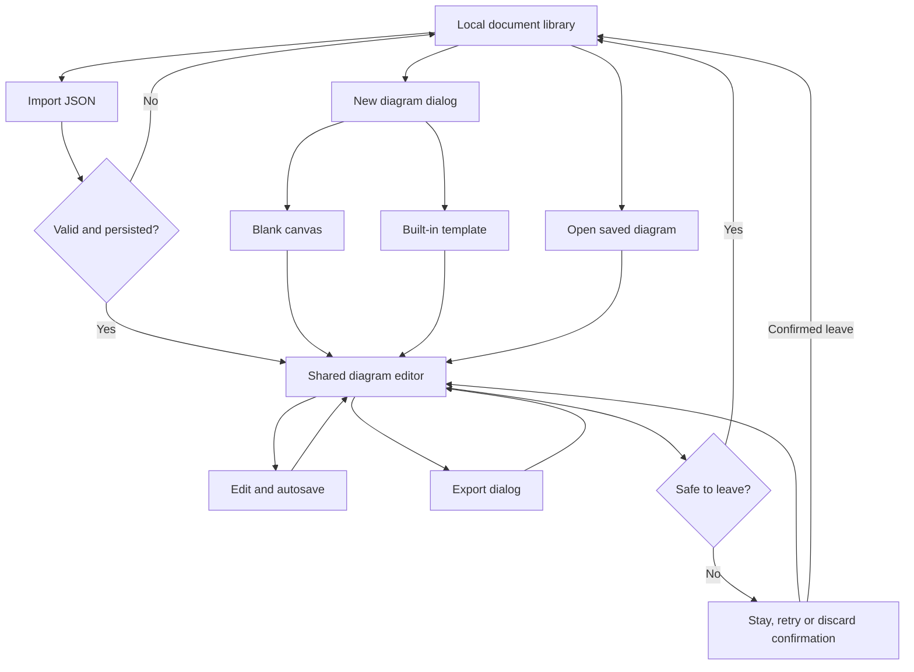

# DGS-04 — UI/UX Design & Workspace Specification

| Document control | Details |
|---|---|
| Project | Diagramming System |
| Document ID | DGS-04 |
| Version | 0.1 |
| Status | Draft — pending design review and usability validation |
| Date | 26 November 2026 |
| Parent specifications | DGS-01 v0.1; DGS-02 v0.1; DGS-03 v0.1 |
| Target release | V0.2 — MVP |
| Owner | Product / Development |
| Audience | Product owner, UI/UX designer, developer, QA and implementation agents |

## 1. Purpose and authority

Define the workspace information architecture, desktop layouts, visual language, visible controls, interaction feedback and accessibility expectations for the MVP. DGS-04 specifies the user-facing design, not a new scope baseline or the final graph implementation. DGS-01 defines product goals, DGS-02 defines mandatory behavior and DGS-03 defines technical architecture. In a conflict, record the discrepancy and resolve it through review. Do not change a Must requirement or claim implementation completion based on a wireframe.

The specification is based on the actual preceding Markdown documents. All 19 functional requirement IDs and their 15 Must / 3 Should / 1 Could priorities remain unchanged. The UI IDs below are design references, not additional release-level functional requirements. Proposed dimensions, palette, typography, layout breakpoints and interaction details are design defaults requiring validation. No implementation, pixel-perfect design, accessibility audit or usability test has been performed.

## 2. Experience principles and product boundaries

- Canvas first: prioritize the diagram over navigation, marketing, dashboards and decoration. Toolbars and inspectors should not compete with the work itself.
- Discoverable essentials: a first-time user can create a diagram, insert components, connect them, edit labels, and export without knowing shortcuts.
- Professional defaults: clear labels, restrained colors, crisp shapes and consistent line styles; users may customize diagram appearance without changing the UI theme.
- One editor: flowcharts, IT architecture and general visual maps use the same canvas, inspector, file model and controls. Categories set starting defaults, not restrictions on the shape library.
- Predictable editing: visible selection, preview versus commit, reversible content operations and no hidden grouping or implicit graph mutation.
- Honest persistence: distinguish unsaved, saving, saved, failed and conflicted states. Never imply browser storage is cloud backup.
- Progressive disclosure: show properties relevant to the current selection, hide deferred controls rather than shipping nonfunctional buttons, and keep advanced capabilities out of the primary path.
- Accessible by design: visible keyboard focus, named controls, alternative text for statuses, explicit errors, keyboard-friendly menus and non-pointer alternatives for essential controls.

Initial target: single-user desktop/laptop, Chrome and Edge, mouse or trackpad with keyboard. No sign-in, team switcher, billing, online status, chat, AI, collaborative cursors, cloud sync, freehand drawing or mobile editor. No product branding is assumed; use “Diagramming System” as a working label. A light application theme is the MVP default; dark theme is not required. Diagram export styling is independent of application chrome.

## 3. Information architecture and navigation

| Screen ID | Route or surface | Purpose | Requirement |
|---|---|---|---|
| UI-01 | `/` | Local diagram library, creation, import, reopen, duplicate, rename, delete | FR-01, FR-11, FR-12, FR-15 |
| UI-02 | Library creation dialog | Blank diagram or built-in template | FR-01, FR-15 |
| UI-03 | `/editor/?id=<uuid>` | Single shared diagram editor | FR-02–FR-14 |
| UI-04 | Editor inspector | Document, node, edge, boundary or multi-selection properties | FR-05, FR-07–FR-09, FR-14 |
| UI-05 | Editor export dialog | JSON, PNG and SVG output | FR-12, FR-13 |
| UI-06 | Import dialog / native file picker | Validate and create separate editable document | FR-12 |
| UI-07 | Recovery and confirmation dialogs | Delete, unsaved navigation, conflict, recovery | FR-01, FR-11 |
| UI-08 | Shortcut reference | Keyboard help and visible action equivalents | FR-14, NFR-05 |
| UI-09 | Loading, empty, missing and error views | Safe initialization and recovery | FR-01, FR-11, NFR-03 |
| UI-10 | Optional productivity surfaces | Mini-map, arrange, extra templates, metadata, search and styles | FR-16–FR-19 only if scheduled |

A separate `/templates/` page is unnecessary for MVP; use the creation dialog. Do not use `/editor/[id]` under static export; DGS-03 specifies the query-based route. Library navigation is available from the editor header. Direct URL reload resolves the local document after browser storage initialization. An unknown or malformed ID never opens a new blank document over an existing one. Browser history is navigation history, not editing undo history.



## 4. UI-01 — Document library

The library is a minimal file manager, not an analytics dashboard. Use a list by default; thumbnail generation and card view are not mandatory. At desktop size, use a centered content area (max width 1200 CSS px), with title, local-storage explanation, primary New diagram action, secondary Import JSON action, and a readable table of existing diagrams. Sort newest modified first. Titles may duplicate; each row must remain addressable by its ID. No required search or folders.

```text
┌──────────────────────────────────────────────────────────────────────────────┐
│ Diagramming System                                       Keyboard shortcuts │
├──────────────────────────────────────────────────────────────────────────────┤
│ My diagrams                              [Import JSON]  [+ New diagram]    │
│ Stored in this browser. Export JSON backups to keep a portable copy.          │
│                                                                              │
│ Name                         Category          Last modified          Actions│
│ ──────────────────────────────────────────────────────────────────────────── │
│ IT Infrastructure            Architecture      26 Nov, 9:15 PM          [...]│
│ Business Operations          Flowchart         26 Nov, 8:30 PM          [...]│
│ Project Map                  General           25 Nov, 4:45 PM          [...]│
│                                                                              │
│ 3 diagrams                                                                   │
└──────────────────────────────────────────────────────────────────────────────┘
```

| Control | Expected interaction |
|---|---|
| New diagram | Opens UI-02; creates only after user confirms and storage succeeds |
| Import JSON | Opens native picker filtered for JSON; validate, save new record, open editor |
| Document title / Open | Opens selected document through navigation controller |
| Rename | Inline or dialog input, prefilled; trim outer whitespace; reject blank; persist before confirming |
| Duplicate | Create independent copy, append “(copy)”, remap identifiers; keep original intact |
| Delete | Named confirmation; remove only after revision-checked storage success |
| Keyboard shortcuts | Opens UI-08; not an editor command on the library |

Empty state: “No diagrams yet”, explanatory sentence, New diagram primary action and Import JSON secondary action. Loading: display “Opening your local workspace…” and disable creation/import until repository ready. Storage initialization failure: explain that local storage could not be opened, offer Retry and recovery guidance; do not show misleading empty list. Row-level pending state prevents repeated create/delete/duplicate submissions. Failed operations keep the previous list and show an inline or persistent message. Relative timestamps may supplement, never replace, an accessible absolute date/time. Use a table with accessible action menus; avoid a nested clickable row trapping button interactions.

## 5. UI-02 — Create diagram and templates

Use a single dialog with title “New diagram”. First choose a starting point (three choices): Blank diagram, Basic process flowchart, IT architecture. Use small local visual previews generated from trusted fixtures or simple static vector thumbnails; previews are illustrative, not verified infrastructure. Blank selection exposes a category choice: General, Flowchart, Architecture. Template selection derives the initial category. All options allow all component types after creation. Set a suggested editable name (“Untitled diagram” for blank, template name for templates). Primary action “Create diagram”; secondary Cancel. Name validation and persistence apply before navigation. Cancel creates no record.

| Starter | Preview and minimum content | Priority |
|---|---|---|
| Blank diagram | Empty canvas and creation hint | Must |
| Basic process flowchart | Start, process, decision, two labeled branches, end | Must |
| IT architecture | At least ten components, a boundary, connections and example statuses | Must |
| Software architecture, automation, organization, mind map | Additional editable fixtures | Should (FR-18) |

Template catalog and fixture geometry are owned by DGS-06. Each instance is independent. Do not present future templates as if available. Creation failures remain in the dialog and preserve user-entered name/category. No additional template marketplace or remote asset service.

## 6. UI-03 — Editor workspace layout

### 6.1 Desktop wireframe (illustrative 1440 × 900 CSS px)

```text
┌────────────────────────────────────────────────────────────────────────────────────────────────┐
│ [← My diagrams] │ IT Infrastructure [rename]        Saved locally        [Export ▾] [Help ?]   │ 56
├────────────────────────────────────────────────────────────────────────────────────────────────┤
│ [Undo] [Redo] │ [Select] [Pan] │ [Group] [Ungroup] │ [Duplicate] [Delete] │ [Grid] [Snap]      │ 48
├────────────────────┬─────────────────────────────────────────────────────┬─────────────────────┤
│ COMPONENTS         │ ·   ·   ·   ·   ·   ·   ·   ·   ·   ·   ·   ·    │ PROPERTIES          │
│ ▾ Flowchart        │         ┌──────────┐                               │ Selected: Web app   │
│ [Start] [Process]  │         │  Users   │                               │ Label               │
│ [Decision] [I/O]   │         └────┬─────┘                               │ [Web application  ] │
│ ...                │  ┌───────────┼──── Infrastructure ─────────────┐   │ Status              │
│ ▾ IT architecture  │  │       ┌───▼────────┐                        │   │ [Completed       ▾] │
│ [User] [Device]    │  │       │ Web app    │ ◇ selected             │   │ APPEARANCE          │
│ [Server] [DB]      │  │       └───┬────────┘                        │   │ Fill       [■][hex] │
│ [Cloud] [API]      │  │           │                                 │   │ Border     [■][hex] │
│ ...                │  │       ┌───▼────────┐                        │   │ Font size  [14] px  │
│ ▾ General          │  │       │ Database   │                        │   │ Text align [L C R] │
│ [Text] [Note]      │  │       └────────────┘                        │   │ SIZE / POSITION     │
│ [Boundary] ...     │  └─────────────────────────────────────────────┘   │ W [180]  H [80]      │
│                    │                                                     │ GROUP                │
│                    │ [−] [100%] [+] [Fit] [Reset]                        │ [Move to group ▾]   │
├────────────────────┴─────────────────────────────────────────────────────┴─────────────────────┤
│ 3 nodes · 2 edges · 1 boundary                                       Local workspace           │ 28
└────────────────────────────────────────────────────────────────────────────────────────────────┘
      224 px                           Flexible canvas                           280 px
```

The wireframe is an arrangement reference, not a running editor or final brand design. Top header and toolbar fixed within app viewport; sidebars scroll independently; canvas pans internally; avoid body-level scrolling while editing. Use a 56 px header, 48 px editing toolbar and compact 28 px status strip. Left library 224 px, right inspector 280 px, optional collapse buttons on both. Canvas occupies remaining space with zoom controls anchored inside its lower-left corner. Panels use a 1 px divider; floating menus and dialogs may overlay the canvas but must not change world coordinates. Header truncates long title visually with full accessible title, preserves save state and export, and uses inline rename or a dialog. No paid features, account avatar or fake sharing button.

### 6.2 Desktop width behavior (CSS viewport, proposed)

| Viewport width | Layout |
|---|---|
| ≥ 1280 px | Both panels open by default; canvas uses remaining width |
| 1024–1279 px | Library about 200 px, inspector about 256 px, both collapsible; toolbar overflow menu retains visible equivalents |
| 768–1023 px | Canvas-first; panels collapsed by default and opened as mutually exclusive overlay drawers; controls accessible via toolbar |
| < 768 px | Library and backup/export remain accessible where feasible; display desktop editing recommendation; compact editor not a supported QA target |

Desktop QA target is initially 1024 px wide and above, with 1280 × 720 and 1440 × 900 representative viewport sizes; test browser zoom and smaller effective widths for graceful access to controls. This is a proposed design test matrix, not a change to NFR-06. The browser's zoom must remain usable. Do not make diagram geometry depend on screen width. Collapse/expand panels must not move nodes, alter zoom unexpectedly, or trigger history. Use overflow menus rather than shrinking text below readable sizes. Low-height windows scroll panel content; dialogs may scroll internally with visible action footer. Mobile touch editing is deferred; no unsupported workflow should silently lose data.

## 7. Editor control inventory and interaction states

### 7.1 Header and toolbar

| Control | Availability / behavior | Mapping |
|---|---|---|
| Back to My diagrams | Flush pending save or show stay/retry/discard flow | FR-01, FR-11 |
| Document name | Rename, validation, accessible full title | FR-01 |
| Save indicator | Always present; failed/conflict opens recovery actions | FR-11 |
| Export | Opens UI-05; JSON backup accessible even if persistence fails | FR-12, FR-13 |
| Help | Shortcut reference and local-storage guidance | FR-14 |
| Undo / Redo | Disabled when corresponding history unavailable | FR-10 |
| Select / Pan | Mutually exclusive tool states; Space temporarily pans | FR-02, FR-03, FR-14 |
| Group selection | Eligible node/boundary selection; create containing frame | FR-08 |
| Ungroup | Selected boundary; preserves contained nodes | FR-08 |
| Duplicate / Delete | Selected eligible content; delete incident edges atomically | FR-03, FR-06, FR-08 |
| Grid / Snap | Independent toggles; indicate pressed state | FR-14 |
| Zoom / Fit / Reset | Visible percentage, minus/plus, fit full content and reset 100% | FR-02 |
| Collapse panels | Presentation-only setting; no graph mutation | UI design |
| Arrange / Mini-map | Hide unless FR-16/17 actually scheduled and implemented | Should only |

Select is default. Connection creation uses node anchors, not a mandatory third toolbar mode. A dedicated connect action or endpoint dialog can supply a keyboard-friendly alternative (see Section 13). Group, ungroup, duplicate, delete and edge operations remain available through context menus or inspector as appropriate, including when toolbar items overflow. Tooltips show control name and shortcut where applicable; never make tooltip the only label for critical actions. Show disabled controls when absence is situational (empty history/selection); hide unsupported future features. Do not reserve empty layout slots for deferred functionality.

### 7.2 Canvas states

| State | Feedback | User outcome |
|---|---|---|
| Empty canvas | Centered non-exported hint “Drag a component here or select Insert.” | Insert first object |
| Idle | Neutral dotted grid if enabled; no handles for all nodes | Pan, select or insert |
| Hover component | Subtle outline; eligible connection handles visible | Discover selection/connection |
| Single selection | Accent outline, resize handles where supported, anchors; inspector populated | Edit selected object |
| Multi-selection | Individual outlines and optional marquee box; selection count | Move, duplicate, delete, group, shared styling |
| Edge selected | Accented path, endpoint reconnect handles, edge inspector | Format, label, reconnect or delete |
| Boundary selected | Distinct outline and resize controls; children remain visible | Move, resize, add/remove membership |
| Drag/resize preview | Live geometry and attached edge updates; appropriate cursor | Commit once on end; cancel restores original |
| Connecting | Temporary edge; valid target highlighted; invalid target uses explicit indicator | Commit valid endpoint pair or cancel |
| Panning | Grab/grabbing cursor; no node movement | Change viewport only |
| Invalid action | Inline tooltip or error near interaction; no invalid commit | Retry or cancel |

Grid spacing 20 world units, zoom clamp 25–200%, 100% reset and independent snap/grid states inherit DGS-02 defaults. World grid anchors stay fixed while panning. Fit-to-view includes visible nodes, groups, edges and labels within supported zoom bounds; if clamp prevents fitting all, explain that not all content fits at minimum zoom. Empty fit resets safely. No global obstacle avoidance, automatic overlap prevention or manual edge waypoints in MVP. Selection and view changes must not create content-history entries. Pointer previews do not save or enter history; one logical committed gesture creates one transaction. Detailed transform, pointer capture, focus transitions and snapping rules are DGS-07 responsibility.

### 7.3 Context menu

Context menus are shortcuts, never the only path to an operation. Right-click a node/edge/boundary selects the target if it is not already in selection; right-click within a selected set preserves the set. Empty-canvas menu: insert component, fit view, grid/snap settings. Node selection: edit label, duplicate, group/add to group, remove from group, delete. Edge selection: edit label, reconnect, delete. Boundary selection: rename, resize via visible handles, ungroup/delete boundary (preserves contents). Multi-selection: duplicate, group, delete and shared styles via inspector. Disable impossible actions or explain why. Escape/outside click closes menu without editing. Provide keyboard menu activation via focused action button or context-menu key where supported. Menu positions clamp to viewport; native text-field context menus are not overridden.

## 8. Shape and component library

Three expandable sections with named, recognizable previews; use two-column tile grid at normal width (approximately 96 × 68 px per tile). Each tile supports pointer drag-and-drop and an accessible click/keyboard insert action. Drag shows a ghost, drop on canvas inserts at transformed world location; drop outside canvas cancels. Click/Enter insertion places the object at a visible available canvas location, selects it and opens relevant inspector controls. Repeated insertions use deterministic offsets or free positions to avoid stacking exactly on top of the previous insertion. No mandatory search field; component search is FR-19 Could. All categories remain accessible in every document type. Remember category collapse state as UI preference where feasible.

| Category | Minimum inventory inherited from FR-04 |
|---|---|
| Flowchart | Start/end, process, decision, input/output, document, data store, subprocess, on-page connector |
| IT architecture | User, device, website/application, server, database, cloud, network, security/firewall, identity/access, email, storage, API, integration |
| General | Rectangle, rounded rectangle, circle/ellipse, diamond, text, note, boundary/group |

The exact semantic registry, preview geometry, eligible anchors and default dimensions belong to DGS-06. Reuse generic bundled vector icons (not remote assets, provider logos or third-party icon URLs). Text and note behavior is type-specific; boundary frames cannot act as connector endpoints in MVP. The component label must identify the semantic type even where two shapes look identical. Ensure hover/focus states and drag affordance are not conveyed by color alone.

## 9. UI-04 — Properties inspector

Inspector updates according to selection and never changes content merely because the selected object changed. Use collapsible sections with compact visible labels, field-level validation and explicit units. Keep common fields above advanced ones. Use native or accessible controls; application focus should not jump to the inspector unexpectedly during drag. Direct label edit via double-click or keyboard action; inspector label field always provides visible alternative. Press Escape to cancel the active field edit; Enter commits single-line fields; multiline fields preserve Enter for newlines and offer explicit Apply (or Ctrl/Cmd+Enter). A valid blur may commit; invalid blur preserves previous committed value and displays feedback. Do not commit intermediate invalid values during typing. Color picker preview and drag sliders commit once when interaction finishes; canceled preview restores old value.

### 9.1 Inspector routing

| Selection | Sections |
|---|---|
| None | Document: title, category display, local storage note; canvas: grid, snap, zoom/fit help |
| One node | Component type (read-only), label, appearance, size/position, group membership; status for eligible architecture nodes |
| One edge | Label, route, arrows, line color/width/style; endpoint summary and reconnect action |
| One boundary | Title, appearance, size/position, parent membership; ungroup/delete-preserving-children |
| Multiple compatible nodes | Selection count, shared compatible style controls, group/duplicate/delete; mixed value indicator |
| Mixed object types | Only operations and fields common to selection; no unsafe conversion; show concise selection summary |

### 9.2 Node control contract

| Field | Input | Default/validation |
|---|---|---|
| Label | Plain text multiline | Registry default, Unicode and line breaks; no HTML; wrap or grow visibly |
| Fill and border | Swatch + labeled hex field | Registry defaults; invalid values preserve previous value |
| Text color | Swatch + hex field | Registry default, user-selectable |
| Font size | Number + px | Proposed 8–72 px; registry default 14 px typical |
| Text alignment | Left / center / right segmented control | Registry default; only when applicable |
| Border width | Number + px | Proposed 0–8 px; valid for supported types |
| Border style | Solid / dashed | Default solid; only supported components |
| Width / height | Numeric world units | Positive finite and type-specific minimums; exact DGS-06 limits |
| X / Y | Numeric world units | Parent-relative if grouped, clearly labeled “Within parent”; otherwise world coordinates; schema bounds TBD |
| Membership | Parent selector / remove action | Explicit operation only; exclude cyclic/invalid destinations; preserve world position |
| Status | Select | Not specified by default; eligible architecture components only |

Exact color encoding and geometry/label bounds belong to DGS-05/06; the picker should emit supported canonical color values. A numeric input must not allow NaN, infinity or out-of-range values into the graph. Coordinates are not viewport pixels. Minimum content size accounts for wrapping/status; reject invalid geometry or visibly expand according to DGS-06/07. No silent text clipping. Semantic type is not changed by choosing a new color, border or shape styling. Extended provider/owner/environment/notes metadata is deferred under FR-19; no fake editable fields.

### 9.3 Edge control contract

| Field | Options |
|---|---|
| Label | Editable plain text (e.g., Yes, No, HTTPS) |
| Routing | Straight; Orthogonal (basic right-angle) |
| Arrowheads | None; Forward; Both ends |
| Line color | Swatch and validated color value |
| Line width | Positive bounded numeric value; exact range DGS-06/07 |
| Line style | Solid; Dashed |
| Endpoints | Source and target names, handle labels, explicit reconnect control |

Default connector proposed: orthogonal, forward arrow, solid neutral slate stroke, 2 world units; confirm in DGS-06. Route changes retain endpoints and label. Arrow appearance does not swap stored endpoint identity. Failed reconnection restores original edge. Loops between distinct nodes are permitted; self-loops and exact directed handle-pair duplicates rejected per FD-03. Orthogonal routes need not avoid all obstacles; users may reposition nodes or choose other anchors. The keyboard endpoint selector should choose eligible existing nodes and valid handles with clear names, using same validation as pointer connect/reconnect.

### 9.4 Boundary and multi-selection contracts

A boundary has title, fill, stroke, line style, dimensions, position and membership. It renders behind children. Adding a node to a boundary is explicit, not automatic on overlap/drop. Group selector excludes current object/descendants and invalid destinations; changing parent preserves absolute position. Moving a boundary moves descendants exactly once. Resize changes frame only, never scales contents; shrinking below required content bounds is rejected with feedback or clamped according to DGS-07. Proposed inherited behavior: expand boundary when contained child moves outside. Delete/ungroup removes frame and preserves direct children, positions and valid edges; menu wording and confirmation must make this clear. Recursive delete is deferred.

For multiple objects, display “Mixed” rather than inventing a shared value; a user choosing a new common style applies it only to compatible selected objects in one atomic transaction. Unselected objects do not change. A blank mixed input is not an instruction to clear values. Multi-object sizes/positions are not bulk scaled in MVP. Avoid duplicate application of commands to descendants when parent is selected. If no common field exists, show selection count and applicable shared actions only.

## 10. Component status and visual language

Status values are identical to DGS-02 FR-09; they describe manually entered implementation progress, not service availability or live monitoring.

| Canonical value | Display | Proposed marker | Text color on white |
|---|---|---|---|
| `completed` | Completed | #15803D | #166534 |
| `in_progress` | In progress | #D97706 | #92400E |
| `pending` | Pending | #DC2626 | #991B1B |
| `not_specified` | Not specified | #64748B | #475569 |

Show a small marker plus readable label in a dedicated node sub-row. The not-specified state may omit the indicator; the inspector still lists it. Status must not replace node fill or border. On a custom dark or saturated node fill, use a small neutral background for status text or another tested contrast-safe rendering. A status legend is optional for MVP and can be composed from text/shape components; do not automatically insert unexplained legend elements. Status edits, reset and duplicate are undoable; exported labels must remain legible in grayscale. No polling or provider status requests.

## 11. Proposed application design tokens

These are neutral product UI defaults, not final brand colors and not a restriction on user diagram colors. Keep semantic tokens in CSS variables/Tailwind theme and centralize defaults. A future dark theme can map the same roles. Use no remote font dependency for core UI or exports.

| Token | Proposed value | Purpose |
|---|---|---|
| `surface-app` | #F8FAFC | Library and application backdrop |
| `surface-panel` | #FFFFFF | Headers, sidebars, dialog surfaces |
| `surface-muted` | #F1F5F9 | Hover, neutral panels |
| `canvas-background` | #F8FAFC | Editor only |
| `canvas-grid` | #CBD5E1 | Decorative dots, not sole positional cue |
| `border-subtle` | #E2E8F0 | Panel dividers |
| `border-control` | #64748B | Visible input/control boundaries where needed |
| `text-primary` | #0F172A | Main text |
| `text-secondary` | #475569 | Supporting text |
| `accent` | #4F46E5 | Primary button and selected state |
| `accent-hover` | #4338CA | Hover |
| `accent-subtle` | #EEF2FF | Selected tile background |
| `focus-ring` | #4F46E5 | 2 px focus ring with offset |
| `danger` | #B91C1C | Error/destructive text |
| `success` | #166534 | Saved confirmation |
| `warning` | #92400E | Conflict or warning text |

Application typography: system sans-serif stack (`system-ui`, `Segoe UI`, Arial, sans-serif); base 14 px / 20 px line height; dense captions 12 px / 16 px; workspace heading 24 px / 32 px; section heading 14 px / 20 px medium; button and inspector label 13–14 px. Diagram typography is separately specified in DGS-06 using a tested local/system font stack shared by editor and SVG scene. Do not rely on editor CSS to style exported SVG. Diagram font size defaults are in world units and visually scale with canvas zoom.

Spacing scale: 4, 8, 12, 16, 24, 32 px. Button height 36 px typical; icon button 32–36 px; avoid controls smaller than 24 × 24 CSS px except diagram handles where effective hit areas should be enlarged and alternatives offered. Input height 36 px typical; multiline grows or scrolls. Radius 6 px controls, 8 px cards, 12 px dialogs. Use restrained shadows only for popovers/dialogs; no decorative gradients. Icons: consistent 16–20 px outline system; icon-only buttons must have accessible names and tooltips. Dialog widths: about 440 px confirmations, 560 px import/export, up to 720 px creation; cap at viewport minus safe margin. Animation 100–150 ms for UI transitions only, respect reduced-motion preference; no delayed edit commits from animation.

Contrast design targets: at least 4.5:1 for normal UI text, 3:1 for large text and meaningful control/focus boundaries where applicable; do not claim audited conformance. User-chosen diagram colors can reduce contrast; provide clear defaults and optional warnings later, not forced recoloring. Test actual states, including text on selected backgrounds and status labels, before release.

## 12. UI-05–UI-09 — File operations, feedback and recovery

### 12.1 Export dialog

```text
┌──────────────────────────────────────────────┐
│ Export diagram                          [×]  │
│ Export the full diagram, not just your view. │
│ Format                                       │
│ ( ) JSON — Editable backup                   │
│ ( ) PNG  — Image                             │
│ ( ) SVG  — Scalable vector                   │
│ Filename [IT Infrastructure             ]   │
│ PNG scale [2×] (shown for PNG only)           │
│ Background: neutral (visual formats only)    │
│                              [Cancel] [Export]│
└──────────────────────────────────────────────┘
```

Use PNG as proposed default for a normal visual export; recovery “Export JSON backup” preselects JSON. Format-specific information explains JSON is editable in this app and SVG/PNG are visual exports; SVG is not native graph import. Filename default derives from title and is sanitized; append correct extension without duplication. Proposed PNG default 2×; show fixed scale unless DGS-08 implements alternatives; never offer unsupported options. Neutral visual background required; transparent option not mandatory. Export entire current valid committed diagram, independent of viewport and save state. If an active edit is uncommitted, settle it explicitly or ask user to finish/cancel before export; do not export a half-applied gesture. Do not include grid, chrome or selection. Empty visual diagram: disable visual export with explanation or show no-content message; JSON remains available as valid editable backup. During generation show “Preparing export…” and prevent duplicate actions. After Blob and browser download handoff, say “Download started” rather than guarantee file saved to disk. Failure shows reason and retry; large PNG can suggest SVG or smaller scale only if feasible. Do not change the graph or viewport. DGS-08 owns actual export limits and filenames.

### 12.2 Import dialog

Explain “Import creates a separate local diagram. Existing diagrams will not be overwritten.” Accept native JSON file selection; proposed 10 MiB cap. Validate size, JSON, schema, graph and safety before creating record. Show filename and validation progress if needed; never render untrusted markup. Cancel before creation leaves state unchanged. During atomic create, prevent duplicate submission; do not promise cancellation after commit. If valid and persisted, open new document. Malformed, unsupported, oversized or unsafe input: concise reason, file-selection retry, optional safe details without raw malicious content. Preserve previous document and library. Import cannot report success on storage failure. Editor import is not required; library import is sufficient, with safe navigation via header.

### 12.3 Save indicator and recovery states

| State | Header treatment | Available actions |
|---|---|---|
| Initial loading | “Opening…” | Wait; no edit commands until valid session |
| Unsaved changes | Neutral outlined icon + text | Autosave scheduled; backup available |
| Saving | Spinner + “Saving…” | Editing may continue; do not imply latest revision saved |
| Saved locally | Check icon + label | Normal editing; local backup reminder |
| Save failed | Error icon + “Save failed” | Retry save, Export JSON backup |
| Conflict | Warning icon + “Changes conflict” | Reload latest with discard confirmation; Save as copy; Export JSON backup |

Autosave after committed edits, debounce up to 1 second per DGS-02. Show saved only when persistence actually succeeds for the current generation. Keep failed/conflict feedback persistent until resolved; no transient toast-only warning. Saving older revision while newer edits exist returns to unsaved/saving, not falsely saved. Save as copy retains current in-memory diagram and remaps identifiers; switch only after successful creation. Reload may discard unsaved changes only after explicit confirmation. Do not retry conflicts as unconditional overwrite. Navigation must preserve current edits if write fails and user stays. Browser unload warning is best-effort and cannot promise async save; advise regular JSON backups. Local storage note: clearing browser data, eviction, private browsing, device loss or origin changes can remove access. No cloud claim.

### 12.4 Confirmation and error inventory

| Situation | Proposed message and actions |
|---|---|
| Delete saved document | “Delete ‘[title]’ from this browser? This cannot be undone.” Cancel / Delete diagram |
| Leave with failed save | “Some changes have not been saved.” Stay / Retry save / Discard and leave; backup accessible |
| Delete boundary | “Remove boundary (keep contents)” visible action; undo supported; no recursive deletion |
| Invalid field | Specific constraint under field, e.g. “Enter a font size from 8 to 72.” |
| Invalid connection | “Choose a different connection point” or duplicate/self-loop reason; no partial edge |
| Missing diagram | “Diagram not found on this browser.” Back to My diagrams |
| Corrupt stored document | “This diagram could not be opened safely.” Back / recovery guidance; do not replace raw record |
| Storage unavailable | “Local storage is unavailable.” Retry; if active valid content exists, export backup |
| Export failure | “Could not prepare [format].” Retry and format-specific guidance |
| Unexpected editor error | “The editor encountered an error.” Reopen last saved version or return safely; backup if valid in-memory data accessible |

Destructive actions default focus to Cancel or safe initial control. Library deletion is irreversible; normal canvas deletion is undoable and does not need confirmation on every keypress. Notifications: polite live status for completed operations, inline feedback for validation, persistent banner for save failures/conflicts; avoid repetitive success toasts on every autosave. Dialogs have clear accessible title, escape behavior where safe, focus containment, and restore focus to invoker. If operation already committed, closing dialog does not reverse it. Do not allow modal/background interactions simultaneously.

## 13. UI-08 — Keyboard interaction and accessibility

| Shortcut | Visible alternative |
|---|---|
| Ctrl/Cmd+Z | Undo toolbar |
| Ctrl/Cmd+Shift+Z; Ctrl+Y on Windows | Redo toolbar |
| Delete / Backspace | Delete toolbar / context menu |
| Escape | Cancel active edit/gesture/menu, then clear selection as appropriate |
| Ctrl/Cmd+A | Select all eligible canvas objects; visible action in overflow menu |
| Ctrl/Cmd+D | Duplicate; toolbar/context action; browser may reserve shortcut |
| Arrow keys | Nudge selected nodes; position inputs provide precise alternative |
| Space + drag | Pan tool; zoom/fit visible controls |

Proposed nudge amount is one world unit when snap disabled and one grid interval when enabled; finalize in DGS-07 and explain in shortcut help. Browser-reserved shortcuts must not be indiscriminately intercepted. Keyboard handler enabled only in appropriate editor scope, never inside text input/contenteditable, dropdown, modal or external UI; native text undo, select-all, deletion and input cursor movement retained. Escape priority: close active menu/dialog if allowed, cancel edit/connection/gesture, then clear selection. No global browser shortcut suppression. Provide visible equivalents even if shortcut unsupported.

Focus order: header navigation/name/save recovery/export/help → toolbar → library categories/tiles → canvas focus region → inspector → status/footer actions. Use semantic buttons/labels, `aria-pressed` for toggles, meaningful names for shapes/handles, text statuses and visible focus. Keyboard-accessible insertion uses button activation; selection of canvas nodes/edges via focusable objects or a compact accessible object picker if renderer traversal is unreliable. Enter/appropriate edit action opens label control. Provide a visible “Connect to…” or “Reconnect…” action in inspector/context menu using source/target node and handle selection, with same validation as pointer operations; this is a proposed accessible interaction for existing FR-06/07, not a new graph feature. Group membership selector provides non-drag alternative. Do not require precise pointer movement for essential workflow. Screen reader announces committed edits and selection changes concisely, not every pointer movement. A selected edge/shape cannot be indicated only by hue. Preserve focus across selection updates and close dialogs safely.

Respect system reduced motion; maintain usable layout under browser zoom. Use native form semantics and status/live regions judiciously. Accessibility QA should test keyboard creation, connection, styling, export, recovery, focus traps and actual screen reader interaction. NFR-05 requires essential accessible actions but no formal WCAG conformance claim is made; verify targets in DGS-10. Do not treat the underlying React Flow accessibility behavior as proof of complete product accessibility.

## 14. UI-10 — Optional feature presentation

| Requirement | If scheduled | Otherwise |
|---|---|---|
| FR-16 Should | Mini-map in lower-right canvas, align/distribute under Arrange menu, additional style presets | Hide controls; zoom/fit and basic styling still work |
| FR-17 Should | Auto layout in Arrange; preview or explicit apply; one undo transaction; failure leaves graph unchanged | No auto-layout control |
| FR-18 Should | Additional template tiles in UI-02 | Only two required templates and blank |
| FR-19 Could | Component search above library categories, optional metadata inspector section, saved style presets | No empty search box, metadata section or preset manager |

No deferred control should be rendered as a working feature or simulated using a placeholder. If enabled, layout changes respect DGS-03 canonical model and validation; optional feature must not impair the mandatory journey. Future UI extension points are toolbar overflow, categorized library, inspector sections and creation dialog; no need to create empty architectural shells.

## 15. UI component implementation guidance

Use Next.js client editor boundary, React Flow adapter, Tailwind CSS and accessible shadcn/ui components as proposed in DGS-03. Prefer native buttons/inputs and standard dialog/menu primitives. Keep layout components separate from domain commands; they render current state and dispatch typed operations rather than mutate graph arrays. React Flow is the interaction surface, not the persistence format. Zustand selectors should subscribe to relevant UI state; do not rerender whole workspace on pointer movement. Store draft field values separately from committed diagram, and route commits through command/validation/history pipeline. Use one canonical diagram and shared geometry/scene semantics so the editor and SVG export agree. No editor DOM screenshot as standalone SVG.

| Proposed UI component | Responsibility |
|---|---|
| `WorkspacePage`, `DocumentList`, `DocumentActions` | Library lifecycle, actions and errors |
| `CreateDiagramDialog`, `TemplateTile` | Starting point and independent document creation |
| `EditorShell`, `EditorHeader`, `EditorToolbar` | Layout, navigation, save state, command availability |
| `ComponentLibrary`, `ShapeTile` | Registry previews and insertion interactions |
| `DiagramCanvas`, `ViewportControls`, `CanvasContextMenu` | Renderer adapter, navigation and selection UI |
| `PropertiesInspector`, `NodeProperties`, `EdgeProperties`, `BoundaryProperties`, `MultiSelectionProperties` | Contextual property controls and validation |
| `SaveIndicator`, `RecoveryBanner`, `ConfirmDialog` | Persistence feedback and safe recovery |
| `ExportDialog`, `ImportDialog` | Format options and validated file flows |
| `ShortcutDialog`, `EmptyState`, `ErrorState` | Discoverability and fallback surfaces |

Names are implementation suggestions, not required file names; DGS-03 folder structure remains authoritative. Build components when needed, not all at once. No account API or server endpoints. Use static editor query route. Keep preferences (panel collapse, grid visibility as appropriate) separate from graph semantics; saved document settings are defined in DGS-05/08. Do not inadvertently persist transient hover, focus, drag, selection, or draft inspector values as document content.

## 16. UI verification and requirement traceability

The checks below supplement, not replace, the 66 DGS-02 feature acceptance criteria and DGS-01 release gates. All checks are Not run. Should/Could checks apply only if implemented. Detailed execution protocols, browser versions and severity thresholds belong to DGS-10.

| UI check | Scenario and expected observation | Trace |
|---|---|---|
| UX-01 | Empty library offers create/import; create, rename, duplicate and delete show correct feedback and independent records | FR-01; AC-05 |
| UX-02 | New diagram dialog presents blank and both templates; cancel leaves no record | FR-01, FR-15; AC-01/02 |
| UX-03 | Open saved document via static query route, reload; invalid ID offers safe return | FR-01, FR-11; AC-05 |
| UX-04 | Pan, zoom, fit and collapse panels; graph geometry unchanged; controls remain usable at desktop sizes | FR-02; AC-08 |
| UX-05 | Drag and keyboard-insert components; single/multi selection and resize feedback readable | FR-03, FR-04; AC-03 |
| UX-06 | Invalid field and multiline label edits preserve valid state; multi-style affects only selected compatible objects | FR-05; AC-03/07 |
| UX-07 | Create decision branches, cycles and cross-boundary connections; invalid endpoint cancels with feedback | FR-06; AC-01/03 |
| UX-08 | Edit connector route, arrows, label and reconnect; invalid reconnect retains original | FR-07; AC-03/07 |
| UX-09 | Move, nest, resize, reparent, delete/ungroup boundaries; children and relationships preserved | FR-08; AC-02/03 |
| UX-10 | Status labels remain readable with color removed; reset does not override styling | FR-09; AC-02/07 |
| UX-11 | One drag or property commit is one undo; disabled states correct; text-field undo remains native | FR-10, FR-14; AC-04/08 |
| UX-12 | Save indicator reports true latest generation, failure and conflict; retry/backup/copy actions accessible | FR-11; AC-05 |
| UX-13 | Import valid/invalid JSON; clear messages, no silent overwrite; backup works even if storage fails | FR-12; AC-06 |
| UX-14 | Export full diagram when zoomed/panned; neutral background, no chrome; PNG/SVG readable in independent viewers | FR-13; AC-07 |
| UX-15 | Independent grid/snap, shortcut reference, keyboard navigation and visible equivalents work | FR-14; AC-08 |
| UX-16 | Both template instances editable independently and exportable | FR-15; AC-01/02/06 |
| UX-17 | Menus/dialogs focus, Escape, contrast, text status and alternative connection action verified | NFR-01/05/06; FR-06/07/14 |
| UX-18 | Optional alignment/mini-map, layout, templates, search/styles only appear and function if implemented | FR-16–FR-19 conditional |

Pilot task A: from empty workspace, build a simple decision flowchart and export PNG. Pilot task B: use IT architecture template, modify a component status and group, then export SVG and editable JSON. Measure time, completion, errors, backtracking, discoverability and whether save status was understood. DGS-01 target: at least four of five users independently complete basic diagram creation in 10 minutes. No pilot tests have yet been performed. Test 1280 × 720 and 1440 × 900 CSS viewport examples; include browser zoom, 1024 px desktop narrow layout, text overflow, keyboard-only path and storage failure injection. Performance fixture remains 100 nodes / 150 edges; DGS-10 defines measured thresholds. Do not claim accessibility or release readiness without evidence.

## 17. Design decisions and unresolved issues

| Decision ID | Proposed design | Status / follow-up |
|---|---|---|
| UXD-01 | Single desktop-first editor, three-panel layout with collapsible library/inspector | Proposed; usability review |
| UXD-02 | List-first local document library; no required thumbnails, folders or search | Proposed; FR-01/19 |
| UXD-03 | Creation dialog with blank and two required templates; no extra route needed | Proposed; DGS-06 fixtures |
| UXD-04 | Neutral light UI with indigo accent, system font and compact controls | Proposed; not product branding |
| UXD-05 | Width breakpoints and panel dimensions from Section 6 | Proposed; test desktop viewport/zoom |
| UXD-06 | Context-sensitive inspector and explicit mixed-value handling | Proposed; DGS-07 commits |
| UXD-07 | Connection anchors plus accessible endpoint-selection action | Proposed; SP-03/07 validation |
| UXD-08 | Explicit group membership and preserve-children removal wording | Inherited from FR-08; DGS-05/07 |
| UXD-09 | Persistent save failure/conflict feedback and JSON backup entry point | Inherited behavior; DGS-08 states |
| UXD-10 | Native standalone SVG/PNG export dialog; no viewport screenshot option | Inherited from FR-13/ADR-08; SP-04 |
| UXD-11 | Optional UI hidden until actual implementation | Proposed; maintain FR priorities |
| UXD-12 | Proposed arrow defaults, nudge amount, label commit and control sizing | Provisional; DGS-06/07 |

Risks: dense side panels can reduce canvas area; test actual narrow desktop and overlay focus. Nested boundary selection/reparenting may be confusing; use explicit actions and visible membership. Labels/status can exceed node dimensions; establish text layout and minimums in DGS-06 and test SVG. React Flow keyboard and pointer behavior must be prototyped (SP-02, SP-03, SP-07); accessibility requires product-specific alternatives. Save state race conditions and error recovery must be validated (SP-05). The UI wireframes are conceptual, not screenshots or a clickable prototype; exact design tokens and breakpoints are not approved. No new requirement priority or feature scope is asserted.

## 18. Specialist handoffs and document control

| Document | Required follow-through |
|---|---|
| DGS-05 — Diagram Data Model & Schema | Canonical colors, supported type/field limits, group-relative geometry, status values, document/view/settings separation, validation and migrations |
| DGS-06 — Shape & Component Library Specification | Exact catalog, visual primitives, text layout, anchors, icons, defaults, status geometry and template fixtures |
| DGS-07 — Canvas & Interaction Specification | Pointer/keyboard state machine, coordinate conversions, selection, resize, explicit membership, edge paths, history, field commit and cancellation |
| DGS-08 — Document Persistence & Export Specification | Save/error/conflict state machine, recovery, filenames, import limits and visual export options/limits |
| DGS-09 — Development Roadmap & Implementation Tasks | Sequence UI shell, mandatory interactions, accessible paths, persistence and export; keep optional features gated |
| DGS-10 — Testing & Release Acceptance Criteria | Desktop matrix, usability, keyboard/screen reader, focus, visual fidelity, performance thresholds and release evidence |
| DGS-11 — Future Features & Scalability Plan | Optional themes, additional diagram types, AI, cloud, collaboration and mobile |

Recommended repository path: `docs/03-design/DGS-04_UI_UX.md`. Preserve versioned source in documentation register. Codex should implement only scheduled scope, use actual graph actions rather than mock controls, and record deviations with corresponding FR/UI/UX references. Do not install packages or create an application as part of this specification. Validate DGS-03 technical spikes before locking implementation details that depend on library behavior.

## Revision history

| Version | Date | Description |
|---|---|---|
| 0.1 | 26 November 2026 | Initial UI/UX and workspace design specification aligned with DGS-01 through DGS-03; all design and implementation checks pending |
