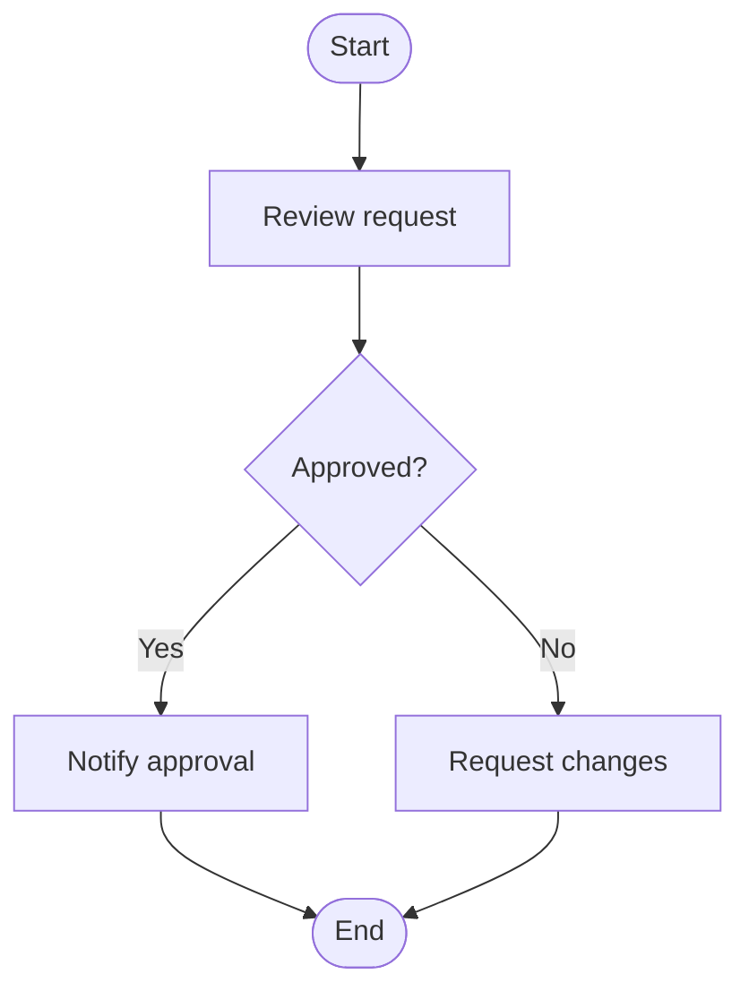

# DGS-06 — Shape & Component Library Specification

| Field | Value |
|---|---|
| Project | Diagramming System |
| Reference | DGS-06 |
| Version | 0.1 |
| Date | 27 November 2026 |
| Status | Draft — pending technical validation |
| Target | V0.2 — MVP; portable schema v1 |
| Parent specifications | DGS-01–DGS-05 v0.1 |
| Audience | Developer, designer, QA, Codex |
| Classification | Component and Visual Rendering Specification |

## 1. Purpose and authority

This specification defines the complete built-in component registry, geometry, label layout, style capabilities, connection anchors, status visuals, boundary rendering and starter templates. It specializes FR-04/05/06/07/08/09/13/15 without changing any of the 19 requirement priorities. DGS-05 and its portable schema own persisted data fields; this document owns the trusted rendering and insertion defaults. DGS-07 owns gesture mechanics and final routing algorithm; DGS-08 owns file encoding, export limits and persistence; DGS-10 owns executable tests and release gates. If a decision conflicts with a parent requirement, raise a documented change request rather than silently changing the contract.

Companion artifacts (same version): `DGS-06_Component_Registry_v1.json`, `DGS-06_Template_Basic_Flowchart_v1.json`, `DGS-06_Template_IT_Architecture_v1.json`. The registry is trusted build-time reference data, not a user-importable diagram. Templates are native portable v1 documents, not flattened images. JSON references are draft specification artifacts, not installed runtime code. No product name or branding is assumed.

## 2. Design principles and scope

- One registry for all categories; category is organizational metadata, never a filter on allowed types.
- 28 node types plus one group boundary. Edges are separate entities, not library nodes. On-page connector is a normal semantic circle, not an invisible jump mechanism.
- Shared geometry and text layout between canvas, library preview and export. No rendering-specific state enters the portable model. Persist resolved style/size values at insertion; changing defaults must not restyle old documents.
- Generic bundled vector icons, no provider-specific brands, user-provided SVG, image upload, icon URLs, remote fonts, gradients, rich text, rotated shapes or arbitrary custom styles in v1. Search and reusable custom styles remain Could (FR-19).
- Architecture cards use a consistent visual silhouette plus differentiated semantic icons. Flowchart shapes use conventional visual distinctions without claiming compliance with a formal notation standard. Annotations are not executable content. Group frames are visual containers, not endpoint nodes.
- Every component remains recognizable with color removed. Color is presentation, not semantic identity; status text and connector labels carry meaning.

## 3. Registry contract and implementation ownership

The registry is a closed immutable map keyed by exact DGS-05 type IDs. The companion JSON enumerates defaults and capabilities. Derive the `NodeType` union from DGS-05 and require exhaustive compile-time coverage; groups use their separate `general.boundary` contract. Validate registry integrity at build/test time. Never look up executable drawing code using an arbitrary imported string; dispatch only through the closed registered primitive keys. No raw paths are accepted from documents.

```ts
type StyleField = 'fill' | 'stroke' | 'strokeWidth' | 'strokeStyle' |
  'text.color' | 'text.fontSize' | 'text.align';
interface NodeDefinition {
  entity: 'node'; type: NodeType; displayName: string; defaultLabel: string;
  defaultSize: Size; minSize: Size; defaultStyle: NodeStyle;
  allowedHandles: readonly HandleId[]; supportsStatus: boolean;
  resizable: boolean; editableStyleFields: readonly StyleField[];
  primitiveKey: PrimitiveKey; iconKey: IconKey | null;
  textRegionKey: TextRegionKey; aspectRatio: number | null;
}
// Group definition substitutes entity='group', type='general.boundary',
// defaultTitle, GroupStyle and optional fillOpacity style field; no handles/status.
```

`primitiveKey`, `textRegionKey`, `iconKey`, `entity`, `aspectRatio` and capability flags are registry-only; never add them to diagram nodes. Store `type`, `label` (or `title` for group), position, size, style and status as DGS-05 defines. Default status is always `not_specified`. Factories allocate UUIDs and deep-copy values, normalize user-provided text only at UI entry, enforce constraints and issue one atomic command. The group factory creates a group, not a node disguised as a boundary. Do not serialize functions, DOM measurements, selection or transient style previews.

## 4. Mandatory component inventory

All dimensions are world units, not screen pixels. Minimums are absolute floors; current content, stroke and shape geometry may require larger values. At insertion, defaults are used with the default label; a larger size is allowed where content requires it. The named icon keys are proposed bundled Lucide icons; verify exact package exports against the pinned version at implementation. All shapes are resizable, subject to limits; on-page connector maintains 1:1 aspect ratio. Architecture types have four handles and support manual status. All other node types have four handles except text and note; boundaries have none.

### 4.1 Flowchart — 8 nodes

| Semantic ID | Display name | Default size | Minimum size | Primitive / icon | Default label or title |
|---|---|---:|---:|---|---|
| `flow.terminator` | Start / End | 140 × 56 | 96 × 40 | `capsule` | Start |
| `flow.process` | Process | 160 × 64 | 96 × 44 | `rect` | Process |
| `flow.decision` | Decision | 160 × 112 | 112 × 80 | `diamond` | Decision? |
| `flow.input_output` | Input / Output | 180 × 72 | 120 × 52 | `parallelogram` | Input / Output |
| `flow.document` | Document | 160 × 80 | 112 × 60 | `document` | Document |
| `flow.data_store` | Data store | 160 × 88 | 112 × 64 | `cylinder` | Data store |
| `flow.subprocess` | Subprocess | 180 × 64 | 120 × 44 | `subprocess` | Subprocess |
| `flow.on_page_connector` | On-page connector | 56 × 56 | 40 × 40 | `ellipse` | A |

### 4.2 Architecture — 14 nodes

| Semantic ID | Display name | Default size | Minimum size | Primitive / icon | Default label or title |
|---|---|---:|---:|---|---|
| `arch.user` | User | 180 × 80 | 152 × 72 | `arch_card` / `user-round` | User |
| `arch.device` | Device | 180 × 80 | 152 × 72 | `arch_card` / `monitor` | Device |
| `arch.website` | Website | 180 × 80 | 152 × 72 | `arch_card` / `globe` | Website |
| `arch.application` | Application | 180 × 80 | 152 × 72 | `arch_card` / `app-window` | Application |
| `arch.server` | Server | 180 × 80 | 152 × 72 | `arch_card` / `server` | Server |
| `arch.database` | Database | 180 × 80 | 152 × 72 | `arch_card` / `database` | Database |
| `arch.cloud` | Cloud | 180 × 80 | 152 × 72 | `arch_card` / `cloud` | Cloud |
| `arch.network` | Network | 180 × 80 | 152 × 72 | `arch_card` / `network` | Network |
| `arch.security` | Security | 180 × 80 | 152 × 72 | `arch_card` / `shield` | Security |
| `arch.identity` | Identity / Access | 180 × 80 | 152 × 72 | `arch_card` / `key-round` | Identity / Access |
| `arch.email` | Email | 180 × 80 | 152 × 72 | `arch_card` / `mail` | Email |
| `arch.storage` | Storage | 180 × 80 | 152 × 72 | `arch_card` / `hard-drive` | Storage |
| `arch.api` | API | 180 × 80 | 152 × 72 | `arch_card` / `cable` | API |
| `arch.integration` | Integration | 180 × 80 | 152 × 72 | `arch_card` / `boxes` | Integration |

### 4.3 General — 6 nodes and 1 boundary

| Semantic ID | Display name | Default size | Minimum size | Primitive / icon | Default label or title |
|---|---|---:|---:|---|---|
| `general.rectangle` | Rectangle | 160 × 64 | 64 × 40 | `rect` | Rectangle |
| `general.rounded_rectangle` | Rounded rectangle | 160 × 64 | 64 × 40 | `rounded_rect` | Rounded rectangle |
| `general.ellipse` | Ellipse | 160 × 88 | 80 × 56 | `ellipse` | Ellipse |
| `general.diamond` | Diamond | 160 × 112 | 100 × 72 | `diamond` | Diamond |
| `general.text` | Text | 180 × 48 | 64 × 32 | `text` | Text |
| `general.note` | Note | 180 × 120 | 100 × 72 | `note` | Note |
| `general.boundary` | Boundary | 320 × 220 | 160 × 100 | `boundary` | System boundary |

### 4.4 Semantic usage

| Component | Intended use |
|---|---|
| Terminator | Start/end or entry/exit; label determines intent |
| Process | Activity or operation |
| Decision | Conditional branch; label outgoing edges where appropriate |
| Input/output | Data entry or output |
| Document | Document or report produced/consumed |
| Data store | Generic persisted data in a process |
| Subprocess | Reusable or abstracted process; no automatic linked subdiagram |
| On-page connector | Explicit reference point; same label does not establish a hidden edge |
| User/device | Actor or endpoint |
| Website/application | Public-facing site vs application; preserve separate semantics |
| Server/database/cloud | Compute, persisted data and hosted service concepts |
| Network/security/identity | Connectivity, security control and access management |
| Email/storage/API/integration | Communication, file storage, interface and external relationship |
| General shapes | User-defined meaning; no implied execution or semantics |
| Text/note | Non-connectable explanatory annotations |
| Boundary | Logical ownership, department, trust zone or infrastructure layer |

## 5. Shared visual geometry

Geometry is expressed in local object coordinates `(0,0)` to `(w,h)` with the outer top-left as origin. Transform to world coordinates exactly once using the DGS-05 parent chain. Use positive finite dimensions and no rotation. SVG path commands below are algorithmic templates: substitute finite numeric values, not user strings. Coordinates describe the centerline of the outline; stroke extends outside by at most half its width for round joins. Use round joins/caps where appropriate and account for any actual extent. SVG `rect` radii must not exceed half the smaller dimension. Geometry, anchors and safe label rectangles must be generated by shared pure functions. Editor-only hit boxes may be larger than visible geometry and must not change the exported shape.

Let `c=w/2`, `m=h/2`, `r=min(w,h)/2`, `d=min(16,w/6)`, `a=min(12,h/6)`, `q=min(8,h/8)` and `s=strokeWidth/2`. Values are world units. SVG coordinates may be fractional; avoid rounding intermediate calculations. The following precise primitives establish v1 geometry.

| Primitive | SVG construction in local coordinates |
|---|---|
| `rect` | `rect(0,0,w,h,rx=0)` |
| `rounded_rect` | `rect(0,0,w,h,rx=min(8,r))` |
| `capsule` | `rect(0,0,w,h,rx=r,ry=r)` |
| `diamond` | `M c 0 L w m L c h L 0 m Z` |
| `parallelogram` | `M d 0 L w 0 L w-d h L 0 h Z` |
| `document` | `M 0 0 H w V h-q Q 0.75w h-q 0.5w h C 0.33w h 0.17w h-q 0 h-q Z` |
| `cylinder` | Filled outline `M 0 a A c a 0 0 1 w a V h-a A c a 0 0 1 0 h-a Z`; visible inner top rim `M 0 a A c a 0 0 0 w a` (no fill) |
| `subprocess` | Outer rect plus vertical lines at `d` and `w-d` from 0 to h; lines share stroke styling |
| `ellipse` | `ellipse(cx=c,cy=m,rx=c,ry=m)` |
| `arch_card` | `rect(0,0,w,h,rx=min(6,r))`; trusted icon and label/status in content area |
| `text` | No fill or stroke geometry; text and invisible editor hit region only |
| `note` | `rect(0,0,w,h,rx=min(4,r))`; no folded corner or shadow |
| `boundary` | `rect(0,0,w,h,rx=min(8,r))` with fill opacity, title and children on separate layers |

**Canonical document path:** `M 0 0 H w V h-q Q 0.75w h-q 0.5w h C 0.33w h 0.17w h-q 0 h-q Z`. It stays inside the bounding rectangle and passes through `(c,h)`, the bottom anchor. Its left and right edges include the midpoints. The bounded path is the only implementation form. The cylinder outline and rim share exact endpoints; do not fill the rim separately. At zero stroke, decoration strokes (rim/dividers) are hidden along with the outline; semantic IDs remain unchanged. Default outlines use 1 unit solid stroke unless otherwise specified.

### 5.1 Anchors and endpoint normals

Default cardinal anchors are `top=(c,0)`, `right=(w,m)`, `bottom=(c,h)`, `left=(0,m)`. These lie on the geometry outline for rectangular, rounded, capsule, diamond, ellipse, document and cylinder primitives. Parallelogram uses `left=(d/2,m)` and `right=(w-d/2,m)`; top and bottom remain `(c,0)` and `(c,h)` because both horizontal segments contain c. On-page connectors are circles, so the four anchors lie at the circle extremes. Annotation types and boundaries return no anchors. Anchor names never change with resize, style or position.

Use cardinal **routing directions** `(0,-1),(1,0),(0,1),(-1,0)` for top/right/bottom/left, even for sloped shapes; these are routing hints rather than exact surface normals. Resolve parent transforms to world positions; apply viewport transforms for editor handles. Edge drawing uses the same anchor and route functions as export. DGS-07 will establish offset, bend selection and endpoint marker clearance. Stroke/marker adjustment must not change stored anchor IDs. Do not attach to icon or text bounds. If visual handle and actual anchor diverge, fix rendering instead of persisting measured coordinates.

Proposed handle visuals: 8 CSS px visible circle, 18 CSS px pointer target with non-overlapping resize hit targets where practical, visible on hover/selection/connection mode and with accessible keyboard endpoints. Fixed CSS-pixel affordance is separate from world geometry. At low zoom or tiny nodes, prioritize active tool and keyboard alternatives; avoid ambiguous hit tests. DGS-07 owns exact event precedence and low-zoom thresholds.

## 6. Typography and content fitting

Use one trusted font stack for diagrams: `Arial, Liberation Sans, sans-serif`, normal weight 400, default size 14 for nodes/groups and 12 for edge labels and on-page connector. UI chrome retains DGS-04 system typography. No font-family or weight fields in portable v1. The font stack is a provisional choice; font substitution can affect line widths in standalone SVG viewers. SP-04 must test real browser/editor/export parity, including non-Latin labels. If unacceptable, select a properly licensed bundled font and fallback strategy via an explicit ADR; do not silently introduce external assets.

Use explicit line layout and coordinates in the shared scene. Browser text measurement (Canvas 2D or a validated equivalent) behind a small measurement interface supplies line advance, ascent/descent and fallback metrics. Domain geometry may receive measured content constraints but must not import DOM or React. Set font explicitly before measuring, wait for applicable font availability, and use consistent baseline and line height (1.25× font size). Match SVG `text`/`tspan` baseline and `text-anchor` to the same positions. Use plain text and safe XML escaping; no `innerHTML`, SVG `foreignObject`, user-defined markup or CSS. Preserve explicit LF and intentional spaces; expand tabs to four spaces for layout only, preserving original text. Use `xml:space="preserve"` or tested equivalent and avoid splitting grapheme clusters. Break at whitespace or Unicode break opportunities, fall back to grapheme boundaries for long tokens; explicit blank lines consume line height. Do not reduce selected font size automatically, append ellipses, clip, or silently truncate. Render missing-glyph cases via trusted system fallback; report unsupported glyph cases if not renderable, and test complex script/bidi shaping. Exact cross-viewer glyph parity is unverified.

### 6.1 Safe label regions

All regions are local rectangles `(x,y,width,height)`. For each row first derive the listed base region, then inset each side by `s` where an outline is present (text uses zero stroke). For slanted/curved outlines use the conservative rectangles below; additional clipping checks at large strokes belong to geometry tests. Reject nonpositive effective region. Label fits when every measured line advance and ink bounds fit within width and the complete line block fits height; use actual ink extents for scene bounds. Horizontal alignment uses left edge, center or right edge of effective region. Vertically center text block in regular shapes; notes and free text start at top. For shapes with a nonempty label, even a single glyph that cannot fit is a content error. Empty labels may omit text.

| Region key | Base rectangle / rule |
|---|---|
| `rect` | `(8,8,w-16,h-16)` |
| `capsule` | `(r+4,8,w-2r-8,h-16)`; if too narrow grow width; do not change font |
| `diamond` | `(w/4+4,h/4+4,w/2-8,h/2-8)`; rectangle lies inside diamond |
| `parallelogram` | `(d+8,8,w-2d-16,h-16)` |
| `document` | `(8,8,w-16,h-q-16)` above wave |
| `cylinder` | `(8,2a+4,w-16,h-3a-8)` between rim and lower curve |
| `subprocess` | `(d+6,8,w-2d-12,h-16)` between dividers |
| `ellipse` | `(w*(1-1/sqrt(2))/2+4,h*(1-1/sqrt(2))/2+4,w/sqrt(2)-8,h/sqrt(2)-8)`; inscribed rectangle |
| `arch_card` | See 6.2; left icon rail and right text area |
| `text` | `(4,4,w-8,h-8)`, no outline |
| `note` | `(10,10,w-20,h-20)`, top aligned |
| `boundary` | `(16,8,w-32,20)` title region; content starts at y=36, see 8 |

Minimum sizes are structural floors, not guarantees that default or arbitrary labels fit at all permitted fonts. For example, a decision diamond at its minimum size may require enlargement for longer text. Fit operations must remain within DGS-05 sizes/world/count/byte budgets. For on-page connector, content growth enlarges both axes equally. The default label of each type should fit its default size in the reference font; prove this in the component test suite. Text measurement is not represented in the file schema.

### 6.2 Architecture card layout and status

Uniform 180×80 default card, 152×72 floor. Left icon at `x=12`, `y=(h-24)/2`, rendered at 24×24 world units; apply inset or grow if a heavy stroke could overlap. Label region base: `(44,8,w-56,h-16)` without status. When status visible, reserve the bottom 22 world units of the label region; label region becomes `(44,8,w-56,h-38)`. Status row base `(44,h-30,w-56,22)` with neutral white background radius 4, marker circle radius 3.5, 8 units left inset, marker-to-text gap 5, 11-unit fixed readable status text; fit status width, including insets, before committing. Inset label and status region by s; allow white status background without changing the node's fill/stroke. Center label block vertically within its region. Icon uses text color and a 1.75-unit source stroke in 24-unit viewBox; no arbitrary color field. Text contrast on chosen fill should be checked and low-contrast choices warned, not silently recolored; status text always uses neutral background and defined dark colors. If a status does not fit, visibly expand node or reject according to the edit policy. `not_specified` hides the row entirely and releases reserved space. Do not encode status in icon or entire card color.

### 6.3 Content fit and editing policy

- On insertion, label/style/status edit, use current geometry if valid; otherwise grow width first for an unbreakable grapheme or status minimum and height for wrapped text; for shape-specific safe regions, evaluate candidate size and retry with bounded growth. A simple bounded search in 4-world-unit increments or monotone widening/doubling followed by bounded refinement is acceptable; enforce domain bounds and cap iterations. Keep upper-left fixed for content-driven growth, preserve parent-relative origin except for required ancestor expansion, and commit all changes together.
- User-driven resize: preview constrained to registry floors, aspect rule and current content; invalid final resize is rejected with visible feedback (no silent text clipping). DGS-07 owns gesture-specific clamp/preview details. Numeric size edits follow same validation. Escape restores previous snapshot.
- On import/load, never automatically resize or snap; reject a geometry/content violation with `CONTENT_DOES_NOT_FIT` or appropriate DGS-05 error. Use consistent supported font metrics to avoid cross-device false rejection; this is a technical risk and requires SP-04 validation. Do not silently mutate old files to fit a new font policy.
- If changes exceed limits or cannot find a valid fit, explain the issue and retain previous committed state. For very long labels, recommend wider component or smaller user-selected font. Keep fit and ancestor expansion in one undo entry. Do not round imported fractional coordinates.

## 7. Style capabilities and status tokens

The companion registry holds complete style defaults. All normal node and group style fields match DGS-05. No new portable fields. Standard default font color `#0F172A`, font size 14, center alignment, outline 1 world unit solid. Architecture and basic general shapes default to white fill and slate `#64748B` outline. Flowchart default colors distinguish common shapes, but semantics remain independent of colors. Notes use pale amber; boundaries use a translucent indigo fill. All colors canonical uppercase hex. Node/boundary stroke width 0–8; edge stroke width 0.5–8; font 8–72; group fill opacity 0–1 (fill only). Dashed stroke uses `dasharray=(4*strokeWidth,3*strokeWidth)` with round joins and no animation, zero width hides stroke. Edge and node styles use identical line-style semantics. No gradients, shadows or dynamic CSS.

| Component family | Editable style fields | Status | Handles |
|---|---|---|---|
| Flowchart (8) | fill, stroke, width, line style, text color/size/alignment | No | Four |
| Architecture (14) | Same | Yes | Four |
| General geometric shapes (4) | Same | No | Four |
| General text | Text color/size/alignment only | No | None |
| General note | All normal node style fields | No | None |
| Boundary | All normal style fields + fill opacity | No | None |

Text-only canonical fill/stroke neutral values are `#FFFFFF`, `#64748B`, strokeWidth 0, strokeStyle solid. Hide controls for these values and reject non-neutral imports as unsupported capability instead of discarding user data. All other fields must obey DGS-05. Bulk styling applies only to shared eligible fields in one command; no hidden changes to incompatible items.

| Status | Marker | Text color | Visual |
|---|---|---|---|
| `not_specified` | #64748B | #475569 | Omitted |
| `completed` | #15803D | #166534 | Completed |
| `in_progress` | #D97706 | #92400E | In progress |
| `pending` | #DC2626 | #991B1B | Pending |

Statuses are manually maintained implementation labels; no external polling or health inference. Non-architecture nodes must hold `not_specified`. Resetting status removes visual indicator without changing other style values. Include visible label in exports and accessibility names; grayscale remains understandable. All status updates and content-driven geometry changes are undoable atomically.

## 8. Boundary geometry and rendering

Boundary default size 320×220, minimum 160×100, 8-unit maximum corner radius, fill #E0E7FF at 0.3 opacity, dashed #6366F1 stroke width 1, text #0F172A left aligned at 14. Title is single region, supports explicit line breaks and wrapping. To accommodate large or multiline titles, DGS-05's top padding 36 is a minimum: compute title block height from measured lines and set `topInset=max(36, 16+titleBlockHeight+strokeWidth)`. Title region becomes `(16,8,w-32,topInset-16)` with stroke inset. Left/right/bottom containment padding remains 16 plus any additional visual extent necessary for children. Group minimum content width must include title and descendant bounds, and height includes dynamic title inset and child bounds. For empty title retain baseline top inset 36. Parent/child positions and padding are not persisted as separate fields; derive from title, style and geometry. Reject impossible imported layouts rather than normalize. When title edit increases inset, preserve child world positions by expanding frame upward if necessary (and width as needed) and update local positions; propagate expansion to ancestors. This proposed refinement requires SP-02 validation and DGS-07 reconciliation.

Boundary frame renders behind descendants, title stays visible; group fills must not occlude cross-boundary edges. Recommended layer order: boundary fills/strokes outer-to-inner, edges, node fills/icons/text/status, edge labels, group titles (titles protected by containment), then editor-only affordances. Edge/node order across same-layer items follows array order; no new z-index field. DGS-07 finalizes hit testing and stacking rules. Group borders may be visually crossed by edges; no boundary anchors. Moving translates descendant world coordinates once; resizing changes frame only. Overlap does not assign membership. Explicit group/ungroup/delete-preserving-children follow DGS-05 atomic commands and nested ancestry rules. Empty frames are valid. Root objects may overlap; no automatic collision solver.

## 9. Connector presentation contract

Edges are created via anchor gestures or keyboard endpoint selection, not as independent shape tiles. Defaults: orthogonal route, forward arrow, solid slate #64748B stroke 2 world units, empty label, text #0F172A at 12 center. Supported arrow modes none/forward/both, route modes straight/orthogonal, and solid/dashed stroke. Store directed tuple source and target regardless of arrow appearance. Self-loops and exact directed endpoint duplicates are rejected, while cycles between distinct nodes, reverse direction and differing handle pairs are allowed. Reconnect preserves identity, style and label.

Proposed arrowhead geometry: filled triangle, length `max(8,4*strokeWidth)`, width `max(6,3*strokeWidth)`; tip at anchor adjusted for node stroke and route direction, base along final segment. Reverse for start arrow, preserve endpoint reference. If a short segment cannot accommodate marker, choose feasible route or shrink marker proportionally with no NaN; for coincident anchors use a deterministic nonzero route or reject invalid creation with guidance. DGS-07 owns exact corner and offset rules, direction, degenerate paths and label placement. Basic routing does not guarantee obstacle avoidance. Use scene bounds including markers and strokes. Do not change persistent data to accommodate viewport zoom.

Connector label: plain multiline text, safe wrap with proposed maximum 240-world-unit width, no automatic font reduction. Draw neutral white background with 4-unit horizontal and 2-unit vertical padding; border none; place at route label point offset if necessary. Alignment controls line alignment inside measured label region. Empty label renders no background. Include text and background in visual bounds, no selection handles. DGS-07 may refine label point; collision-free global label placement is deferred.

## 10. Icons, asset policy and licensing

Use proposed Lucide keys in registry for architecture cards, supplied as local trusted vector primitives in a pinned build. Lucide's official licensing page identifies ISC terms and MIT terms for Feather-derived icons (including monitor, database and server). Source: https://lucide.dev/license (reviewed 27 November 2026). Retain appropriate upstream notices in repository and distributed assets, including exported SVG where required; review whether notices in standalone output and other formats need additional treatment before release. Do not assume every icon has identical origin/license. Pin package version, confirm key availability, record original source, version and license for each asset in THIRD_PARTY_NOTICES.md. Full dependency and output-licensing review remains pending. No vendor logos or trademark representations in MVP. UI icons and diagram icons may use the same upstream assets but diagram rendering must use the shared trusted vector representation, not screenshot or React DOM capture.

Build step: extract/copy only selected trusted icon geometry into the renderer asset registry using allowed SVG elements/attributes; normalize to 24×24 viewBox, consistent stroke and no remote resources. If an icon is absent or incompatible, replace via explicit registry decision before release; do not silently substitute for saved semantic types after release. No file with raw user-provided SVG is accepted. The component palette uses scaled trusted previews, not screenshots or network requests. Offline component insertion requires assets already loaded locally; full offline application launch is not implied.

## 11. Component library UI and rendering integration

Follow DGS-04 two-column categorized library at normal width, approximately 96×68 CSS px tiles, label plus recognizable preview, all categories available in any document. Preview uses primitive and icon at scaled fit, without status or selection; label is the accessible display name (not truncated without tooltip/accessible full name). Hover/focus affordances, drag ghost and click/Enter insertion use same registry. Drop on valid canvas translates screen to world; outside cancels. Click/keyboard insertion chooses visible position, deterministic offset for repeated insertion, selects new item and reveals applicable inspector. No auto-parenting based on overlap. DGS-07 defines precise position/snapping and group commands. Text label and status controls remain accessible through inspector, not pointer-only gestures. Unsupported controls are hidden/disabled. Use no network request for built-in components after app assets loaded. No compulsory search feature.

Recommended runtime interfaces (conceptual): `getDefinition(type)`, `createNode(type,position)`, `createBoundary(position)`, `buildShapeGeometry(type,size,style)`, `getAnchors(type,size)`, `getContentRegions(node)`, `layoutText(text,style,region,metrics)`, `validateComponent(node,definition,metrics)`, `buildNodeScene(node,worldPosition)`, `buildGroupScene(group,worldPosition)`. Return typed geometry/scene data with supported SVG attributes, not HTML strings. The React Flow adapter consumes geometry and anchor locations and translates transient events into commands. The SVG serializer consumes the same scene and outputs escaped, standalone SVG with explicit bounds and no editor DOM. PNG rasterizes SVG as DGS-03 specifies. Use shared text layout/asset primitives and route generator to prevent divergence. React Flow measurements remain renderer-only and must not overwrite canonical width or height.

## 12. Starter templates (FR-15)

Two mandatory immutable sources, in DGS-05 envelope format. Both templates are illustrative, not claims about actual organizations or business processes. Template IDs are stable source IDs within their fixtures, not live user document IDs. Instantiate with fresh UUID v4 for document, nodes, groups and edges; build old→new mapping, remap parent and endpoint references in second pass, set new timestamps and independent styles/settings; validate entire graph and save atomically before navigation. Source never mutated. If viewport null, fit to content; do not persist library template edits back into source. Ordinary JSON import must apply the same independence rules. The two templates may be previewed locally without remote resources. No additional templates are required; automation, mind map and organizational chart are FR-18 Should.

### 12.1 Basic process flowchart

File: `DGS-06_Template_Basic_Flowchart_v1.json`. Six nodes, six edges, no groups. Start → Review request → Approved? Decision splits into Yes (Notify approval) and No (Request changes), both reach End. Layout uses distinct branches with labeled edges and a shared terminator. All labels editable, status not specified. This represents one review attempt, not a mandatory loop or business approval rule. Branch direction is explicitly stored; no implied workflow execution.



### 12.2 IT architecture

File: `DGS-06_Template_IT_Architecture_v1.json`. Ten architecture nodes, ten edges, three boundaries (one outer and two inner). Users access public website and identity service. Application layer illustrates website → web application → backend API → database. Corporate services layer illustrates identity → email → document storage → endpoint security and partner integration. A cross-layer edge connects API to document storage. These arrows are example relationships only, not verified infrastructure dependencies or security best practice. Includes completed, in progress, pending and not specified statuses; nodes remain generic. Parent-relative geometry is explicit, source viewport null for fit. DGS-07 route verification may adjust template coordinates or edge handle choices while preserving intended semantics and valid schema. No template claims about a real client.

## 13. Validation and quality controls

All imported and committed components follow DGS-05 structural + domain checks. Registry checks add: exact closed type set, default size >= min, type-specific minimum, circle 1:1 (floating comparison tolerance proposed 1e-6), supported fields/status/handles, content fit, group containment and world visual extents, and no invalid assets. Validate whole operation or reject without mutation. Import must not auto-correct incompatible sizes or unsupported styles. Geometry functions assert finite values; defensive resource ceilings remain DGS-05 (1,000 nodes, 2,000 edges, 100 groups, eight group ancestors, 10 MiB, size 1–100,000, world ±1,000,000). Export budgets in DGS-08 are independent. Bounds include stroke, text ink, icons, edge markers, labels and group titles; no clipping of legitimate content. For empty text-only annotations, invisible hit box exists only in editor; DGS-08 decides no-content export handling when there is no visible scene.

Artifact checks performed on this draft: Python Draft 2020-12 JSON Schema validation for both starter templates and previous DGS-05 architecture example; registry type coverage, default style structural checks, floors, eligible handles/status flags, unique IDs, existing endpoints, duplicate/self-loop rules, parent membership, containment with baseline padding, ancestry and world rectangle bounds. Basic label width check for the new architecture fixture using a local Liberation Sans font at 14 units. This does not validate dynamic text fit, actual browser fonts, precise stroke extents, visual route intersections, vector icon availability, rendering, or export fidelity. All runtime acceptance criteria below remain unexecuted. No production TypeScript/Zod code or app was created.

## 14. Component-level acceptance scenarios

| ID | Scenario and pass condition | Traceability |
|---|---|---|
| CL-01 | Exhaustively insert 28 node types and one group; type, names, default style/size and entity collection correct | FR-04 |
| CL-02 | Every default label fits at default size; all 29 previews recognizable at palette size | FR-04/05 |
| CL-03 | Mix categories, save/reload and export without semantic type changes | FR-04/11/12/13 |
| CL-04 | Disconnect network after assets loaded; insert every built-in component without asset fetch | FR-04 |
| CL-05 | Verify exact primitive path/rect/ellipse output at nominal and extreme aspect sizes; finite bounds | FR-04/13 |
| CL-06 | Check all 104 eligible handles (26 nodes × 4); anchors remain on outline after resize | FR-06 |
| CL-07 | Text/note/boundary cannot connect by pointer or keyboard; invalid imported endpoints rejected | FR-06 |
| CL-08 | Move, resize and reparent nodes; stored endpoint IDs unchanged and routes update | FR-03/06/08 |
| CL-09 | Circle maintains aspect ratio and floor; invalid imported aspect rejected | FR-03/04 |
| CL-10 | Edit valid styles; invalid colors/ranges rejected; unsupported text fill/stroke rejected | FR-05/12 |
| CL-11 | Wrap multiline, long tokens, whitespace, Unicode and markup-like text; no truncation or execution | FR-05/13 |
| CL-12 | Edit text/font causing growth, ancestor expansion and undo; single transaction restores geometry | FR-05/08/10 |
| CL-13 | Resize below content floor; rejected with guidance and previous state preserved | FR-03/05 |
| CL-14 | Assign all four status values to every eligible architecture type; non-eligible values rejected | FR-09 |
| CL-15 | Status marker + label legible on dark fills and grayscale, status reset does not change style | FR-09/13 |
| CL-16 | Nested boundary renders behind children; title growth and group move preserve world positions appropriately | FR-08 |
| CL-17 | Boundary delete/ungroup preserves children/edges; nested groups stay valid | FR-08/10 |
| CL-18 | Straight/orthogonal route, all arrow modes, dashed and labeled edge export match canvas | FR-07/13 |
| CL-19 | Zero-stroke node, narrow shape, large stroke and negative coordinates export without clipping | FR-05/13 |
| CL-20 | SVG contains supported vector geometry and escaped text, no foreignObject/external asset/selection | FR-13 |
| CL-21 | Independent browser/SVG viewer and PNG match reference scene within approved tolerances | FR-13 |
| CL-22 | Both templates load, contain required counts and editable content; labels and branch edges intact | FR-15 |
| CL-23 | Two instances have distinct IDs, valid remapped references, independent content; source immutable | FR-15/01 |
| CL-24 | Template instances round-trip JSON and persist/reopen through normal document workflow | FR-11/12/15 |
| CL-25 | Keyboard insert/label edit/connect, visible focus, named handles and status accessible | FR-04/06/14/NFR-05 |
| CL-26 | Licensed pinned asset list and notices verified; no missing icon at build/runtime | FR-04/13 |

CL scenarios supplement existing DGS-02 acceptance criteria; no change to release scope. Mandatory requirements still control release. DGS-10 will define fixtures, browser thresholds, screenshot tolerances and test execution evidence. If a hard requirement fails, fix or obtain explicit scope revision rather than silently lowering fidelity.

## 15. Implementation structure and sequence

```text
src/core/registry/component.registry.ts
src/core/registry/component.types.ts
src/core/registry/component.defaults.ts
src/core/geometry/shape-primitives.ts
src/core/geometry/anchors.ts
src/core/geometry/content-regions.ts
src/core/geometry/containment.ts
src/core/scene/text-layout.ts
src/core/scene/component-scene.ts
src/core/scene/icon-registry.ts
src/features/shape-library/ComponentLibrary.tsx
src/features/shape-library/ShapeTile.tsx
src/features/editor/nodes/ComponentNode.tsx
src/features/editor/nodes/BoundaryNode.tsx
src/infrastructure/rendering/react-flow/
src/infrastructure/export/svg/
src/features/templates/fixtures/
tests/fixtures/
```

Create modules when required, avoid dozens of empty files. Sequence: registry/default factories → geometry/anchor tests → text measurement/fit → shared scene + icons → React Flow renderer → boundary and status rules → starter template factory → SVG parity. Test representative process, decision, architecture card and nested boundary early in SP-02/03/04 before polishing every component. Do not implement advanced routing or layout as a prerequisite for manual component insertion. Actual type/schema implementation belongs to DGS-05, persistence/export orchestration to DGS-08.

## 16. Decisions, unresolved risks and handoffs

| ID | Proposed decision / risk | Disposition |
|---|---|---|
| CD-01 | Uniform architecture cards with side icon rail instead of individually shaped architecture nodes | Proposed; visual design review |
| CD-02 | Flowchart geometry and per-type dimensions, colors | Proposed; registry defaults |
| CD-03 | On-page connector circle aspect lock | Proposed; DGS-07 confirm interaction |
| CD-04 | Text and note non-connectable; groups no handles | Inherited DGS-05; confirm with user if broader annotation use desired |
| CD-05 | Arial/Liberation Sans/system fallback and explicit text metrics | Conditional on SP-04; cross-device import parity risk |
| CD-06 | Text fit growth on content edit; reject invalid manual resize/import | Proposed; DGS-07 refine and verify |
| CD-07 | Dynamic boundary title inset, top expansion while preserving children | Proposed refinement; DGS-07/SP-02 |
| CD-08 | Generic Lucide icon keys; license/notice and availability audit | Pending pinned package review; no vendor assets |
| CD-09 | Scene layering, marker and dashed style definitions | Proposed; DGS-07/08 review |
| CD-10 | Two native starter fixtures and explicit remapping | Proposed illustrative content; runtime tests pending |
| CD-11 | Strict neutral hidden style values for text annotation | Proposed registry capability; verify backward compatibility before release |
| CD-12 | No schema change, all 29 DGS-05 IDs retained | Verified artifact coverage; actual Zod implementation pending |

No changes were made to DGS-01–05 or their companion files. The registry and starter templates pass artifact checks only; the production renderer, icon availability, accessibility, actual export appearance, content fit and connector routing have not been implemented or verified. The selected dimensions, colors, shape paths, font stack, layout and fixture content were chosen as draft defaults, not approved brand requirements. No blockers prevent continuing specification work. The major technical blockers to release are actual prototype verification of shared scene/vector export and grouped coordinate behavior; if font portability or routing proves inadequate, revise the corresponding decisions explicitly.

DGS-07 — Canvas & Interaction Specification: finalize selection/drag/resize, shape hit regions, anchor hit priority, keyboard connection, snap behavior, reparenting, dynamic title containment, route generation and stacking. DGS-08 — Document Persistence & Export Specification: final SVG safe serialization, asset notices, PNG budgets, bounds, templates/backup and error handling. DGS-09: sequence work by requirements and technical spikes. DGS-10: execute CL scenarios and trace to parent requirements. DGS-11: optional custom icons, vendor packs, freehand, advanced typography and other post-MVP features.

## 17. Revision history

| Version | Date | Summary |
|---|---|---|
| 0.1 | 27 November 2026 | Initial component catalogue, geometry, text/style/status contracts, template fixtures and verification plan. |
