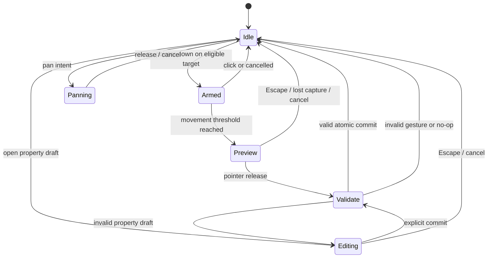

# DGS-07 — Canvas & Interaction Specification

| Document control | Value |
|---|---|
| Project | Diagramming System |
| Reference | DGS-07 |
| Version | 0.1 |
| Date | 27 November 2026 |
| Status | Draft — pending technical validation |
| Parent specifications | DGS-01 through DGS-06 v0.1 |
| Release | V0.2 — MVP |
| Portable schema / component registry | v1 / v1 |
| Audience | Developer, product owner, QA, Codex |

## 1. Purpose, authority and scope

Define the operational contract of the unified structured diagram editor: viewport, input arbitration, insertion, selection, movement, resize, connections, grouping, text and property edits, history, keyboard alternatives and failure handling. This is a specification, not an implementation or a claim of browser support. DGS-01 owns product objectives, DGS-02 owns requirements and priority, DGS-03 owns architecture, DGS-04 owns UI, DGS-05 owns the canonical model and DGS-06 owns registry/visual primitives. DGS-07 resolves interaction details delegated by those documents; conflicts must be recorded and reviewed, not silently patched in parent documents. All 19 FR priorities remain unchanged. No new portable fields or component types are introduced.

Mandatory: FR-02–10 and FR-14 interaction behavior; interfaces to FR-01, 11–13 and 15. FR-16 alignment/distribution/mini-map and FR-17 auto layout remain Should; FR-18/19 remain optional at their existing priorities. Freehand, rotation, arbitrary transforms, free-floating connectors, manual waypoints, obstacle avoidance, recursive group deletion, multi-object resize, collaboration and mobile editing are not required. The 29 registry entries (28 nodes, one boundary) share the same editor.

## 2. State ownership and interaction lifecycle

| State | Owner | Lifetime / mutation |
|---|---|---|
| Committed graph | Diagram session | Valid canonical document only; changes through commands |
| Selection | Editor session | Set of existing typed object IDs; transient |
| Active tool | Editor session | Select / Pan; temporary Space pan; connection and resize are gesture modes |
| Active gesture | Editor session | Pointer ID, start coordinates, immutable baseline, candidate, validity, intent |
| Property draft | Inspector or inline editor | Local editable buffer, validation feedback, original value |
| Viewport | Editor session | CSS-pixel translation and zoom; separately persisted |
| History | History service | Immutable graph before/after content, session-local |
| Save generation and revision | Save coordinator | Monotonic edit generation, independent database revision |
| Renderer projections | Adapter | Derived React Flow state and temporary measurements; not authoritative |

Only one mutating gesture or property edit may be active at a time. Preview is derived from the start baseline, never from accumulated deltas. Capture document ID and generation at gesture start; if an unexpected content change invalidates the baseline, cancel with feedback rather than rebase silently. A renderer callback cannot bypass a command. After a successful command, project committed state, reconcile selection, append one history entry if applicable, schedule persistence. No-op operations do not create entries or schedule graph saves. Viewport changes may schedule independent view persistence.



Preview states: marquee, move, resize, insert drag, connect, reconnect; each has a defined candidate and cancellation. Panning and selection do not mutate graph. When a modal or context menu opens, finish/cancel active draft first; if invalid draft remains, focus its error instead of opening a new operation. Escape closes the topmost popup/dialog first, then cancels active editing/gesture, then clears selection. Pointer cancel, lost capture, window blur and document switch cancel pending graph gestures and restore baseline, with no history entry. Normal pointer-up releases capture after marking gesture ended so lost-capture event does not roll back a successful commit. Navigation/export cannot read an uncommitted preview as content.

## 3. Coordinate spaces, viewport and fit

Use CSS pixel client coordinates, canvas-local CSS pixels, world coordinates and parent-local world coordinates. No device pixel ratio in input calculations. Let C=(clientX,clientY), R=(canvasRect.left,canvasRect.top), T=(viewport.x,viewport.y), z=zoom. `world=(C-R-T)/z`; `client=R+T+z*world`. World origin of a child = its local position + world origin of direct parent. Parent is the outer top-left, not the title inset. Reparent: `newLocal=oldWorld-newParentWorld`. Store finite fractional values; never round during conversion or import. Negative coordinates supported. DGS-05 bounds: local coordinates and derived node/group rectangle bounds ±1,000,000 world units; size up to 100,000, registry minima; view translation ±4,000,000 CSS px. Clamp view only, not document coordinates.

Example: canvas origin (240,104), viewport translation (80,-40), zoom 0.5, pointer (470,214) maps to world (300,300). If the chosen parent world position is (100,120), local point is (200,180). Reversing transform returns original client point. Subtract canvas rect once; adapter may use renderer conversion helpers after verifying same contract.

### 3.1 Navigation

| Input | Behavior |
|---|---|
| Pan tool primary drag | Pan from any canvas target; no selection mutation |
| Space + primary drag | Temporary pan when canvas focused; restore previous tool after key release and gesture end |
| Middle button drag | Pan regardless of select tool; suppress autoscroll only within canvas |
| Wheel over canvas | Vertical pan, horizontal wheel/trackpad delta pans x; Shift+vertical may pan horizontally |
| Ctrl/Cmd + wheel or supported pinch | Zoom about pointer; intercept only within focused editor canvas when cancelable; browser zoom remains available elsewhere |
| Visible +/- | Zoom by factor 1.2 or reciprocal about canvas center |
| Reset | 100% about canvas center; empty canvas reset translation to origin |
| Fit | Compute full visual scene bounds including labels, markers, strokes and boundaries |

Zoom clamp 0.25–2; default 1. For zoom about canvas-local point p: `w=(p-T)/z`, `z2=clamp(requested,0.25,2)`, `T2=p-z2*w`, then apply translation limits. Normalize wheel delta mode to CSS pixels; proposed wheel zoom `z2=z*exp(-0.002*dy)`, use normalized/clamped event delta. Side panels scroll independently and don't pan canvas. During graph gesture or property draft, disable new pan/zoom gestures; cancel explicit graph gesture before tool switch; avoid browser-wide key interception. For viewport resize, retain world point at previous canvas center when feasible; geometry unchanged. Recompute DOM rect before input and fit, avoid stale offsets after panel collapse. View translation clamps may prevent perfect focus retention at extreme limits; give fit/reset alternative.

Fit uses padding 48 CSS px on each side, reduced to at most one quarter of smaller available dimension for small canvas. Bounds include full visible scene, not editor grid or handles. `zFit=min((canvasW-2p)/max(boundsW,1),(canvasH-2p)/max(boundsH,1))`, clamp to 0.25–2; center visual bounds at viewport center, clamp translation. If full content cannot fit, center and disclose minimum zoom prevents full fit. Empty document fit resets to safe (0,0,1); zero-size viewport defers fit until measured. Restore valid persisted viewport best effort; if absent, fit populated document. View persistence does not dirty graph or alter last modified. Optional minimap follows same transform if FR-16 implemented.

### 3.2 Grid and snapping

Grid and snap are independent document settings. Grid interval G=20 world units; align dotted grid to world origin, render lighter/coarser display at low zoom only if needed, never change snap interval. Snap function `S(v)=G*floor(v/G+0.5)` (ties toward positive infinity, including negative values). Snap in WORLD space, not parent-local or CSS pixels. Insertion snaps top-left after subtracting library drag hotspot. Movement snaps one reference root's world top-left; apply the same delta to every transform root, preserving relative offsets. If drag threshold not reached or net movement is zero, no snap mutation. No snapping during load, undo/redo, reparent, grouping, automatic fit growth or viewport change. Numeric property edits use exact validated numbers without snap. Keyboard nudge uses 1 world unit per arrow when snap off, 20 when on; intentionally adds delta, does not realign off-grid selection (preserves relative layout). Resize snaps only moved world-space rectangle sides, not fixed opposite sides. For circles, snap the dominant dimension then derive the other dimension, aspect ratio takes precedence. Minimum/content constraints override snap on preview or reject on commit; explain when exact grid alignment unavailable. No temporary snap override key required for MVP; toggle toolbar.

## 4. Hit testing and selection

Hit-test in canvas-local CSS pixels against transformed visual geometry, not a DOM bounding box alone. Stable visual order follows DGS-06: group frames outer-to-inner, edges, nodes in array order, edge labels, group titles, editor affordances. Later sibling/node drawn on top wins within layer; nested frames ordered by depth then original array index. No persisted z-index or rearrange-to-front required. Boundary body is non-capturing for ordinary selection: use title/header or border to select/move; empty interior may marquee/deselect; explicit object picker permits selecting any boundary. Nodes hit filled outline/shape plus small border tolerance, annotations use text rectangle; transparent fill still selectable. Edge hit region is max(12 CSS px, rendered stroke width+8 CSS px) centered on actual polyline; label box is also hit target. Hidden labels/handles not hit-testable. Handle visuals 8 CSS px, target diameter 18 CSS px; resize square 8 CSS px, target 14 CSS px. Hit tolerances are screen-space, never stored or exported.

Priority, highest first: modal/popup and input fields; active gesture capture; pan override; active connection/reconnection target anchors; selected-object resize controls or selected edge endpoint controls; visible node connection anchors; edge label; group title; node shape; edge path; boundary border; canvas. In idle selection mode, a selected edge endpoint control wins over overlapping node anchor; deliberate edge selection required to reconnect. During connection only valid/invalid node anchors are candidates; resize and node move disabled. At overlap of anchor/resize hit targets, select nearest visible center within target and tie-break by stated priority; when centers are within 10 CSS px on small nodes, show only resize corners and use Connect to.../explicit connection mode for anchors. Edge endpoints at same screen point: inspector chooses source/target. At 25% zoom, keyboard/object picker alternatives remain available. Avoid duplicate renderer event bubbling (pointer on handle must not trigger node drag). Right click selects target if not selected, preserves existing selected set if target already selected; context menu coordinates clamped. Text fields retain native menu.

### 4.1 Selection rules

| Intent | Outcome |
|---|---|
| Primary click object | Replace selection with object; inspector follows |
| Shift+click | Toggle object in selection |
| Click empty canvas | Clear selection |
| Drag empty area in Select tool | Marquee; 4 CSS px threshold; replace selection on release |
| Shift+marquee | Union original selection with hits; no toggle |
| Ctrl/Cmd+A | Select all eligible nodes, groups and edges in focused canvas |
| Escape idle | Clear selection |
| Right click | Select target if not already selected; preserve existing selection otherwise |

Marquee uses full containment of node/group visual bounding rectangles in selection rectangle; edge selection requires full path/label/marker bounds (not partial crossing). Selection may include descendants of selected groups and edges. Normalize by operation: for move/duplicate use top-level selected transform roots (exclude any node/group with selected ancestor); for delete remove explicitly selected normal nodes and frames, not every descendant. Edges don't independently translate. For resize only one selected node/group allowed, selected edge only shows reconnect affordance. Focus remains meaningful; selection not content history. Click vs drag threshold 4 CSS px Euclidean distance, same at all zooms. Dragging an already selected object preserves selection; pointer-down on unselected object selects it before drag. Modifier-click toggles on click release; shift-drag from a selected object preserves selection for move, not toggle. If shift-drag begins on unselected object, add it before move; if marquee, union. Cancelled marquee restores starting selection.

## 5. Component insertion and movement

Library drag uses trusted registry type, not arbitrary transferred markup. Record normalized hotspot (fraction of tile/component preview, default center if unavailable). Convert final client location to world, subtract hotspot times default size, snap top-left if enabled. Preview ghost uses registry dimensions and style. Drop only in canvas, not sidebars or header. Drop over boundary does not imply membership: insert at root, then explicit Add to group if desired. Accessible click insertion uses viewport center minus half default size; try bounded offsets (20 world units diagonally, up to 10 attempts) to avoid exact coincidence with existing object top-left, overlap otherwise allowed. If no legal placement, show error. Allocate fresh UUID and registry defaults once for commit; validate content fit and all limits. Select new object after commit. Do not generate graph entries for cancelled drag, invalid type or failed placement.

Move: capture world positions of transform roots. Convert start/current pointer to world under frozen viewport; calculate raw delta. Reference root is directly dragged selected object if it is a transform root, otherwise its selected ancestor; for keyboard commands use first transform root in stable document order. Apply snapped reference delta to every root; convert targets to local positions against candidate parent world origins. Moving selected parent includes its descendants exactly once by inheritance; no extra writes to child coordinates except compensations when an ancestor frame expands. Recompute edges from preview anchors; keep unrelated objects stable. Crossing a group border does not detach or reparent. Explicitly contained children can grow parent boundaries under §8. Validate limits before commit. If candidate invalid, show ghost/last feasible preview with reason; release invalid gesture rejects entire change, never silently commits last feasible position. Pointer capture continues outside canvas; final move/resize may commit outside viewport if candidate valid (unlike insertion/connection, which require valid target). No auto-pan required; users pan before dragging distant objects. No collision prevention. A pointer gesture producing identical committed geometry is a no-op.

Duplicate: deep-copy selected transform roots and descendants of selected groups, fresh UUIDs for all copied objects, preserve relative geometry and original parents for roots; descendants reference copied parents. Offset world root positions by (20,20), no independent snap. Copy exactly those existing edges whose two endpoints are in copied node set, new IDs and remapped endpoints, irrespective of edge selection; selected standalone edges cannot be duplicated without endpoint nodes. Expand original parent frames if needed, validate atomically; select copied roots and internal edges. Original graph unchanged except required ancestor expansion (world positions preserved). Deletion: explicitly selected nodes and edges removed; incident edges removed; selected frames removed with children preserved as §8. Clear deleted IDs from selection. A group-only deletion is not recursive deletion. All operations respect DGS-05 count, ID, depth, geometry and byte budgets.

## 6. Resize, label and property editing

Single eligible node/group displays eight resize controls (corners/sides); on-page circle uses corner controls only. Resize baseline world rectangle (L,T,R,B). Drag adjusts only named sides; opposite sides fixed. Snap moved side(s) in world space before validation; no flipping across opposite sides. Clamp preview to registry minimum if raw size too small and show limit; releasing a below-minimum or content-invalid proposal rejects rather than silently committing clamp. Distinguish preview clamp from actual validity. For on-page connector choose dominant absolute delta in requested width/height, derive square size, preserve opposite corner, reject negative/inverted or below-min values. No rotations or multi-object scaling. Update anchors, routes, labels and scene bounds in preview.

Group resize changes frame rectangle only. Children retain world positions; if frame origin changes, recompute direct children's locals using original world positions. Reject shrink that violates dynamic title/padding or child visual bounds; do not scale or detach children. Expanding frame may expand ancestor. For numeric group position change, treat as move (descendants translate); numeric size change fixes top-left and children world positions. Numeric position fields represent direct parent-relative coordinates (label coordinate space in inspector); convert through parent origin before geometry checks. Invalid fields retain last committed value and show inline error. No implicit snap for numeric input.

Text and style edits: double-click label or choose Edit label / inspector field. Explicit Apply/Enter for single-line; multiline Enter inserts newline, Ctrl/Cmd+Enter commits; Escape cancels; valid blur commits unless leaving for explicit cancel action; invalid blur preserves draft and blocks dependent operation with focusable error. IME composition prevents premature Enter/keyboard command. Commit each field edit or explicit bulk style transaction once; color picker/slider previews transient, commit on release/apply. Mixed selection shows mixed values; only intersection of editable fields applies to entire chosen set. Validate ranges/capabilities, plain text, status eligibility and contrast warning (not silent recolor). Content-driven growth follows DGS-06, upper-left fixed except ancestor expansion; enlarge circular connector equally. No automatic font reduction/truncation. Reject if content cannot fit within limits. Group title growth may enlarge top/width and propagate to ancestors preserving descendants. Status edit supports architecture nodes only and does not override chosen style. Non-graph title/category/grid/snap metadata commits separately; not graph history.

## 7. Connectors, reconnection and path geometry

Start from eligible visible handle by drag or accessible Connect to... action. Source endpoint stable ID and cardinal handle. Preview tracks pointer in world coordinates; near eligible target use target anchor and show explicit valid/invalid feedback. On release only target handle within hit region qualifies; empty canvas, non-connectable node, boundary, text, note, self-loop or exact directed endpoint tuple duplicate cancels with reason. Distinct handle pairs, reverse edges, branching and graph cycles allowed. Directed tuple independent of arrow mode. Default orthogonal, forward, solid #64748B width 2, empty label, DGS-06 style. Reconnect only selected edge endpoint or explicit Reconnect source/target action. Keep original edge visible or dimmed during draft; exclude its ID from duplicate check; if cancelled or invalid preserve old edge fully; no-op if same endpoint. Reconnection changes only selected endpoint, never label/style/ID. Edge-only deletion removes edge without nodes. Keyboard endpoint chooser uses same validation and command.

### 7.1 Deterministic route contract

Resolve DGS-06 local outline anchors then world positions A,B and cardinal outward directions u,v. Use geometry shared between editor and export; never persist path/waypoints. A straight connector is segment A→B. Coincident straight anchors use a deterministic nonzero orthogonal fallback for rendering (stored route remains straight); show overlap warning. Orthogonal route uses outward stubs P=A+u*k, Q=B+v*k, with `k=max(12, markerLength+strokeWidth+4)` where markerLength=max(8,4*strokeWidth), regardless of arrow mode to keep routes stable. Compute candidates from P to Q: direct when aligned; horizontal-first bend (Q.x,P.y); vertical-first bend (P.x,Q.y); midpoint x and midpoint y two-bend routes; outer lanes beyond min/max of endpoint NODE rectangles and P,Q by k, on left/right/top/bottom. Outer-x candidate P→(laneX,P.y)→(laneX,Q.y)→Q; outer-y analogous. Include corner detour candidates using both outer lanes (P→(laneX,P.y)→(laneX,laneY)→(Q.x,laneY)→Q, and transposed form). Append A and B. Remove consecutive duplicate points and merge collinear segments only if same direction (never collapse reversals); discard nonfinite, zero-length whole paths, any immediate 180-degree reversal, or paths with first/last direction not u/-v. Use endpoint rectangle interior intersection count excluding initial/final stubs as a *preference*, not a graph rule. Select lexicographically by intersection count, total Manhattan length, bend count, fixed candidate enumeration order. No global obstacle avoidance; crossing other nodes/groups/edges remains possible. If no valid candidate (including coincident endpoints), construct a bounded outside-rectangle dogleg using both outer lanes and choose a nonzero axis-aligned path with correct terminal directions; if still infeasible return typed controlled ROUTE_UNAVAILABLE and block new invalid mutation, never delete saved edge or blank export. Existing invalid/unrenderable route gets visible diagnostic; export refuses incomplete scene. Prototype coincident/overlapping cases before freezing algorithm. All derived coordinates finite; derived paths may extend beyond canonical node rectangle bounds, include in export/fit visual bounds. No arbitrary route data from imports.

### 7.2 Markers and labels

DGS-06 marker dimensions: filled triangle length max(8,4s), width max(6,3s), s=edge stroke width. Tip at outline anchor adjusted toward outside along terminal ray by half node stroke (for sloped outlines use actual intersection with stroked outline where practical); shorten drawn stroke under marker and avoid overshoot. Start arrow points toward source, end toward target. Both uses both, none no markers. If segment too short proportionally shrink marker to available length; if both markers share straight segment allocate nonoverlapping lengths. Degenerate path never divides by zero. Straight routes may approach a side from inside a node due to manual overlap: render deterministic geometry, warn rather than introduce automatic routing or silently change stored endpoints. Orthogonal endpoints use cardinal hints, not mathematical surface normals. Use shared marker/stroke bounds; dashed line per DGS-06. Edge label at half total path length, ties use first segment reached; center neutral white label background there, 4 horizontal/2 vertical padding, wrap up to 240 world units with measured text, no auto font reduction. Label drawn over edge and nodes per DGS-06; overlaps may be resolved manually by moving nodes or changing handles. Label position not editable/persisted in MVP. Include label and marker bounds in fit/export, hit-test visible label. Route updates on move/resize/reconnect/style changes; no content mutation from derived path.

## 8. Grouping, containment and reparenting

Boundary membership is explicit, not inferred from overlap. Every node/group has at most one direct parent; boundaries alone can be parents. Maximum eight ancestors per object under DGS-05, with at least two nested levels required. Group selection for creation must contain at least two selected sibling nodes/groups after transform-root normalization (edges ignored). Single object can be added to an existing or empty frame by explicit action. Restrict grouping across different parents; show guidance to explicitly reparent first. This retains DGS-05's provisional simplification. Create new boundary at union of selected root visual bounds with left/right/bottom padding 16, top inset computed below; enforce 160×100 minimum, title fit and geometry/byte budgets. Parent is the common original parent. Preserve every selected object's world position when assigning new parent; edges unchanged. Empty frame insertion uses registry defaults and root placement.

### 8.1 Expansion algorithm

For group G, calculate current outer world rectangle, child visual extents (including strokes/text as specified by shared scene, excluding edges), and title block measured against proposed width. `topInset=max(36,16+titleBlockHeight+strokeWidth)`; other sides minimum 16. Expand frame to union of existing rectangle and required child rectangle plus padding. If width changes, remeasure title; iterate boundedly until all constraints hold, rejecting on impossible fit or resource limits. For empty group enforce registry minimum/title fit only. If frame origin shifts by delta, subtract delta from all direct children's local positions, including moved child calculated at intended world target, so child world positions are unchanged. Propagate bottom-up through ancestor chain; avoid repeatedly expanding a frame for a stale child rectangle. All affected frame dimensions and positions part of same command/history. User-driven frame resize is not automatic shrink-to-fit: reject when requested frame fails containment, expand ancestors only for valid frame growth. Group move translates descendants once; parent expansion may compensate local coordinates but must not change intended world coordinates. No automatic group shrink after child removal. Empty valid frames remain.

Illustrative case (ignoring stroke for arithmetic): boundary world rectangle x=100,y=100,w=320,h=220. Child target rectangle x=70,y=155,w=160,h=64. Required left=54, existing right=420, top/bottom remain unchanged. Expanded boundary x=54,w=366. A stationary sibling originally local x=200 becomes local x=246 (world x=300 unchanged); moving child becomes local x=16. Production extents include strokes and title fit, so exact bounds may differ. Undo restores original frame and child state together.

### 8.2 Explicit membership operations

| Operation | Result |
|---|---|
| Add to group | Eligible selected root(s) assigned target frame; world positions unchanged; expand target/ancestors if required |
| Remove from group | Assign selected object to current parent's parent (or root); world position unchanged |
| Ungroup | Remove selected frame; promote direct children to frame's parent, preserve world coordinates and all edges |
| Delete frame | Same as ungroup; no recursive child deletion |
| Nested frame deletion | Remove explicitly selected frames; each surviving object assigned nearest surviving ancestor using original chain |
| Delete mixed selection | Explicitly selected nodes deleted with incident edges; explicitly selected frames removed preserving other children |
| Reparent group | Preserve world positions of frame/descendants; reject self, descendant target and excess depth |

For mixed/multi reparent, calculate original world positions first; normalize selected transform roots; validate target not selected or descendant of any moving group. Resolve new parent and expand candidates bottom-up once. For ungroup/delete, compute old world positions and surviving ancestor chains before mutating; reconstruct local positions against surviving parents, validate graph and containment; no orphaned references. Reparenting to current parent is a no-op. Use inspector/context menu target group chooser showing hierarchy/name and disabling cyclic/ineligible destinations with explanation. Do not snap, scale, move nodes or rewrite edge IDs merely due to membership. No implicit reparent on drag, resize, visual overlap or template loading.

## 9. Commands and history contract

Use typed, discriminated application intents with explicit IDs and validated payloads. All graph commands share pure domain mutation functions and common validation. Generate fresh IDs before executing deterministic commands. The following names are proposed internal contracts, not persisted JSON fields.

| Command | Input intent | Atomic effect |
|---|---|---|
| ADD_NODE / ADD_GROUP | Registry type, new ID, placement | Defaults, fit, geometry, select result |
| MOVE_OBJECTS / NUDGE | Transform roots and world delta | Geometry, containment expansion |
| RESIZE_OBJECT | Object ID and requested world rectangle | Size/origin, content fit, preserve group children |
| SET_LABEL / SET_STYLE / SET_STATUS | IDs, compatible fields, validated values | Graph properties, required content/ancestor growth |
| CREATE_EDGE | Fresh ID, directed endpoints | Valid edge with defaults |
| RECONNECT_EDGE | Edge ID, endpoint role and replacement | Preserve edge identity and other fields |
| UPDATE_EDGE | Edge ID, label/style/route/arrow changes | Valid edge properties |
| DELETE_SELECTION | Explicit object IDs | Remove nodes/edges, ungroup frames, repair membership |
| DUPLICATE_SELECTION | IDs, fresh ID map, offset | Copy roots/descendants/internal edges |
| GROUP_SELECTION | Sibling roots, fresh frame ID, title | New frame and preserved world positions |
| REPARENT / UNGROUP | Roots/frames and destination as applicable | Membership, coordinate conversion, expansion |
| SET_DOCUMENT_SETTINGS / RENAME_DOCUMENT | Valid metadata/settings | Persist metadata without graph-history entry |
| UNDO / REDO | Active session history | Restore before/after graph content, new generation |

```typescript
// Reference interface, not a complete production implementation.
type CommandResult =
  | { kind: 'committed'; document: DiagramDocument }
  | { kind: 'noop' }
  | { kind: 'rejected'; issues: ValidationIssue[] };
```

Document snapshots use structural sharing where feasible; retain at least 50 logical graph transactions in reference workload. Capture nodes/edges/groups and their embedded styles; do not capture document title/category/settings, viewport, selection, DB revision or transient state as graph history. One pointer gesture, committed text edit, style slider release, bulk update, group operation or keyboard nudge sequence yields one graph entry. Keyboard repeat: coalesce same arrow/direction/selection until keyup (or 300ms idle), then commit once; a different direction/selection finishes old sequence first. Escape during sequence cancels preview. Undo after active gesture cancels it rather than implicitly committing; subsequent undo action restores last committed transaction. Native text undo inside editor draft does not affect graph. On undo/redo restore graph only, keep current metadata/view and DB base revision, new edit generation and updatedAt; validate resulting state, reconcile selection to existing IDs, autosave. New committed graph edit clears redo; metadata-only edit does not clear redo (graph snapshots exclude metadata). If merged graph plus current metadata exceeds limits, reject history operation with feedback and keep stacks intact. History is session-local; reload/open starts fresh after navigation/save decision. Never create history entries for invalid/no-op gestures, hover, selection or viewport. Use full validation on complex operations; incremental hot-path validation only if equivalence tested. A command failure cannot partially update graph or history.

## 10. Keyboard controls, accessibility and focus

| Shortcut (canvas focus) | Behavior | Visible alternative |
|---|---|---|
| Ctrl/Cmd+Z | Undo | Toolbar |
| Ctrl/Cmd+Shift+Z; Ctrl+Y Windows | Redo | Toolbar |
| Ctrl/Cmd+A | Select all eligible objects | Menu |
| Ctrl/Cmd+D | Duplicate when browser permits interception | Toolbar/context menu |
| Delete / Backspace | Delete selection | Toolbar/context menu |
| Escape | Close popup, cancel active draft/gesture, then deselect on subsequent press | Cancel/deselect actions |
| Arrows | Nudge selected transform roots | Numeric position fields |
| Space + drag | Pan | Pan tool |
| Enter | Activate focused control; edit label if focused node and not in text input | Edit label action |

Do not intercept shortcuts in input, textarea, contenteditable, IME composition, modal, select/listbox or unrelated application areas. Browser/system shortcuts remain accessible. Use preventDefault only for handled cancelable events. Pointer interaction transfers focus to canvas where appropriate without destroying active draft; keep visible focus ring and meaningful object names. Keyboard-only essential path: create document, insert from library button, choose object with focusable canvas elements or compact object picker, edit label/properties, enter exact coordinates/size, choose Connect to... source/target IDs and handle menus, assign group membership, undo/redo, save/export. This is an accessible alternative for existing FRs, not a new diagram feature. Object picker includes edges and nested frames with label/type and path to disambiguate duplicate names. Connection menu disables invalid pairs and announces reason; reconnect action exposes which endpoint changes. Toolbar reflects disabled actions and selection counts. Screen-reader live announcements on completed actions/errors only, not every drag update; status includes text, not color alone. Use DGS-04 focus order and restore focus after dialogs. Respect reduced motion. Provide help reference for exact shortcuts, snap/zoom behavior and browser limitations. No formal accessibility conformance claim until actual QA.

## 11. Interaction errors and navigation coordination

| Condition | Required response |
|---|---|
| Invalid placement, resize, text or property | No partial commit; clear reason and valid bounds/capability if known |
| Invalid endpoint or reconnect | Cancel preview; preserve old graph/edge |
| Group cycle/depth/containment violation | Reject with actionable membership/size guidance |
| Resource limit exceeded | Reject atomic command; explain relevant limit; do not truncate |
| Pointer capture lost/window blur | Cancel preview, release tool override safely |
| Unexpected session generation mismatch | Cancel stale gesture; redraw committed state |
| Renderer route failure | Controlled diagnostic, preserve stored graph, block incomplete visual export |
| Save failure/conflicting revision | Graph remains in memory; show DGS-08 recovery options; no silent overwrite |
| Navigation/export during edit | Finish valid draft or explicitly cancel; invalid draft blocks until corrected/discarded; active pointer gesture cancelled before action |

Use DGS-05 typed validation codes (INVALID_GEOMETRY, CONTENT_DOES_NOT_FIT, INVALID_ENDPOINT, SELF_LOOP, DUPLICATE_EDGE, GROUP_CYCLE, GROUP_DEPTH, INVALID_CAPABILITY, LIMIT_EXCEEDED etc.). Interaction-only codes such as CANCELLED, STALE_GESTURE and ROUTE_UNAVAILABLE are application diagnostics, not new schema fields. Never persist temporary invalid graph. Save coordinator receives committed immutable snapshot and generation; existing autosave proposal up to 1s debounce inherited; DGS-08 defines queue/conflict/recovery. Selection/pan/zoom do not dirty graph. On storage failure do not disable unrelated editing unless resource integrity requires; allow editable backup of current valid graph. On closing/navigating, respect DGS-04 unsaved/recovery decisions; no claim that browser unload can guarantee pending async write. Export consistent committed snapshot regardless of current zoom; exclude handles, grid, ghost, selection and other chrome.

## 12. Renderer adapter and performance

Controlled React Flow projection is conditional on SP-01–04 and SP-07/08. Map canonical groups to renderer parent nodes in parent-before-child order; maintain explicit world/local conversion, stable semantic IDs, stable registered custom node/edge types. Render custom shape/anchor geometry with shared scene. Disable or intercept built-in deletion, automatic parent extent clamping, default node/edge mutations, default selection/move/snap behavior where incompatible. Do not let library snap and domain snap both act. Keep renderer event translation centralized; library-specific event names/props/version are implementation details to verify against pinned dependencies. In particular, separate source/target handle projection may require an adapter even though canonical cardinal handle IDs are shared. Recompute handle internals on size/geometry changes and prove actual endpoint attachment. If built-in group bounds restrict required expansion, use controlled preview projection or revise adapter, not canonical membership. If library default fit ignores label/marker bounds, use shared bounds and viewport transform. A chosen custom rendering path must still provide accessible selection/connection alternatives.

Performance design: schedule pointer preview updates at most once per animation frame; avoid autosave/full graph validation on every move; cache world transforms and per-type geometry/text metrics with invalidation by affected IDs, update incident edges for moved descendants, memoize static registry and component renderers. Recompute full graph/bounds on commit when needed; do not sacrifice correctness for caching. Use indexed maps for IDs, parents, children and incident edges. Stable array order and shared geometry ensure deterministic hit testing. Validate reference workload of 100 nodes/150 edges including nesting and labels, then explore defensive caps separately; caps are not performance guarantees. Proposed diagnostic goals (not release thresholds): median preview frame within 16.7ms and p95 within 33.3ms on documented reference machine during representative drag; DGS-10 must define reproducible workloads/hardware and final thresholds. No performance measurements have been made. Test at 25%, 100%, 200% and different CSS viewport sizes; browser device pixel ratio changes cannot alter geometry. Optional FR-16/17 features use same commands/validation, remain hidden until implemented. Auto-layout, if added, commits one validated graph transaction and never runs implicitly on manual edit.

## 13. Implementation sequence and ownership

| Module | Proposed responsibility |
|---|---|
| core/geometry/coordinates.ts | Pure screen/world and parent conversion, grid snapping |
| core/geometry/bounds.ts | Visual extents and fit calculations |
| core/geometry/anchors.ts | Registry outline anchor positions |
| core/geometry/routes.ts | Shared deterministic path, marker and label geometry |
| core/geometry/containment.ts | Dynamic padding and ancestor expansion |
| core/commands/ | Atomic graph mutation and validation |
| application/session/ | Command dispatch, generation, commit orchestration |
| application/history/ | Graph transaction snapshots, undo/redo |
| features/editor/interactions/ | Intent, pointer capture, keyboard handling, gesture lifecycle |
| features/editor/canvas/ | Viewport, selection, hit testing, overlays |
| features/editor/properties/ | Property drafts and validation feedback |
| infrastructure/rendering/react-flow/ | Controlled graph projection and library event translation |

Build by functional slices, not all abstractions upfront: (1) transform/navigation and one node insert/move; (2) anchors/route/reconnect with shared geometry; (3) groups/containment/resize and text fit; (4) transaction history and bulk operations; (5) keyboard/accessibility/cancellation/error tests; (6) persistence/export coordination and reference performance. SP-02 nested boundaries, SP-03 routing and SP-04 scene parity remain high-risk gates. DGS-09 owns implementation scheduling, DGS-10 owns release verification. No library installation or production code changes performed in this specification task.

## 14. Interaction acceptance scenarios

All cases below are proposed, unexecuted runtime scenarios, supplement DGS-02 FR acceptance criteria and DGS-04 UX / DGS-06 CL checks. Each scenario is mandatory where mapped to Must functionality; optional FR-16/17 tests conditional on implementation. Test with real browser pointer/keyboard plus pure unit fixtures; verify graph equality on cancellation/no-op, history delta, generation, save signal and world geometry as appropriate.

| ID | Scenario / expected outcome | Trace |
|---|---|---|
| CI-01 | Round-trip screen/world and parent-local conversion at multiple zoom/pan/DOM offsets, including negative/fractional positions | FR-02 |
| CI-02 | Pan/zoom about pointer or center, verify focus retention within bounds and unchanged graph/history | FR-02 |
| CI-03 | Fit full scene with markers/labels, negative coordinates, empty document and minimum-zoom limit feedback | FR-02,13 |
| CI-04 | Resize/collapse panel then insert at correct world point, no geometry shift | FR-02,03 |
| CI-05 | Drag library node/drop outside/click insert; valid defaults and one commit only for valid insert | FR-03,04 |
| CI-06 | Grid visible vs snap independent; negative tie and world snap within parent | FR-14 |
| CI-07 | Click/Shift-click/marquee/Ctrl+A selection; no content/history changes | FR-03,14 |
| CI-08 | Overlapping nodes/edge label/frame border, verify hit priority and noncapturing frame interior | FR-03,07,08 |
| CI-09 | Small low-zoom node handles overlap; accessible connection/resize alternatives work | FR-03,06 |
| CI-10 | Drag multiselection with snap; preserve relative offsets, move parent/descendants once | FR-03,08 |
| CI-11 | Nudge off-grid object with snap on/off; repeat sequence one undo entry, no forced realignment | FR-14,10 |
| CI-12 | Resize from left/top and corner; opposite side fixed, anchor follows, fractional coordinates remain valid | FR-03,06 |
| CI-13 | Resize circle; equal dimensions, invalid inversion or undersize rejects | FR-03,04 |
| CI-14 | Resize below content fit; preview constraint and reject final invalid geometry | FR-03,05 |
| CI-15 | Edit multiline/long text, font or status; grow content and ancestors atomically, no clipping | FR-05,08,09 |
| CI-16 | Invalid property/IME/escape/blur; no accidental commit or native text shortcut interference | FR-05,14 |
| CI-17 | Mixed styles show mixed values, explicit shared fields only, one transaction | FR-05,10 |
| CI-18 | Connect branching graph via pointer, preserve endpoints during movement/resize | FR-06 |
| CI-19 | Reject self-loop, duplicate, annotation/frame/empty drop; accept reverse, cycles and distinct handle pairs | FR-06 |
| CI-20 | Reconnect either endpoint; valid change preserves style/ID, invalid restores original | FR-07 |
| CI-21 | Straight and orthogonal routes, all handle pairs, coincident/aligned/overlap cases; finite deterministic geometry | FR-07,13 |
| CI-22 | Arrow modes and dashed paths, short segments and long labels; visual bounds include markers/labels | FR-07,13 |
| CI-23 | Group siblings, move boundary and cross-boundary edge; no child double-translation | FR-08 |
| CI-24 | Child moves beyond left/top; expand frame/ancestors with unchanged unrelated world positions | FR-08 |
| CI-25 | Boundary title grows and frame shrinks below content; preserve world positions, reject invalid shrink | FR-08 |
| CI-26 | Explicit reparent preserves world positions; overlap alone does not reparent; reject cyclic/depth-invalid target | FR-08 |
| CI-27 | Delete/ungroup nested selected frames with mixed nodes/edges; preserve unselected descendants, undo fully restores | FR-03,08,10 |
| CI-28 | Duplicate selected parent+child and internal edge; fresh IDs, no external edge copy, parent containment correct | FR-03,08 |
| CI-29 | Escape/pointercancel/lost capture/blur during move/resize/connect/marquee; unchanged graph/history | FR-03,06,07,10 |
| CI-30 | 50 logical graph edits, undo/redo branch behavior, current metadata/view/revision retained | FR-10 |
| CI-31 | Save after undo, reload fresh history with restored graph; active gesture never persisted | FR-10,11 |
| CI-32 | Keyboard-only insert/select/connect/reconnect/resize via fields/group/delete with visible focus | FR-03–08,14 |
| CI-33 | Preview invalid/stale generation/resource-limit operation; no partial graph changes or history entry | FR-03,08,10 |
| CI-34 | Export during active draft/gesture, verify committed snapshot only and no editor overlays | FR-12,13 |
| CI-35 | Reference 100-node/150-edge workload with zoom, drag, resize and route updates in target browsers; measure actual latency | NFR-02, FR-02,03 |
| CI-36 | Optional minimap/align/distribute/layout if implemented: correct geometry and validated single commit, no silent changes | FR-16,17 (Should) |

## 15. Decisions, open risks and handoffs

| ID | Proposed decision / risk | Status |
|---|---|---|
| IN-01 | 4 CSS px gesture threshold, 8 px handles, 18 px anchor targets, small-node fallback | Proposed, usability test |
| IN-02 | Wheel pan; modifier-wheel zoom; zoom about focal point; 48px fit padding | Proposed, browser/trackpad test |
| IN-03 | World-grid tie rule, anchor-only multi-snap, fixed nudge deltas | Proposed; test negatives and off-grid |
| IN-04 | Full containment marquee; Shift toggle/union; edge bounds selection | Proposed; usability test |
| IN-05 | Root-only library insertion, explicit parent assignment, sibling-only grouping | Inherited/refined; review workflow |
| IN-06 | Resize preview clamp but invalid release rejects; circle corner lock | Proposed; reconcile user feedback |
| IN-07 | Bottom-up group expansion and dynamic title inset preserve world positions | Inherited/refined; SP-02 critical |
| IN-08 | Basic deterministic orthogonal candidates and overlap fallback; no global avoidance | Proposed algorithm; SP-03 critical |
| IN-09 | Half-path label point and short-marker shrink; scene bounds shared | Proposed; SP-04 export parity |
| IN-10 | One gesture/edit/nudge sequence per history entry; metadata excluded | Inherited/refined; SP-06 |
| IN-11 | Keyboard object picker and endpoint dialogs; no broad shortcut interception | Proposed accessible alternative; SP-07 |
| IN-12 | Controlled React Flow adapter; no direct graph mutation or double snapping | Inherited; pinned package prototype required |

Decisions were selected to keep the MVP achievable, not explicitly approved by the product owner. No prior documents or schemas are modified. Routing is a proposed bounded algorithm, not a proven obstacle-avoidance solution; coincident endpoints, marker clearance and library integration require prototypes. Font-dependent content fitting and dynamic group expansion require shared scene measurement validation. Runtime tests, performance benchmarks, and actual accessibility testing are pending. No blocker to finishing planning; release is blocked until mandatory tests and technical spikes pass. DGS-08 should define save queue, revision conflict, backup/import lifecycle, SVG/PNG resource budgets, visual bounds and recovery. DGS-09 should sequence implementation and spikes. DGS-10 should turn CI cases into executable acceptance tests and thresholds. DGS-11 should retain advanced routing, manual waypoints, mobile and collaboration as future capabilities.

## 16. Revision history

| Version | Date | Change |
|---|---|---|
| 0.1 | 27 November 2026 | Initial canvas and interaction contract, proposed route and geometry rules, command/gesture state and 36 verification scenarios |
