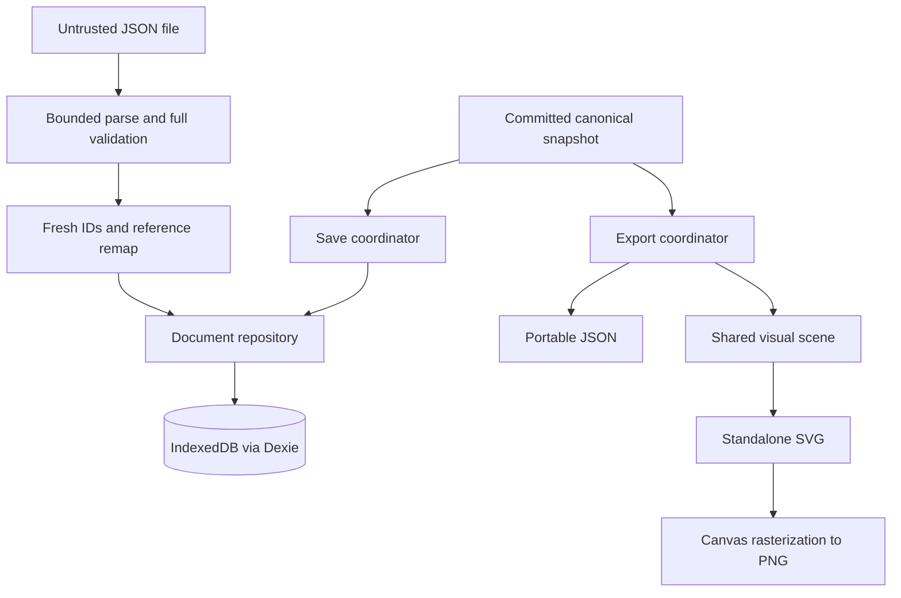
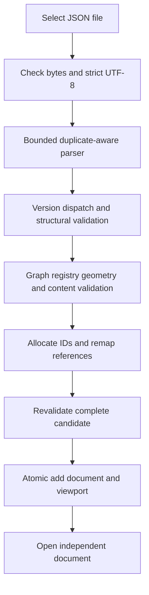

# DGS-08 — Document Persistence & Export Specification

## 1. Document control and purpose

| Field | Value |
|---|---|
| Project | Diagramming System |
| Reference | DGS-08 |
| Version | 0.1 |
| Date | 27 November 2026 |
| Status | Draft — pending technical validation |
| Parent specifications | DGS-01 through DGS-07 v0.1 |
| Release | V0.2 — MVP |
| Portable schema / initial DB schema | 1 / 1 (independent versions) |
| Audience | Developer, QA and Codex |

This specification defines browser persistence, document lifecycle, autosave, conflict detection, recovery, import/export and compatibility. It implements FR-01, FR-11, FR-12 and FR-13, supports FR-02/05–10/14/15, and contributes to AC-05–08 of DGS-01. All existing priorities remain unchanged. DGS-05 owns the portable envelope and graph validation; DGS-06 owns component scene and capabilities; DGS-07 owns interactions and command commit boundaries. This is a design contract, not production code or executed browser testing.

### Scope

Must: local document library, create/open/rename/duplicate/delete, committed snapshot autosave, restore on reload, revision-checked writes, stale-tab detection, failure feedback, independent JSON import and backup, complete standalone vector SVG and PNG output, two native starter templates. No cloud backup, sync, multi-user merges, authentication, encrypted vault, persistent undo history, remote assets, PDF, Mermaid, draw.io, batch export or arbitrary SVG import. Optional transparent export and higher-resolution controls are not release gates. The 100-node/150-edge reference workload remains; defensive resource ceilings are not performance promises.

## 2. Architectural contracts



Canonical graph is authoritative in memory during editing; the last committed database row is authoritative for reload. Temporary gestures, selection and property drafts are not saved. A storage failure does not invalidate a valid in-memory graph. Export always uses a captured current valid committed snapshot, never a fallback stale DB row. Save, import and export are separate workflows with independent status. Neither a download attempt nor a viewport update can mark content as saved. All operations run on the device; hosting serves assets only. Browser-only services initialize after hydration. No external request is needed for document content or rendering.

## 3. IndexedDB database and repository

Proposed DB name: `diagramming-system`, stable across compatible deployments on the same origin. Use Dexie with one read/write transaction per atomic repository action. Do not use localStorage for graph snapshots or maintain a redundant second authority. Initial logical schema:

```ts
// Illustrative Dexie declaration; validate against pinned package in SP-05.
db.version(1).stores({
  documents: 'id, updatedAt, category',
  viewports: 'documentId',
  preferences: 'key'
});
```

| Table | Key | Content |
|---|---|---|
| documents | id | DGS-05 StoredDocument: id, title, category, schemaVersion, createdAt, updatedAt, revision, content |
| viewports | documentId | DGS-05 StoredViewport: documentId, viewport {x,y,zoom} |
| preferences | key | Allowlisted local application preferences (initially panel collapsed states); not document graph |

Row metadata is projected from canonical content and must agree on read; it is not independently editable. `revision` starts at 1 and increments by 1 on each successful content update. It is a positive safe integer, never exported or restored by history. Exhaustion fails with a recoverable diagnostic. `schemaVersion` is the portable content version; Dexie version is storage structure. Dates use the DGS-05 UTC format and monotonic updatedAt guard. A viewport write does not update modified date, revision, history or content save indicator. Null viewport means absent view row. Preferences have explicit defaults and bounded validated fields; do not introduce generic arbitrary key/value imported data. Corrupt preference or viewport may be ignored with a warning and safe default; do not silently repair graph rows.

Suggested repository port (conceptual):

```ts
interface DocumentRepository {
  list(): Promise<DocumentSummary[]>;
  open(id: string): Promise<StoredDocumentWithView>;
  create(input: PortableDiagram): Promise<StoredDocument>;
  save(document: DiagramDocument, expectedRevision: number): Promise<StoredDocument>;
  remove(id: string, expectedRevision: number): Promise<void>;
  saveViewport(id: string, viewport: ViewportState): Promise<void>;
}
```

Return typed errors rather than raw browser exceptions to UI. Validate full snapshots before entering transaction; inside compare current row identity/revision and metadata invariants, then write; no network, font loading, file parsing or unrelated asynchronous work in transaction. Do not swallow a failed request within transaction. Await outer transaction completion, not just put/add success. Where supported, evaluate strict IndexedDB durability in the pinned adapter; successful transaction is browser-level commit, not a guarantee against power loss, eviction or storage clearing. Keep all browser DB access inside repository. Tests use injected DB names/clock/UUID provider; production never wipes an existing DB on init error.

## 4. Document lifecycle

| Operation | Precondition and atomic effect |
|---|---|
| List | Read summaries, descending updatedAt then ID tie-break; distinguish empty from unavailable/corrupt |
| Create blank | Validate title/category/settings; allocate fresh UUID, timestamps, empty graph; add row rev 1; no view row until needed |
| Create from template | Clone validated trusted native fixture; fresh document and all graph IDs, remap references; preserve relative geometry; rev 1 |
| Open | Read row and viewport together, validate content/metadata; start fresh history and generation counter; restore valid view or fit/default |
| Rename | Validate title; commit non-history content change and schedule save; library rename uses expected revision and transactional update; no change on no-op |
| Duplicate | Source is current valid committed graph in editor, or validated saved snapshot in library; regenerate document and all graph IDs; independent graph, rev 1 |
| Delete | Confirm named document, resolve active drafts and pending save, compare revision, remove row and view in same transaction; never resurrect |
| Import | Validate and remap before add-only transaction; navigate only after commit |

Creation, import and duplication must use `add`, not upsert. Collision fails atomically; generate new IDs and retry only with a bounded retry for a confirmed identity collision (proposed 2 retries). Original document remains unchanged. Copy title defaults to source title plus ` (copy)` with code-point-safe shortening to 120 characters; user can edit. Imported title may be retained, since title uniqueness is not required. Creation/import/copy timestamps use current local lifecycle UTC time, not source timestamps. Source graph ordering, styling, statuses, settings and viewport are retained (null viewport stays absent); graph references remapped in two passes. No geometry offset for whole-document copy. Copy/import fully validate again after remapping. Template fixture is never modified. Resolve navigation away from current document before writing a new document or opening it; failed creation leaves existing active state unchanged. Successful operation followed by navigation error reports that the new document exists and offers library navigation, not another blind write. No automatic duplicate from repeated clicks; disable pending submit.

On deletion cancel unsent saves and await already-running write to settle; if user elects to save first, flush current graph and use new expected revision. If user discards unsaved edits for deletion, discard only after confirmation; if delete fails, keep in-memory state. Cross-tab removal conflicts if revision changed or row absent. Library refresh re-reads rather than pretending operation succeeded. Never use automatic trash recovery in MVP; deletion is permanent and JSON backups are separate files. A delayed save must not recreate a removed row. A delayed viewport write checks existence in a transaction covering documents and viewports; no orphan row.

## 5. Autosave and revision protocol

Each editor session has document ID, session token, base DB revision, current content generation, saved generation, latest immutable committed snapshot, pending timer, in-flight capture, and error/conflict state. Generation increments for committed graph/metadata changes including undo/redo; no increment for selection, hover, cancelled gestures, viewport or no-op. New/open session starts from saved generation 0. At most one content write in flight per active document coordinator. Proposed trailing debounce 750 ms, max-wait 1,000 ms from first unsaved commit when idle and writable. If a write is in progress, retain only latest pending snapshot; begin next immediately after success when pending deadline passed. The deadline is a scheduling target, not a guarantee of physical persistence within one second (browser scheduling and I/O vary). Manual Retry/Save now and internal navigation flush bypass debounce.

```text
onCommit(snapshot):
  generation += 1
  latest = immutable snapshot
  mark dirty, schedule unless conflict/error paused
flush():
  if inFlight or no pending changes or paused: return
  capture = (sessionToken, docId, generation, latest, baseRevision)
  validate capture, then start one repository save
  on committed success:
    if session token differs: ignore UI completion
    else baseRevision = returnedRevision; savedGeneration = capture.generation
    if currentGeneration == savedGeneration: mark saved locally
    else mark dirty; schedule latest (immediate if due)
  on failure: keep latest and old base; pause auto-write; classify error
```

Core CAS contract:

```ts
// Pseudocode: actual types and API verified during implementation.
const saved = await db.transaction('rw', db.documents, async () => {
  const row = await db.documents.get(snapshot.id);
  if (!row || row.revision !== expectedRevision) throw new ConflictError();
  assertStoredRowMetadata(row);
  const revision = nextSafeRevision(row.revision);
  const candidate = projectStoredDocument(snapshot, revision);
  const count = await db.documents.update(row.id, candidate);
  if (count !== 1) throw new ConflictError();
  return candidate;
});
// Only here acknowledge the committed revision.
```

Full content validation occurs before transaction, and no update of another document is permitted. Guard pending timers and callbacks by session token and document ID. A late callback may not alter a newly opened session's history, revision or save status. Before abandoning a session, await in-flight write or explicitly block transition until outcome known; do not imply a running write can always be cancelled. On confirmed abort, retain old DB revision. For ambiguous outcome (connection lost), re-read row; if cannot prove ownership/revision of committed capture, treat as conflict and offer reload/copy. Never blindly increment local revision or force an overwrite. A transaction that successfully wrote an older generation advances base revision but cannot show saved for newer edits. New edits while error paused remain exportable; explicit retry captures latest, not original failed snapshot.

### Save state transitions

| State | Entry | Exit/action |
|---|---|---|
| Saved locally | Current generation equals last committed generation and no known conflict | Edit → unsaved; external change → conflict/stale |
| Unsaved changes | New committed edit | Timer/flush → saving |
| Saving | Capture in flight | Commit current → saved; commit older → unsaved; reject → failed/conflict |
| Save failed | Quota, denied access, transaction abort, validation or DB connection error | Retry after resolving cause, JSON backup, or discard with confirmation |
| Changes conflict | Expected revision mismatch, deleted row, or external change confirmed | Reload latest, save independent copy, JSON backup |

Show persistent text feedback and relevant actions. Do not display success before commit. A clean stale session can offer reload without prompting discard of nonexistent edits; never silently overwrite. User-visible save status applies to content, not best-effort viewport. Error reports are sanitized; no raw diagram content in console/telemetry.

## 6. Concurrent tabs, navigation and recovery

### Concurrent tabs

Multiple tabs may read/open documents, but simultaneous editing is unsupported. Atomic read/compare/update is the correctness mechanism even without BroadcastChannel. Optional same-origin BroadcastChannel conveys only document ID, revision and event (`created`, `updated`, `deleted`), not content; validate received message and re-read repository before treating it as authoritative. On focus/visibility return, check current row revision (and refresh list); ignore stale/out-of-order notices and own event. While save is in flight, reconcile notification with returned revision and re-read if necessary. Do not replace dirty graph automatically. If external update confirmed, pause writes and show conflict. If current row missing, do not recreate. Save as copy writes independent graph with fresh IDs and revision 1, then opens new session only after success. Reload latest requires confirmation if discarding pending edits; if deleted, return to library after resolution. No merge or force-overwrite action. A viewport-only update is best effort last writer wins for that view and never causes content conflict; before writing check document existence.

### Viewport and preferences

Persist valid viewport separately on settled pan/zoom (proposed 500 ms debounce); do not record every pointer event. Capture ID/session; check document existence, then put view atomically. Ignore or warn on failure without changing content save status. Use valid saved view as best effort across screen sizes; null/invalid view means fit if content exists, else 100% default origin. Fit respects DGS-07 zoom range. UI panel preferences are local only; invalid settings fall back visibly if relevant, never change diagram content. No reliance on a viewport write to save graph edits.

### Leaving and recovery

For internal navigation, resolve active draft (commit valid, discard explicitly; invalid draft blocks until corrected/discarded), cancel active pointer gesture, flush pending content and await outcome. If failed/conflict, offer stay/retry, backup, or explicitly discard unsaved changes. External close/reload: register beforeunload only while unsaved committed work, active dirty draft, or pending write; use browser-native prompt where supported. visibilitychange/pagehide can request best-effort save of committed work; do not promise asynchronous completion on unload. Restore last validated persisted revision on reload, fresh history. Changes never committed to IndexedDB may be lost on process crash. Show this in help and recovery UI. No crash journal or automatic version history in MVP.

| Failure | Recovery |
|---|---|
| Quota exceeded | Preserve memory; JSON backup; free browser storage carefully, retry |
| DB unavailable/permission denied | Preserve active graph; retry open or save; export current graph if present |
| Invalid/corrupt row | Preserve original; mark unavailable, offer raw diagnostic copy if safely serializable (not a native validated backup), restore from known-good JSON |
| Missing row / conflict | Reload or independent copy, never upsert |
| Browser data cleared / device lost | Restore from user's external JSON backup if available |
| Viewpoint corrupted | Reset view only; graph unaffected |
| Unexpected render failure | Error boundary offers valid committed JSON backup if accessible, or reopen last valid stored revision |

No automatic database deletion or corruption repair. An initial DB failure must not show empty library or claim creation succeeded. MVP does not provide a separate memory-only new-document mode; existing active valid graph remains exportable even if later storage fails. User can retry creation/import without partial rows. Warn that storage is origin/profile/device bound, private mode and eviction may remove data, and app is not guaranteed to launch offline. Optional navigator.storage.persist/estimate may be evaluated, not required and not proof against user clearing storage. Do not instruct clearing site data as routine recovery without verified backups.

## 7. Editable JSON export and import

### Format

Use exact DGS-05 `PortableDiagram` root with `document` and nullable `viewport`. No new fields, no registry payload, no session history, no DB revision, no renderer data. UTF-8, MIME `application/json`, `.json` extension. Use compact JSON as size authority (10 MiB = 10,485,760 bytes); pretty formatting may be offered only if resulting byte count fits. Do not drop fields, truncate text or modify geometry to fit. Empty graph is valid and exportable as JSON. Validate captured snapshot and view; if viewport cannot be validated use null only with explicit warning (do not silently discard unknown portable fields on import). Capture current valid view at export even if not persisted. No storage access necessary for editor export. JSON remains native backup; do not imply SVG can be reimported as native editable graph.

### Import pipeline



At any stage before write, rejection/cancel leaves all existing data untouched. Check raw File.size before reading, decode UTF-8 strictly (reject invalid sequences; accept optional initial UTF-8 BOM as encoding marker), enforce DGS-05 nesting limit 32, reject duplicate object keys and unsafe keys (`__proto__`, `constructor`, `prototype`) anywhere, before constructing unsafe objects. Do not claim native JSON.parse catches duplicate keys. Use bounded parser/preflight or vetted dependency; no regex-only parsing. File extension/MIME is a hint. Reject unknown fields, unsupported versions, invalid IDs, timestamps, numbers, colors, sizes, handles, status eligibility, cycles, dangling references, excessive counts/world bounds, text/containment failures and noncanonical unsupported style. Plain labels that resemble HTML remain inert text; no markup execution. No automatic correction of imported graph, no automatic snap. Structural schema alone insufficient; domain validation required. Cap diagnostics to 20 safe path/code messages; show additional issue count if available without unbounded work. Resource constraints from DGS-05: 1,000 nodes / 2,000 edges / 100 groups / eight group ancestors, geometry and serialized byte limits. Validate again after remap, then add-only write both row and initial view atomically. User cancellation permitted before write begins; during transaction show busy and resolve actual outcome rather than claiming cancellation. Imported source file remains unchanged. Invalid files are never persisted into native documents.

## 8. Visual export snapshot and bounds

Both visual formats consume the same DGS-06 scene/geometry and DGS-07 routes; do not screenshot the editor. Export commits a valid active text/property draft or asks user to cancel it; invalid draft blocks until resolved; ongoing pointer gesture cancelled. Capture one immutable content snapshot and export options; while generation runs, later edits do not affect captured output. No mutation of document, geometry, viewport, history or save state by export itself (a user-approved draft commit is a separate edit). Include visible node shape/stroke/icon/text/status, boundaries/title, paths, labels/label backgrounds, arrowheads and actual ink extents. Exclude transparent hit regions, empty invisible text annotations, editor grid, handles, ghost, selection, toolbar, minimap, menus, viewport translation and zoom. An empty boundary with visible title/outline is content; blank graph or only invisible objects yields NO_VISIBLE_CONTENT for visual formats, but JSON still valid. Background alone does not constitute content.

Use union of actual scene visual bounds, including stroke caps/joins and marker extents (conservative outward bounds acceptable; no clipping). Resolve parent-relative transforms to world; allow negative coordinates. Shared paint order follows DGS-06: boundary fills/strokes outer-to-inner, edges and arrowheads, node fills/icons/text/status, edge labels, group titles, then editor-only affordances (excluded from export). Preserve array order for same-layer ties. No independent export-specific stacking. Proposed padding 32 world units per side; default opaque white #FFFFFF. Optional transparent output only after parity tests; no background state stored in schema v1. Bounds algorithm:

```text
L = floor(minX - padding); T = floor(minY - padding)
R = ceil(maxX + padding); B = ceil(maxY + padding)
W = R - L; H = B - T
viewBox = L T W H
pixelWidth = ceil(W * requestedScale)
pixelHeight = ceil(H * requestedScale)
```

Finite positive values only. Example: bounds (-120.5,-40.25) to (780.2,420.75) → viewBox `-153 -73 966 526`; PNG at 2× → 1932 × 1052. White background rect uses exact viewBox geometry; no clipping due to viewport. Scene builder receives validated graph, trusted assets and measured text metrics. If path/text layout or required assets unavailable, fail visual export rather than substitute or silently omit. Independent viewers may substitute fonts: resolve local font metrics and explicitly set family, size and baseline positions; preserve line breaks via tspan; use no remote font. Test Arial/Liberation Sans fallbacks across target viewers. If parity fails, evaluate locally bundled licensed font or approved text-to-path strategy (tradeoff: searchability/accessibility, size); do not promise exact glyph parity until tested. JSON preserves labels regardless of SVG text strategy.

## 9. Standalone SVG generation

Mandatory native vector output, `image/svg+xml` UTF-8, `.svg`. Use controlled XML serializer from typed scene primitives, not `innerHTML`, DOM cloning, canvas screenshots, user-provided SVG or raw imported CSS. Root has SVG namespace, explicit width/height and valid viewBox. Output self-contained supported `svg`, `g`, `rect`, `ellipse`, `circle`, `path`, `line`, `polyline`, `polygon`, `text`, `tspan`, `title`, `desc`, safe local defs if needed. Use explicit allowlisted attributes, finite numeric geometry, hex colors/opacity, dash patterns, explicit text properties and trusted vector icon paths. Prefer explicit triangle arrowheads from shared scene, or deterministic locally referenced marker IDs if equivalent. IDs are generated safely, not label-derived. Escape XML text/attributes independently (`&`, `<`, `>`, quotes in attributes); preserve valid Unicode. Invalid XML 1.0 control characters or unpaired surrogates must cause clear visual export error if present, never be silently removed; review DGS-05 validation for future explicit compatibility refinement, without changing v1 here. No scripts, event attributes, `foreignObject`, remote href, external CSS, `@import`, user-controlled URLs, executable SVG assets or external font fetches. No raster image wrapped as SVG. Include trusted applicable icon attribution/license text in safe metadata/comments per licensing review; no user data in comments. Set title/desc from escaped document title or neutral descriptive text. Validate output XML in tests; parsing alone is not security validation, also inspect allowed tags/attributes/resources.

Proposed standalone SVG resource ceilings: width/height each <= 2,100,000 world units (above expected DGS-05 visual bounds); serialized UTF-8 <= 20 MiB; <= 100,000 emitted scene primitives/elements including text lines and icon paths. Count/size incrementally before unbounded assembly; independent limits protect memory; not a promise every valid graph exports visually. If exceeds limit, explain reducing complexity or use JSON. SVG size/geometry thresholds must be proven in SP-04; no automatic geometry scaling or clipping to force compliance.

## 10. PNG rasterization and resource budgets

Mandatory PNG output, `image/png`, `.png`. Use same SVG scene at explicit dimensions, local Blob URL and decoded image, Canvas 2D draw at requested output dimensions, then `toBlob('image/png')`. Ensure font readiness and asset availability before serialization; use same local scene text layout. No dependence on screen devicePixelRatio or editor zoom. For SVG images whose intrinsic dimensions exceed browser decoder limits, generate raster-only SVG wrapper with width/height set to target pixel dimensions and same viewBox, never change scene geometry. Verify image load/decode, context availability, nonzero size and non-null PNG Blob. If decode/raster fails, show error and offer SVG/JSON, or explicit lower scale retry. Do not silently lower scale. Release transient canvas backing store and image/object URLs on completion/error/cancel; keep download URL alive long enough for browser handoff (separate managed URL lifecycle). No direct filesystem write permission required. Native toBlob returns asynchronously and can fail; handle errors and null output. PNG cannot substitute for mandatory SVG.

| Proposed setting | Value |
|---|---:|
| Default PNG scale | 2× |
| Explicit lower-scale retry | 1× |
| Max width | 8,192 px |
| Max height | 8,192 px |
| Max area | 16,777,216 pixels (16 Mi pixels) |
| Nominal RGBA backing-store budget | 64 MiB at max area |
| Max generated PNG blob | 64 MiB (proposed defensive cap) |
| Concurrent visual exports | 1 per tab |

Apply dimensions AND total area checks before allocating canvas; multiplication safe, finite positive integers. Actual memory can be considerably higher (decoder, canvas, SVG, copies, encoded blob); browser capacity varies. These are conservative product ceilings, not universal browser maximums. Use image generation timeout/abort handling (proposed 30 s for decode/encode where feasible; native work may continue, ignore stale result and clean up after settlement). Single operation remains busy while non-cancellable resource work outstanding to avoid overlapping allocations. Check output type and size; no false successful export. Provide dimensions/scale preview and reason when blocked. If 2× invalid and 1× fits, offer explicit retry; if both fail, offer SVG and JSON. No tiling or partial-image export in MVP. Large valid graphs may be impossible to rasterize under caps; communicate limitation, not data corruption.

| World scene after padding | At 2× | Result under proposed caps |
|---|---|---|
| 1200 × 800 | 2400 × 1600 = 3,840,000 | Allowed by preflight |
| 2048 × 2048 | 4096 × 4096 = 16,777,216 | At pixel limit |
| 3000 × 2000 | 6000 × 4000 = 24,000,000 | Reject area; 1× fits |
| 5000 × 1000 | 10000 × 2000 = 20,000,000 | Reject width/area; 1× fits |

Preflight passing is not runtime success. Tests must simulate allocation/decode/null-blob errors and verify cleanup.

## 11. Export and import UX, filenames and diagnostics

Export dialog defaults to PNG, full scene, white background, scale 2×. JSON option identifies editable backup, SVG identifies scalable vector. Show derived width/height in world units and raster dimensions where applicable; not a screenshot preview requirement. Filename base defaults to document title. Trim and normalize separators/control characters, remove path separators and platform-reserved characters `<>:"/\\|?*`, strip trailing dots/spaces, avoid Windows reserved device names (CON, PRN, AUX, NUL, COM1–9, LPT1–9 including names before extension), limit base to 100 Unicode code points and a conservative UTF-8 byte length (proposed 200), fall back to `Untitled diagram`, append selected format exactly once. Filename is not document title mutation. Never accept a path or URL as download destination. Use Blob, URL.createObjectURL and browser download anchor with sanitized name; revoke URL after handoff (deferred cleanup, tested across Chrome/Edge), remove temporary elements. Browser controls actual destination and duplicate filename suffixes; report `Export ready / Download started`, not `Saved to disk` unless filesystem completion is actually known. A generated file is not proof user retained backup. Exports do not update document timestamps or save revision. Use no remote conversion API.

Import dialog shows selected filename, parse/validation progress, errors with safe paths and explicit create/open action if appropriate. Do not display raw markup from input. After successful transaction, new document title and category appear in library. Repeated imports intentionally create independent documents when user confirms; double-click within same operation does not create duplicates.

| Diagnostic | Meaning / action |
|---|---|
| DB_UNAVAILABLE / DB_BLOCKED | Storage inaccessible or upgrade blocked; close other tabs/retry, backup active content |
| SAVE_FAILED / QUOTA_EXCEEDED | Write not acknowledged; preserve active graph, retry or JSON backup |
| REVISION_CONFLICT / DOCUMENT_MISSING | Reload latest or save independent copy |
| CORRUPT_RECORD | Preserve stored record; recovery guidance, no auto-wipe |
| UNSUPPORTED_SCHEMA_VERSION | Use compatible app version, retain original file |
| IMPORT_TOO_LARGE / INVALID_ENCODING / INVALID_JSON | Choose supported file, correct source |
| INVALID_GRAPH / INVALID_CAPABILITY / CONTENT_DOES_NOT_FIT | DGS-05/06 typed details with bounded safe paths |
| NO_VISIBLE_CONTENT | Add visible objects or export JSON |
| EXPORT_LIMIT_EXCEEDED | Show measured dimensions/budget, offer lower scale if feasible or SVG/JSON |
| SCENE_UNAVAILABLE / INVALID_XML_TEXT | Preserve graph; explain rendering problem; JSON available when structurally valid |
| PNG_DECODE_FAILED / PNG_ENCODE_FAILED | Retry or use SVG/JSON |
| EXPORT_CANCELLED | No success claim; release resources |

Progress states for operations: idle, validating, generating/writing, ready/committed, failed, cancelled. Accessible live region for completed status/errors, not every percentage update. Busy state prevents duplicate export/import submissions. Use deterministic error codes and separate human-readable messages; log only bounded technical context, never complete user documents. Recovery action should always be reachable from error UI, including storage-disabled environment if active document exists.

## 12. Schema and database migration strategy

Separate portable version, IndexedDB schema version, storage revision and session generation. v1 is first and only supported portable version; no invented legacy migration. Version dispatch rejects unknown future/missing versions. Future import: validate historical envelope, execute pure sequential tested migrations, validate each result, then remap identities and add as new document. Preserve originals and semantic intent. Future local row migration: read validated old-format snapshot outside transaction, transform/validate, compare expected revision in update transaction, preserve document ID, bump storage revision. No in-place transformation of graph without validation. Stored row migrations can be lazy per document, separate from IndexedDB structure upgrade; list unsupported rows without presenting editable graph. Do not advance schema marker without successful migration. Preserve raw original on failure and offer compatible-version recovery. Future schema change requires golden fixtures, version compatibility matrix and explicit migration policy before deployment.

Dexie version upgrades are transactional; keep required historical upgrade definitions. In an upgrade transaction only execute bounded DB operations and synchronous transformations; don't perform network or arbitrary async work. If schema upgrade needs heavy validation, use separate revision-checked content migration after structural upgrade. On `versionchange`, stop new writes, close DB connection promptly (allow in-flight outcome to settle if feasible without blocking indefinitely), preserve dirty graph in memory and display reload/JSON backup message. On blocked upgrade, notify user to close/reload older tabs, no forced deletion. Test with real multiple browser tabs. Downgrade/rollback must not open higher DB schema as older format or reset data; show incompatible app/storage version and guide using compatible build. Deployment checklist: compatible migrations, backup notice for breaking upgrades, rollback compatibility explicitly documented. Origin changes (preview vs production, custom domain, HTTP vs HTTPS) require portable JSON transfer; no cross-origin storage promise.

## 13. Security, privacy and resource management

- All content parsing, scene creation, export and storage on device. Bundled assets only; no remote telemetry or automatic document transmission. Static hosting may still log asset requests. Do not equate local-first with encrypted at rest; browser profile access and same-origin scripts may read data. Use HTTPS, dependency lock/audit, restrictive CSP compatible with tested app and local Blob image pipeline; no raw HTML insertion, untrusted SVG or arbitrary CSS.
- Preserve DGS-05 strict graph/byte/nesting validation; verify import parser rejects duplicate keys before data mutation. Validate stored records and imported content as untrusted input. Avoid unsafe object merges, prototype pollution and unsafe file paths. Filename and labels are plain text, not markup.
- Keep one active export, one content save in flight per coordinator, bounded pending snapshots, no indefinite automatic retry. Release URLs/canvas buffers and drop obsolete immutable snapshots once no history or export uses them. Separate optional viewport writes from graph write state. Quota is variable; no fixed storage capacity claim. No auto-eviction of documents to free space.
- Exported files may contain sensitive IT architecture; communicate that users control destination and sharing. No user-level authorization or access control in MVP. License review of pinned Lucide geometry and standalone output notices remains required. No vendor logos or user-supplied images in v1.

## 14. Implementation structure and dependencies

```text
src/
  application/
    documents/document.service.ts
    session/save-coordinator.ts
    ports/document-repository.ts
    import-export/import.service.ts
    import-export/export.service.ts
  infrastructure/
    persistence/indexeddb/db.ts
    persistence/indexeddb/document.repository.ts
    persistence/indexeddb/viewport.repository.ts
    persistence/indexeddb/migrations.ts
    persistence/indexeddb/tab-events.ts
    export/json/portable-json.ts
    export/svg/svg-serializer.ts
    export/png/png-rasterizer.ts
    export/download.ts
  core/
    schemas/validation.ts
    geometry/bounds.ts
    scene/component-scene.ts
  features/
    editor/feedback/SaveIndicator.tsx
    editor/feedback/RecoveryBanner.tsx
    export/ImportDialog.tsx
    export/ExportDialog.tsx
tests/ (repository root, per DGS-03)
```

These are logical implementation targets, not mandatory empty modules. Reuse DGS-05 validator and DGS-06/07 shared scene/geometry instead of creating independent rules. Dexie/IndexedDB, native File/Blob/URL APIs, Canvas 2D and Zod; no added paid dependency. Bounded duplicate-aware JSON parser selection pending review. Build sequence: SP-05 repository create/save/delete and real tab CAS → save coordinator and navigation/recovery → validated import and JSON backup → SP-04 shared SVG primitives and PNG rasterization early (parallel with component spike) → complete export parity → migration/error/security tests. DGS-09 owns scheduling; DGS-10 defines final thresholds and CI/release evidence.

## 15. Acceptance scenarios and traceability

All below are proposed mandatory runtime checks (unless explicitly conditional); none executed against a production app. They supplement, not replace, DGS-02 AC-FR identifiers. Use deterministic fake clocks and injected storage failures in unit/integration tests; browser E2E with actual IndexedDB and actual Chrome/Edge for critical behavior. Validate graph equivalence after remap using mapping-aware comparisons, not raw ID equality.

| ID | Scenario and expected result | Trace |
|---|---|---|
| PE-01 | Create blank and each starter template; rev 1, valid independent IDs, correct list ordering | FR-01,15 |
| PE-02 | Reload validated document with nested groups, styling, status and saved viewport; graph identical, fresh history | FR-01,10,11 |
| PE-03 | Rename valid title then reject empty/oversize; no unintended history or revision on no-op | FR-01,11 |
| PE-04 | Duplicate active unsaved valid graph; independent all IDs, remapped parent/endpoints, source unchanged | FR-01,12 |
| PE-05 | Cancel delete; then confirm valid deletion; row and view removed atomically | FR-01 |
| PE-06 | Fail second create/import transaction write; no partial row/view or active state change | FR-01,12 |
| PE-07 | Rapid commits; coalesce latest pending generation, one in-flight write | FR-11 |
| PE-08 | Sustained edits with fake clock; max-wait schedules write even without idle pause | FR-11 |
| PE-09 | New edit during in-flight save; old success advances base but not saved badge | FR-11 |
| PE-10 | Undo/redo then save/reload; committed graph restored, no history/revision rewind | FR-10,11 |
| PE-11 | Inject quota/transaction abort; old row intact, current graph and JSON backup available | FR-11,12 |
| PE-12 | Retry after error and additional edits; saves latest valid graph only | FR-11 |
| PE-13 | Two tabs use same base revision; exactly one competing content write succeeds, stale tab conflicts | FR-11 |
| PE-14 | Remote deletion then pending save/view write; no resurrected row or orphan viewport | FR-01,11 |
| PE-15 | Stale delete after remote edit; reject and preserve newer row | FR-01,11 |
| PE-16 | Conflict save as copy / reload with discard confirmation; no overwrite and correct session | FR-11 |
| PE-17 | Disable tab notifications; CAS still prevents stale overwrite, focus refresh detects | FR-11 |
| PE-18 | Navigate while save pending; wait or resolve error; old callback cannot update new session | FR-01,11 |
| PE-19 | Reload after last acknowledged save; do not promise recovery of uncommitted work | FR-11 |
| PE-20 | View-only pan/zoom persistence changes neither content revision nor updatedAt/history | FR-02,11 |
| PE-21 | Corrupt viewport/preferences and corrupt graph separately; safe view fallback, graph not silently repaired | FR-11 |
| PE-22 | Storage init failure; show unavailable rather than empty library; no auto-reset | FR-01,11 |
| PE-23 | JSON export/reimport all fixtures incl. null viewport; graph equivalent after ID remap; empty document valid | FR-12 |
| PE-24 | Reject malformed UTF-8, duplicate keys, unsafe keys and oversize/deep JSON before persistence | FR-12 |
| PE-25 | Reject unsupported version, unknown fields, invalid geometry, cycles, dangling edges and invalid statuses | FR-12 |
| PE-26 | Cancel import before transaction; no write, no session mutation; duplicate submission prevented | FR-12 |
| PE-27 | Export current valid in-memory graph when DB unavailable; no stale snapshot substitution | FR-11,12,13 |
| PE-28 | Active gesture/draft at export; cancel gesture or resolve draft; captured snapshot stable during later edits | FR-12,13 |
| PE-29 | Export full negative-coordinate scene at different pan/zoom; identical geometry, all labels/markers/boundaries included | FR-13 |
| PE-30 | Verify SVG XML structure, explicit viewBox, vector primitives, safe escaping and no remote assets/scripts | FR-13 |
| PE-31 | SVG/PNG parity across all 29 component types, all edge modes, nested groups and statuses; no editor chrome | FR-13,04–09 |
| PE-32 | Plain labels with XML metacharacters/Unicode preserved as inert text; invalid XML characters handled explicitly | FR-05,12,13 |
| PE-33 | Empty graph/invisible-only scene rejects visual export; visible empty boundary allowed; JSON always valid | FR-13 |
| PE-34 | PNG default 2× dimensions, white background; same content independent of devicePixelRatio | FR-13 |
| PE-35 | Reject max width/height/area violations before allocation; explicit 1× fallback only if feasible | FR-13 |
| PE-36 | Simulate decode/context/null Blob/timeout failures; release resources, no false success | FR-13 |
| PE-37 | Filename sanitization across reserved characters/names, Unicode and long titles; correct extensions | FR-12,13 |
| PE-38 | Download handoff works in actual target browsers; no claim file retained on disk | FR-12,13 |
| PE-39 | DB blocked/versionchange and newer-version rollback; preserve data and dirty backup, no destructive recovery | FR-11 |
| PE-40 | Reference graph 100 nodes/150 edges; measure autosave, import/export time/memory and UI responsiveness on DGS-10 reference hardware | FR-11–13, NFR-02 |

Conditional checks if optional transparent background or persistent-storage request implemented: transparency survives PNG/SVG viewer output without affecting geometry; storage request denial is nonfatal and never changes backup messaging. Future migration test fixtures required when introducing actual v2, not invented legacy migration now.

### Release gates

All FR-01/11/12/13 mandatory AC-FR cases and applicable PE checks pass; all DGS-01 acceptance gates remain authoritative. SP-04 (standalone SVG/PNG) and SP-05 (local persistence and real concurrency) must pass before release. No critical/high-severity data loss, silent overwrite, invalid import, clipped reference export or false save confirmation defect. Visual acceptance requires independent viewer comparison and real-browser tests, not JSON schema validation alone. If a technical spike fails, document defect and decision; do not silently downgrade mandatory vector export or conflict safety.

## 16. Decision register and limitations

| ID | Proposed design decision | Validation |
|---|---|---|
| PX-01 | Stable DB name, three stores, snapshot row and separate viewport | SP-05 |
| PX-02 | 750ms debounce, 1s idle max-wait, 500ms view debounce | PE-07/08/20 |
| PX-03 | Transactional CAS, no overwrite or merge, add-only copies | SP-05 |
| PX-04 | Optional tab notifications, correctness independent of them | PE-13/17 |
| PX-05 | Last acknowledged stored snapshot only; no crash journal | PE-19 |
| PX-06 | Compact UTF-8 JSON, strict bounded parse, BOM accepted | PE-23/24 |
| PX-07 | Full visual scene, 32-unit padding and white background | SP-04 |
| PX-08 | Controlled SVG serializer, native vector scene, bounded output | SP-04 |
| PX-09 | PNG from SVG at 2×, 1× explicit fallback, 8192 edge/16 Mi pixel area | SP-04 |
| PX-10 | Browser handoff and safe filename; not proof of backup retention | PE-37/38 |
| PX-11 | Independent DB/portable migrations; no implicit wipe/downgrade | PE-39 |
| PX-12 | Invalid XML text diagnostic, future schema compatibility review | PE-32 |

These are draft engineering choices, not approved product requirements or measured browser ceilings. DGS-05 schema permits some strings XML 1.0 cannot represent; this specification explicitly reports visual export error and preserves JSON. Before MVP release, review whether to reject incompatible input at commit/schema boundary or adopt a documented lossless visual representation; no silent truncation or schema edit has been made in this task. Font portability, output notices, safe parser dependency, strict durability adapter support, canvas budgets and exact timeouts require prototype verification. No production TypeScript/React code, browser tests or benchmark results delivered. Existing DGS-01–07 files and fixtures remain unchanged. Next DGS-09 schedules the implementation and risk spikes; DGS-10 defines measurable release verification; DGS-11 covers future cloud/AI and interoperability.

## 17. Technical references

Official references consulted for API behavior on 27 November 2026. Exact pinned dependency APIs to verify during implementation.

- Dexie transaction scopes and commit behavior: https://dexie.org/docs/Dexie/Dexie.transaction%28%29
- Dexie transaction error guidance: https://dexie.org/docs/Tutorial/Best-Practices
- Dexie blocked upgrades: https://dexie.org/docs/Dexie/Dexie.on.blocked
- Dexie versionchange: https://dexie.org/docs/Dexie/Dexie.on.versionchange
- IndexedDB complete event: https://developer.mozilla.org/en-US/docs/Web/API/IDBTransaction/complete_event
- IndexedDB transaction durability options: https://developer.mozilla.org/en-US/docs/Web/API/IDBDatabase/transaction
- Browser storage quotas/eviction: https://developer.mozilla.org/en-US/docs/Web/API/Storage_API/Storage_quotas_and_eviction_criteria
- Canvas toBlob: https://developer.mozilla.org/en-US/docs/Web/API/HTMLCanvasElement/toBlob

## 18. Revision history

| Version | Date | Change |
|---|---|---|
| 0.1 | 27 November 2026 | Initial persistence/export contract, proposed budgets, recovery, migrations, 40 acceptance scenarios and traceability. |
