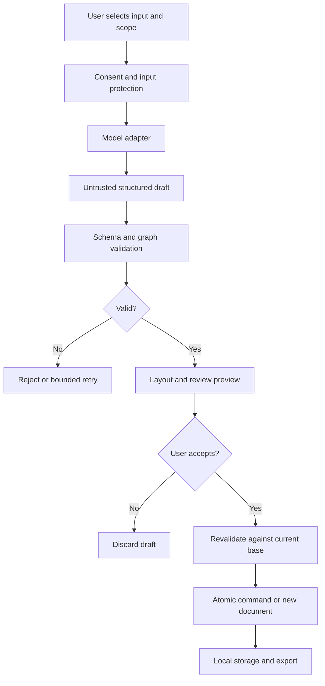
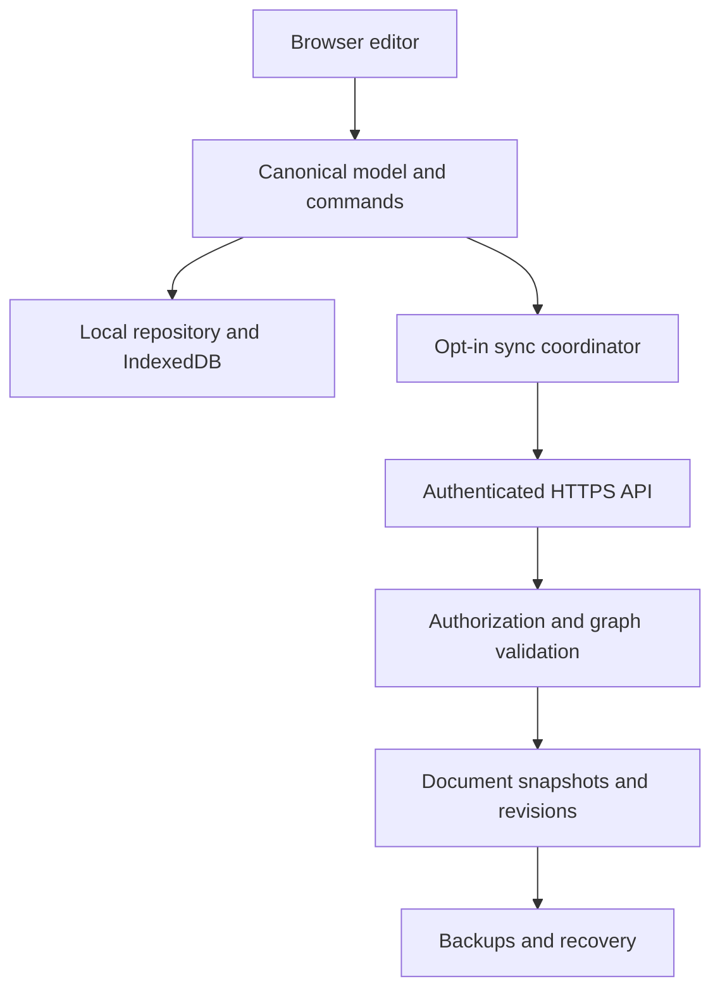

# DGS-11 — Future Features & Scalability Plan

| Document control | Value |
|---|---|
| Project | Diagramming System |
| ID | DGS-11 |
| Version | 0.1 |
| Date | 27 November 2026 |
| Status | Draft — future development reference |
| Baseline | DGS-01 through DGS-10 v0.1 |
| Target now | V0.2 — MVP |
| Owner | Product owner / developer |
| Classification | Product Evolution & Scalability Specification |

## 1. Purpose and scope protection

This is the final planned specification, not an authorization to implement post-MVP features. It establishes candidate releases, architectural evolution, security and compatibility principles, prioritization and exit gates. DGS-09 and DGS-10 remain the execution and verification authorities for V0.2. This document does not amend FR-01–19, schema v1, the registry, task register or acceptance register. The companion future-feature register is a separate backlog, not a new set of MVP tasks.

The initial system is a desktop-first, single-user, client-side modular monolith using Next.js, React Flow (conditional on spikes), TypeScript, Zustand, Zod and IndexedDB via Dexie. It must meet FR-01–15, eight NFRs, eight product acceptance gates, 205 mandatory scenarios, eight technical spikes and DGS-10 release gates. There are 13 conditional scenarios for optional scope. The existing 56 tasks and 13 phases are unchanged. The 29 built-in component types, two mandatory starter templates and JSON/SVG/PNG remain the baseline.

FR-16–18 retain Should priority; FR-19 retains Could. Their default scheduling is post-MVP, unless explicitly approved under change control. No account, server, cloud database, AI, billing, real-time sharing, mobile editing, freehand canvas, PDF or third-party format import is required for V0.2. Do not create placeholder server endpoints, empty sync layers, billing screens or speculative schema fields. A user must be able to use the local editor without remote document transmission. Cold offline start is not guaranteed by MVP; offline editing after application load is distinct from installable offline application support.

## 2. Product evolution strategy

Prioritize structured professional diagrams rather than attempting full parity with general design tools. Preserve one canonical graph, one shared scene, safe local storage, explicit user control and editable portability. Separate product version, schema version, DB version, registry compatibility and storage revision. Only add capabilities where evidence justifies the maintenance, UX, security and operating costs. Release labels are planning bands, not contractual promises, dates or exhaustive lists. V0.1 is an internal working-editor milestone in DGS-09; V0.2 is the first stable target. No feature in this document has been implemented or validated.

| Release | Theme | Entry conditions |
|---|---|---|
| V0.1 | Working editor | DGS-09 M2 (development only) |
| V0.2 | Local-first MVP | Existing DGS-10 gates and owner approval |
| V0.3 | Professional editing | V0.2 release evidence and profiling; independent feature approval. |
| V0.4 | Intelligent diagramming and interoperability | Stable canonical graph and version dispatcher; V0.3 baseline or explicitly compatible subset. |
| V0.5 | Connected workspace | Approved identity/data residency/security design, operational owner and cost budget. |
| V0.6 | Collaborative platform | Stable authorized repository and sync; invariant-safe concurrency prototype. |
| V1.0 | Commercial platform | Proven adoption, legal/operational readiness and separately approved billing. |
| Beyond V1.0 | Exploratory expansion | Evidence of demand and dedicated feasibility review. |

A release band is the earliest proposed target, not a dependency on every feature in earlier bands. Features may be postponed or split. Each included feature needs separate scoped requirements, acceptance cases, compatibility review and approved implementation tasks. Reuse DGS-10 severity policy and evidence requirements; future gates supplement rather than waive baseline regression tests.

## 3. Deferred feature register

IDs FF-01–28 are backlog references only. Dependencies listed are feature-level prerequisites in addition to a stable MVP and release entry conditions. Priorities marked Future are not DGS-02 Must/Should/Could changes. All items remain `deferred` and `not_run`. Scope, design and acceptance evidence in this table are candidate definitions.

| ID | Earliest band | Feature | Priority | Source | Dependencies | Scope / guardrail | Candidate exit evidence |
|---|---|---|---|---|---|---|---|
| FF-01 | V0.3 | Mini-map | Should | FR-16 | — | Viewport and graph overview with click-to-navigate; no content mutation. | Viewport navigation preserves graph and history; AC-FR-16-01 passes. |
| FF-02 | V0.3 | Alignment and distribution | Should | FR-16 | — | Align eligible siblings by edge/center; distribute at least three objects; reversible world-coordinate operation. | Mixed-parent constraints, graph validity and undo; AC-FR-16-02 passes. |
| FF-03 | V0.3 | Additional named style presets | Should | FR-16 | — | Apply compatible explicit properties only; preserve semantics and status. | One atomic transaction, unaffected fields retained; AC-FR-16-03 passes. |
| FF-04 | V0.3 | Automatic arrangement | Should | FR-17 | — | Explicit layout preview; evaluate ELK or alternatives; support only verified graph/group types. | No graph metadata loss, valid nesting, reversible layout; all FR-17 cases pass; license review. |
| FF-05 | V0.3 | Additional starter templates | Should | FR-18 | — | Software architecture, automation workflow, org chart and mind map starter templates. | Independent valid instances, save/reopen/export; all FR-18 cases pass. |
| FF-06 | V0.3 | Advanced connector editing | Future | DGS-02 FR-07 | — | Optional waypoints, endpoint-aware obstacle routing, label positioning; no mandatory auto-reroute on every edit. | Versioned geometry; path determinism and bounded failure; editor/export parity. |
| FF-07 | V0.3 | Extended metadata, search and reusable styles | Could | FR-19 | FF-03 | Owner/provider/environment/notes; library search; user style presets; explicit portable metadata extension. | Schema and migration approval, inert text, field preservation and applicable FR-19 cases. |
| FF-08 | V0.3 | Professional notation and icon packs | Future | DGS-02 FR-04 | — | Optional swimlanes, architecture packs and UML/BPMN-inspired shapes; no formal notation compliance claim. | Approved stable IDs, upstream licenses, render/anchor/export tests and no remote asset dependency. |
| FF-09 | V0.3 | Presentation output and themes | Future | DGS-04; DGS-08 | — | Optional transparent output, design themes and presentation view; evaluate dark UI separately from diagram style. | No hidden content or contrast regression; portable appearance and independent viewer tests. |
| FF-10 | V0.4 | Mermaid import and export | Future | DGS-08 | — | Support explicitly documented subset, mapping nodes/edges/styles; loss report for unsupported syntax. | Untrusted syntax inert; supported roundtrip semantic equivalence; explicit unsupported-feature handling. |
| FF-11 | V0.4 | PDF export | Future | DGS-08 | — | Single-page fit or paginated output with explicit paper sizes, margins and readable scaling. | Viewer validation, vector fidelity where supported, no crop, page/font license review. |
| FF-12 | V0.4 | AI text-to-diagram | Future | DGS-03; DGS-05 | — | Natural-language request produces untrusted structured draft graph, review before commit. | Invalid/refused/truncated output safe; model never writes directly; user-reviewed draft and cost limits. |
| FF-13 | V0.4 | AI document-to-diagram | Future | DGS-01 | FF-12 | Selected text or locally extracted supported document content, evidence links and unresolved assumptions. | Explicit upload/consent, no hidden transfers, extraction fidelity and prompt-injection regression tests. |
| FF-14 | V0.4 | AI code-to-architecture | Future | DGS-01 | FF-12 | Read selected source or repository snapshot, infer components and dependencies; no code execution. | Separate observed vs inferred links, scope/secret filtering, provenance and review before applying. |
| FF-15 | V0.4 | AI-assisted editing | Future | DGS-05 | FF-12 | Propose command batches or graph diffs for selected content; preview impact and ask user approval. | Validate against current base generation; stale proposal blocked; atomic undo and no unapproved mutation. |
| FF-16 | V0.4 | Draw.io interoperability | Future | DGS-08 | — | Feasibility review of limited mxGraph mappings; explicit unsupported feature reports. | Bounded XML parser without external entities, no scripts/remote assets, supported roundtrip tests. |
| FF-17 | V0.5 | Account identity and authorization | Future | DGS-03 | — | Optional sign-in; server-side authorization; secure account lifecycle and session handling. | Ownership enforced per request; session/CSRF tests as applicable; local mode remains usable. |
| FF-18 | V0.5 | Cloud document repository | Future | DGS-03 | FF-17 | Server-side validated snapshots, revision checks, owner access and export/delete controls. | Cross-account isolation, atomic revision writes, backup restore and operational monitoring. |
| FF-19 | V0.5 | Offline-aware synchronization | Future | DGS-03 | FF-18 | Explicit opt-in upload, durable outbox, retries, conflicts and deletion semantics; no automatic merge initially. | Offline/reconnect/race tests, no resurrection or lost work, account/origin isolation. |
| FF-20 | V0.5 | Document version history and recovery | Future | DGS-08 | FF-18 | Immutable revisions or checkpoints; restore creates new revision; retention policy and export. | Restore drill, retention/deletion behavior, permissions and revision integrity. |
| FF-21 | V0.5 | Offline installation and mobile viewing | Future | DGS-03; DGS-04 | — | Separate evaluation of service-worker shell, update handling and read-only responsive viewing. | Offline cold-load proof if advertised; update compatibility and no misleading mobile editing promise. |
| FF-22 | V0.6 | Team workspaces and permissions | Future | DGS-01 | FF-17, FF-18 | Membership/invitations, owner/editor/viewer roles and controlled sharing. | Authorization matrix, revocation, invite expiry and cross-tenant negative tests. |
| FF-23 | V0.6 | Real-time collaborative editing | Future | DGS-03 | FF-19, FF-22 | Evaluate CRDT vs server-authoritative operations; invariant-preserving concurrent transactions. | Convergence under network faults plus no invalid graph, per-user undo, reconnect/revocation tests. |
| FF-24 | V0.6 | Comments, review and presence | Future | DGS-01 | FF-22 | Document or node-linked comments, resolved threads and ephemeral presence. | Permission checks, anchor deletion behavior, bounded presence and accessible review. |
| FF-25 | V1.0 | Subscriptions and entitlements | Future | DGS-01 | FF-22 | Provider-based billing, server-side entitlements, idempotent webhook processing and cancellation. | Sandbox billing lifecycle and permission tests; export/recovery after plan change; owner approval. |
| FF-26 | V1.0 | Organization governance and audit | Future | DGS-01 | FF-22 | Workspace administration, content-safe audit records, retention and account deletion; SSO evaluation. | Isolation, revocation and audit integrity; jurisdiction/privacy review before launch. |
| FF-27 | V1.0 | Production operations and scaling | Future | DGS-03 | FF-18, FF-19 | Defined SLOs, load tests, backups, restore drills, alerting and incident response. | Measured load capacity and approved RPO/RTO; tested rollback, restore, privacy and cost guardrails. |
| FF-28 | Beyond V1.0 | Advanced whiteboard and mobile editing | Future | DGS-01; DGS-04 | — | Freehand, image embedding, rotation, touch/stylus, richer canvas objects; evaluate renderer fit before commitment. | Separate product scope, interaction/security tests, migrations and export compatibility. |

## 4. V0.3 — Professional editing

Start with high-value improvements that require no new infrastructure. Review the four deferred DGS-02 requirements before introducing more features. FF-01 mini-map is viewport-only; no undo or content revisions. FF-02 alignment/distribution operates on eligible same-parent objects or a separately reviewed mixed-parent algorithm; use canonical bounds, not screen pixels. FF-03 presets apply explicit compatible fields, not semantic identifiers, manual status or unrelated settings. FF-04 auto layout builds a candidate graph from an immutable snapshot and applies only after preview and valid command commit. Keep IDs, labels, styles, statuses and membership intact; preserve edges; calculate nested world/local positions and containment. Reject unsupported hierarchy without partial changes. Compare layout engines and exact package licensing during a spike; do not install an optional engine now. Layout runs outside the pointer-critical path; move expensive computations to a worker only if profiling justifies it. Stale layout results are discarded or regenerated against the current document generation.

FF-05 templates use existing native format and independent ID mapping; distinguish illustrative organization charts/mind maps from new semantic node families. FF-06 waypoints require versioned persisted geometry and valid anchor semantics; routes must remain finite under move/resize and all visual extents must participate in exports. A bounded fallback route is preferable to a hung editor. No promise of perfect global obstacle avoidance. FF-07 metadata requires approval of a new schema or explicit supported extension; never stuff arbitrary `data` into strict v1. Search must not upload diagram text. Preset storage is application configuration, not implicit mutation of existing documents. FF-08 icon packs must be locally trusted and versioned, with attribution/license inventory; vendor brand logos are not automatically approved for redistribution. Formal BPMN/UML correctness, simulation or execution requires a later dedicated specification. FF-09 theme changes must not recolor a user's saved diagrams merely because the app theme changes. Transparent export and presentation mode need clear background and contrast rules.

Release gate candidate: all applicable FR-16–19 cases pass, core regressions pass, schema migrations/asset licenses reviewed where applicable, no S1/S2 defects; usability pilot verifies added controls do not degrade the basic creation workflow. Use actual demand and prototype results to choose a smaller release if necessary.

## 5. V0.4 — AI-assisted diagramming and interoperability

### 5.1 AI product scope

The initial AI workflow is draft generation from a natural language description. It produces structured canonical graph data, not an image, executable workflow, raw HTML/SVG or a React Flow object dump. Documents and code are later input adapters. Natural-language editing is a proposed graph diff or command batch, not unbounded autonomous changes. The user retains final control over content, labels, inferred relationships and architecture statuses. No live service health, business facts or verified dependency claims should be inferred solely from model text.

Candidate pipeline:

The draft may contain local symbolic references which are validated and mapped to application-issued UUIDs before creating a native document. Do not trust provider-issued IDs, status values, file paths, URLs or arbitrary output fields. Apply registry capabilities, graph invariants, size limits, label fit and containment. For new diagrams, issue fresh document and graph IDs; for edits, preserve existing IDs and compare base generation to the current document. A proposal cannot commit if the user has changed the underlying document; show a stale state and require regeneration or explicit review of a validated rebase. Apply one atomic command and one undo entry. If any validation fails, preserve the original graph. Model failures, timeouts, refusals or truncated JSON do not modify anything.

### 5.2 Evidence and review

For document and code ingestion, distinguish user-provided facts, extracted facts, inferred relationships and assumptions. Where feasible, link extracted evidence to a source location (page/section/line) in the proposal review data; no unverified source links. Native schema v1 does not have provenance fields; keep the proposal evidence outside v1 or approve a versioned extension. Present missing information as a question or unknown, not an invented service. Architecture implementation status defaults to not_specified unless explicitly supplied or approved. Permit user to change the diagram before committing. A generated architecture is a documentation aid, not a security audit or verified deployment.

### 5.3 Provider, privacy and resource boundaries

Choose model providers only after an evaluation of structured-output support, data terms, cost, latency, regional processing and licensing. Hosted AI may require a minimal authenticated server-side proxy even while documents remain local. Never expose a provider secret in the client bundle. An optional local model adapter may be evaluated independently; no unsupported claim of offline generation or hardware compatibility. The model adapter must not receive automatic access to all local diagrams, files or repositories. Show what data is being sent, provider/processing context and applicable retention notice; obtain explicit action for each generation or clearly scoped session. Local-only editing remains available. Avoid storing raw prompts/content in logs; protect model credentials; enforce authenticated rate/budget limits at server if hosted. Reject unsupported inputs, cap bytes/tokens/pages/requests, use timeout/cancellation, bounded retries, explicit error states and usage estimates or hard budget caps before paid calls. Avoid duplicate paid requests through request identity and bounded retry policies. No automatic spending authorization from this plan.

Treat every document/code snippet as untrusted data: embedded instructions cannot grant permissions, change system behavior, request secrets or trigger tools. Model has no arbitrary shell, browser, network fetch, file-write or deployment privileges for generation. Do not execute source code or macros. Extract locally where feasible, allow user to inspect selected input and redact secrets; repo ingestion requires explicit scoped authorization, least privilege, no full-repo upload by default, and no retention beyond the approved purpose. Attachment/file parsers need size, recursion and decompression limits. Apply output validation independently of model claims. If hosted, establish abuse protection, privacy review, and provider contracts before launch.

### 5.4 Model evaluation

Create a consented/synthetic evaluation corpus with process, architecture, ambiguous and adversarial prompts. Proposed initial pilot: at least 30 cases across three input classes, record invalid output rate, schema-valid draft rate, human-assessed semantic accuracy/completeness, unsupported factual claims, review effort, latency, cost and refusal/timeout behavior. A valid graph is not evidence of factual accuracy. Set quality thresholds after baseline measurements; any invalid mutation or unapproved transfer is a blocker regardless of model score. Regression corpus includes prompt injection, malicious strings, wrong handles, excessive counts, circular parents and stale proposals. Track model/version/configuration and test evidence without sensitive input. Do not promise accuracy or fixed generation latency before testing.

### 5.5 Interchange adapters

Mermaid input/output begins with a documented supported flowchart subset. Parse to a bounded intermediate representation, then map to registry nodes/edges and native schema. Disable executable directives, raw HTML and unsafe links; do not render arbitrary untrusted Mermaid configuration. Explicitly report unsupported notation and lost style/layout information. Require user acceptance before lossy conversion; never overwrite the original source. Roundtrip equivalence applies only to documented supported semantics, not pixel-perfect fidelity. Draw.io/MXGraph import is a separate feasibility item with bounded XML parser, external entities/DTD disabled, no remote resource retrieval, limits on compressed input, and transparent unsupported field mapping. SVG and PNG remain visual outputs, not reliable native graph import formats. PDF uses shared scene with explicit page sizing, margins and readable scaling; test independent viewers and font rights. Do not confuse editable JSON with exported PDF/SVG. Add adapters outside core; format-specific mapping should not become canonical field names.

Release gate candidate: AI safe draft review and evaluation approved, privacy/budget/provider review complete, interoperability supported-subset fixtures pass, no mandatory regressions, no S1/S2. Individual features can ship independently after approval, without requiring AI or every file format.

## 6. V0.5 — Accounts, cloud persistence and sync

### 6.1 Architecture evolution

Cloud mode is opt-in, not an automatic conversion of local documents. Introduce a server only when a product need requires it (hosted AI proxy may precede full cloud). Keep the same domain contracts on both client and server, with independent server enforcement and no reliance on trusted client validation. Evaluate a small modular backend (e.g. Next.js server deployment/API or NestJS), managed relational database (e.g. PostgreSQL), and object storage for approved large assets/backups only when needed. These are candidate options, not final vendor selections or MVP dependencies. A Next.js static export cannot itself host a runtime API; choose a compatible hosting topology when cloud is approved. No need for microservices, message broker or distributed database at initial cloud scale.

### 6.2 Identity and data model candidates

Keep account/workspace identity distinct from portable document identity. A portable import must not confer server ownership. Proposed server records: accounts (identity provider subject), workspaces (owner/tenant), memberships (roles), documents (server ID, workspace ID, canonical payload, schema version, current revision), revisions (immutable snapshot or recoverable checkpoint), deletion markers (versioned tombstone), and optional operation/idempotency records. Index tenant-scoped document listings and revision lookups; use transactional unique constraints and row/repository authorization checks. No billing or membership attributes in portable schema v1. Local IndexedDB namespaces/mappings distinguish local-only, cloud account and server IDs; switching accounts must not expose prior account's private cloud cache. The account deletion/retention UX must distinguish remote and local copies. Never upload existing local documents merely because a person signs in; offer explicit import/upload as copy, show scope and confirm.

Authentication mechanism, cookies/tokens, CSRF protections where relevant, origin policy, session renewal, password reset/account recovery, rate limiting and account deletion are separate security design decisions. Prefer established identity services over inventing credential handling. On every API request, authorize access to the actual tenant and document; never rely on unguessable UUIDs or role claims sent by clients. Limit request size and validate graph server-side. Use HTTPS, secret management, encrypted transport and evaluate storage encryption/backup access and data residency before using actual customer documents. Avoid sensitive content logs. User-visible privacy policy and export/deletion process required before public cloud use.

### 6.3 Sync protocol and conflict handling

Local save and cloud sync are separate states. `Saved locally` does not mean remotely stored. Use a durable outbox with document identity, base server revision, immutable snapshot or approved operation, idempotency key and sequence. Persist local content and its outbox entry atomically when cloud mode is enabled. Serialize writes per document; retries replay the same key and payload. Server compares expected revision and authorization inside the transaction, commits new snapshot/revision/idempotency result, and responds with the committed revision. A lost response must not cause a second logical write. An ACK applies only to the relevant generation; subsequent edits remain pending. On reconnect, check authorization and server version; if divergent, preserve both versions and offer explicit reload or save copy. No silent last-write-wins, automatic rebase or merge in the first cloud version. A local tab conflict still uses local revision checking; it is not replaced by sync.

Use deletion markers to prevent stale offline clients resurrecting deleted documents. Conflict recovery preserves unsynced local content via explicit independent copy/JSON, subject to account policy; do not recreate the deleted server object implicitly. Define tombstone/idempotency retention from supported offline horizon; if an older client falls outside the window, require full resync and explicit recovery. Re-authentication failures pause sending without discarding pending edits. Revocation prevents further server reads/writes; a previously downloaded offline copy cannot be remotely erased by promise. Distinguish local-only, queued, syncing, synced, offline, conflict, unauthorized and failed states. Logout must warn about unsynced work, prevent cross-account transmission, and respect local data clearing choices. No claim of simultaneous multi-user collaboration.

### 6.4 Version history and backup

Version restore is a new revision, not a rollback of monotonic revision numbers. Define retention tiers and quotas only after measuring document sizes, write frequency and cost. Keep JSON export available as user-controlled backup. Database snapshots, point-in-time restore where appropriate and object backups require independent restore tests; backup success alone is not recovery evidence. Establish approved RPO/RTO, encrypted backup access, retention and deletion policies, incident owner and recovery playbook before public launch. Candidate starting objectives for evaluation: RPO 24 hours, RTO 4 hours for service-wide recovery; neither is a promise nor acceptable substitute for confirmed per-document sync durability. Improve these if actual use demands it.

FF-21 offline installation/mobile viewing is separately gated: service-worker update must preserve schema compatibility, not cache sensitive cloud responses across accounts, and allow safe update/reload. Mobile viewing does not imply touch editing. Local-first behavior and access to JSON backups must survive loss of internet service.

Release gate candidate: two-device sync/reconnect, concurrent revisions, lost acknowledgement, deletion and account switch tests pass; authorization isolation and backup restore evidenced; cost and privacy controls approved; baseline local workflow remains supported.

## 7. V0.6 — Collaboration, shared workspaces and reviews

Collaboration is a separate architectural problem, not simply opening a WebSocket or adding a database listener. First establish server-side authorization and reliable cloud sync. Define tenant roles (owner, editor, viewer; optional commenter only if separately approved) and granular resource actions. Invitations expire, use scoped random tokens, and cannot escalate roles. Sharing defaults private. Explicit public links, if ever supported, require revocation, scope, access expiry and separate policy. Permissions checked at connection establishment and on each operation; enforce revocation for active sessions. No cross-tenant search, subscriptions, exports or presence.

Evaluate two approaches in a technical spike: a server-authoritative operation log with deterministic ordering/conflict rules, versus a CRDT-based replicated model (candidate Yjs or alternatives, not selected). Compare convergence, offline semantics, validation, schema migration, history, payload/operational cost and library terms. Neither model automatically preserves graph invariants. Define how concurrent deletion and connection creation, competing reparent operations, cycles, duplicate edges, group expansion and text edits are resolved deterministically. Do not accept arbitrary field-level merges into the canonical valid graph. Prefer a transaction design that preserves or rejects a complete operation and has a deterministic, user-visible recovery rule; if a CRDT proposal cannot maintain convergence and validity together, change the representation/protocol or do not release it. Do not mix snapshot sync and live operation streams as independent authoritative writers.

Candidate operation envelope includes protocol version, document/workspace identity, operation ID, author/session identity, base/order or causal context, validated command payload and server acknowledgement. Server derives actor from authenticated session. Bounded payloads, deduplication, backpressure, retry, reconnect/resync, snapshot checkpoints and compaction must be designed together. Durable graph edits are separate from ephemeral cursor/selection presence; do not persist every mouse movement. Presence has bounded TTL/rate and no hidden tracking. Collaborative undo is scoped to the user's own accepted operations or semantic compensation; must not blindly replace another user's changes with an old full snapshot. Document history remains available as separate reviewed restore action. Use clear conflict/rejected-op messages. Establish client compatibility negotiation before joining a live session; older incompatible writers must not erase unknown fields.

Comments/reviews are separate entities with document/node anchor and author, timestamps, thread/resolved state and permissions. Define what happens when an anchor is deleted (e.g. preserve thread as orphaned review with clear indication). No content execution in comments. Presence and comments must be accessible. Document permissions and retention apply to any captured preview and audit event. Public or anonymous sharing deferred unless approved.

Prototype workload candidate: three simultaneous editors on reference graph, duplicate/delayed/reordered messages, partitions/reconnect, conflicting group and edge changes, revoked role mid-session and concurrent undo. After quiescence, all authorized replicas must agree on valid semantic graph and no accepted nonconflicting work lost; compare normalized content, not transient viewport or presence. Document rejection outcomes and convergence rules. Proposed first load study: 2, 5 and 10 concurrent editors per document, with measured latency and error rate, not a supported limit until measured. Release only after convergence, graph validity, authorization and recovery evidence. Avoid premature distributed service decomposition.

## 8. V1.0 — Commercial platform and governance

Commercialization depends on product usage, feedback, support capacity, security and operating budget, not only feature count. Keep free local editing and editable JSON portability as proposed product principles; do not promise permanent free cloud storage or unlimited AI. Candidate plans: local/free, professional (advanced tools/limited cloud or AI), team (collaboration/admin); actual entitlements, prices, currencies, regions and limits require owner approval and market validation. No payment provider selected or paid account created.

Server-side entitlement checks must be authoritative for cloud/AI services. Billing provider integration requires sandbox tests, verified signed webhooks, idempotent event handling, out-of-order event handling and reconciliation, cancellation/refund rules, grace-period policy and explicit confirmation of upgrade costs. Do not store payment card details in application. Plan downgrade must not silently delete diagrams; provide read/export and clearly communicated retention/cleanup policy. Local editor should not depend on a payment check for existing local documents. Account and organization lifecycle, team transfers, permission escalation, audit and incident procedures require negative tests. Legal review: terms, privacy, data processing and retention, tax/payment rules and jurisdiction, accessibility claims, dependency/assets licensing. This document is not legal/compliance certification.

Production operations include an owner for incidents, status/maintenance communication, alerting, secrets rotation, patching, vulnerability response, tenant-aware support tooling, backups/restore, release rollback, schema compatibility and tested account deletion. Establish realistic SLOs using observed traffic, a documented load model and costs. Candidate service metrics: API success rate and latency, sync queue age, conflict rate, backup restore success, job error rate, collaborative convergence/reconnect time, cost per active workspace and AI cost per successful accepted draft. No production telemetry without explicit data-minimization and privacy approval. Separate anonymous aggregate operational measurements from diagram content and avoid cross-tenant exposure in support logs. SSO, enterprise governance, advanced auditing and retention policies are separate scope proposals, not mandatory for V1.0 unless validated by customer needs.

## 9. Scalability strategy and measurable experiments

Scalability includes graph size, interactive responsiveness, storage, concurrent operations and operating cost; user count alone is insufficient. Maintain DGS-10's baseline reference workload (100 nodes, 150 edges, two nested boundaries) and PF-01–09 release checks on recorded desktop/browser environments. DGS-05 defensive document caps (1,000 nodes, 2,000 edges, 100 groups, depth 8, 10 MiB JSON) and DGS-08 raster caps are not guarantees of smooth editing or export. No future cap increase without profiling, security review and migration/compatibility checks. Benchmark synthetic data, never actual confidential architecture by default.

| Dimension | Candidate experiment | Evidence / trigger for action |
|---|---|---|
| Editor | 100/150 baseline; 250/400, 500/750, 1000/2000 stress graphs within valid caps | p50/p95 frame intervals and command latency, long tasks, heap, save/export times; compare baseline regression |
| Geometry | Nested groups, dense connectors, multiline labels, offscreen elements | Profile route recomputation, scene construction, text layout and bounding calculations |
| Storage | Increasing snapshot sizes, 50+ history edits, injected quota and abort | Write latency, bytes, recovery, memory growth; preserve DGS-08 atomicity |
| Export | Full scene SVG and PNG at 1x/2x within limits | Allocation and encoding failure handling; no silent quality change |
| AI | Synthetic 30+ prompts, bounded concurrent requests | Semantic review, invalid outputs, per-draft latency/cost, refusal and privacy tests |
| Cloud | Pilot 10/50/100 concurrent active sessions, mix of reads and saves | API p95, errors, DB lock/connection saturation, throughput and cost per active user |
| Collaboration | 2/5/10 editors per shared document, fault injection | Convergence, ack latency, queue size, dropped presence and invalid operations |

These workload sizes are proposed experiments, not capacities, service guarantees or release promises. Use deterministic generators and record versions, build, hardware, sample counts, data sizes and power/network configuration. DGS-10 thresholds govern MVP, not newly invented future latency gates. For subsequent releases approve performance budgets before testing. Investigate any baseline regression above agreed tolerance; no waiver of mandatory tests. Profile before optimizing: selectors/memoized projection, affected-edge recalculation, scene caching, offscreen virtualization when safe, bounded history and background workers for expensive layout/import/export. Ensure offscreen virtualization never changes canonical/export content or keyboard access. Use cancellation or generation stamps for asynchronous work; do not commit stale outputs. Maintain document-level queues and coalescing; no persistent pointer events. Only introduce spatial indexes, incremental diff storage or workers when measured bottlenecks justify complexity.

Server evolution: start with a modular service and indexed tenant-scoped relational records; measure query latency and connections; then add connection pooling, bounded queues or worker jobs if needed. Cache only safe data with tenant/version-aware keys and invalidation. Job queue (if introduced) is not a new graph authority; job identity, retry/timeout, cancellation and resource quotas are explicit. Scale horizontally only when load measurements show benefit, and design shared coordination before scaling stateful live sessions. Object storage handles large assets/checkpoints only under approved content/retention policy. No sharding, Kubernetes, distributed event bus or multi-region writes by default. Reevaluate if operational evidence demands them.

## 10. Compatibility and migration strategy

Keep schema v1 strict; unknown fields/unsupported versions must not be silently dropped. Add schema v2 only for an approved incompatible change (e.g., metadata, waypoints, new required semantics). Define a versioned registry manifest when component IDs/anchor semantics/geometry change. Existing semantic IDs never reused for a different meaning. A change that modifies legacy appearance requires explicit migration or retained compatible renderer; do not silently restyle saved diagrams with new defaults. Preserve coordinates, group membership, edges, labels, statuses, IDs and intended appearance. Add version dispatcher with bounded migrations per DGS-05 and schema/Zod parity fixtures. Validate source version, migrate through known steps, validate each, and commit only after final validation; maintain source backup on failure. Imported docs receive new IDs after migration; in-place saved migrations preserve identity and monotonic storage revision. Database upgrades are distinct from portable format changes. Do not downgrade by discarding fields; explicit lossy format export if approved, with disclosure and original retained. Old clients must reject unsupported versions or become read-only; mixed cloud writers require protocol negotiation. Test N-1 upgrade and all supported historical versions, unknown future versions, corrupt/partially migrated records, interrupted migrations, and rollback/forward-fix. No destructive DB resets.

Compatibility decision already outstanding from DGS-08/10: v1 JSON can contain characters not directly expressible in XML 1.0. Resolve before MVP release through approved canonical validation or explicitly defined reversible export-safe handling; do not quietly remove user text, waive vector export or leave this to V0.4. Include malformed Unicode and XML control-character fixtures. DGS-10 adds candidate UX-05 task links not present explicitly in DGS-09; reconcile in consolidated review. The RG-09 pilot disposition wording must be reconciled with the mandatory NFR-01 target before release; an approved disposition cannot silently waive a required acceptance criterion. These are existing baseline review items, not future feature dependencies.

## 11. Security, privacy and data governance by stage

| Stage | Minimum additional review |
|---|---|
| V0.2 | Existing local-only privacy, import/export protection, dependencies and recovery (DGS-08/10) |
| V0.3 | New geometry/parser/asset inputs, local font and icon licensing, rendering resource limits |
| V0.4 | Consent and data disclosure, hosted secret isolation, prompt injection, bounded parsers, AI usage/cost policy |
| V0.5 | Identity, authorization, tenant separation, retention, cloud deletion, encryption, restore drills |
| V0.6 | Permission changes mid-session, concurrent operation integrity, share/revocation, presence/comment privacy |
| V1.0 | Billing/webhook security, governance, audit, support access, incident response and legal readiness |

Separate local-only processing from optional hosted processing in the UI and architecture. Do not describe browser storage as application-encrypted or guarantee device-loss protection. Cloud/local data may contain confidential IT architecture, network details and operational notes; default to minimal collection and controlled access. Keep synthetic data for development/test. Never send private diagrams to model providers, analytics, error reporters or public links without authorized purpose and clear user controls. Log event identifiers and aggregate metrics, not graph content/secrets by default. Threat-model each new trust boundary; use secure dependency review with exact pinned versions and explicit asset notices. Any confirmed data loss, authorization bypass or silent overwrite blocks applicable release. Protect recovery copies under the same permissions as primary documents.

## 12. Prioritization and financial planning

Review backlog after actual MVP use. Candidate scoring dimensions (1–5 each): user value, frequency, strategic fit, risk reduction, effort and operational burden. A simple proposed heuristic is (value + frequency + fit + risk reduction) / (effort + burden); do not score hypothetical demand as measured. Safety/compatibility/mandatory defects take precedence over numerical scores. Record evidence source, owner, rationale, dependencies, estimated effort range and approval. No scores, launch dates or costs assigned before evidence. Prefer FF-01–05 first because they enhance the core editor without requiring accounts/cloud. AI can precede cloud if an approved safe adapter exists. Full collaboration waits for identity, storage and sync. Freehand/mobile editing/other broad design capabilities require a separate product decision (not a forced V1.0 requirement).

Cost model for planning, not a quote: monthly fixed hosting/database/monitoring + storage/backup usage + bandwidth/egress + compute/worker usage + AI request/token cost + payment fees + support/maintenance. For AI, estimate requests x average input/output token counts x verified per-unit rates, plus retries and extraction compute. For cloud, track active users, documents per user, average bytes, revisions retained, read/write rate and backup copies. Estimate retained storage from snapshots/revisions and overhead; use measured compression only if verified. Set budget caps and per-tenant quotas; forecast low/base/high from observed usage. Confirm provider prices, license terms and commercial hosting eligibility at selection time. No vendor, price, spend or revenue guarantee is approved by DGS-11. Do not add paid dependencies in Phase 00 without explicit authorization.

## 13. Future release gates and change control

| Gate | Required evidence |
|---|---|
| FG-01 | Approved scope and owner; explicit deferrals; dependency and compatibility assessment |
| FG-02 | Existing applicable mandatory regression suite and new feature-specific acceptance cases pass |
| FG-03 | Schema/registry/DB/protocol migrations and rollback/forward-fix tested where relevant |
| FG-04 | Security/privacy threat model, license review and no unresolved S1/S2 or mandatory failure |
| FG-05 | Measured performance/load and resource/cost limits approved; no unreviewed baseline regression |
| FG-06 | Usability/accessibility/independent export verification for changed workflows |
| FG-07 | Operational readiness, recovery, support and release approval appropriate to the new trust boundary |

All seven gates are future candidate gates, not replacements for RG-01–10. At each release define applicability, exact thresholds and evidence before implementation. Change request records feature ID, user problem, acceptance criteria, compatibility, affected FR/NFR/AC/BR/ADR IDs, target version, dependencies, tasks, tests, risk, privacy/operational cost, owner approval and status. Update affected specifications and machine artifacts together after approval; never edit historic evidence to pretend requirements passed. Create dedicated phase tasks and test IDs at scheduling time, not now. Use feature flags only for real staged functionality; hide unavailable controls. Release closure requires actual test evidence and owner approval. All FF entries remain deferred. No new feature automatically becomes mandatory because it is in a roadmap.

## 14. MVP development guardrails and handoff

For Codex, DGS-09 is the current execution sequence and DGS-10 is the current verification standard. DGS-11 is read-only direction for future changes unless a specific FF item is explicitly scheduled. Do not install AI/cloud/billing/collab packages, add accounts, expand schema v1, change the static route or introduce microservices in anticipation of this roadmap. Use only the approved existing port interfaces and modular boundaries. Prototype required architectural risks in Phase 00/01; a failing mandatory spike requires a focused decision and revalidation, not arbitrary fallback or silent requirement deletion. Treat task estimates as provisional. No application initialization, deployment or paid service action is authorized by this document alone.

The next activity is one consolidated consistency review of DGS-01–11 plus all companion artifacts. Reconcile FR priorities, scenario and task cross-links, conditional tests, schema/registry/fixtures, route/storage/export defaults, unresolved XML compatibility, pilot gate wording and milestone labels. Record discrepancies, propose exact changes and preserve original versions until approved. Then assemble Codex Development Starter Pack with the 11 specs, schema/registry/template/benchmark examples, DGS-09 and DGS-10 registers, this backlog, AGENTS.md, README.md, IMPLEMENTATION_TRACKER.md, DECISIONS.md, CHANGELOG.md and a Phase 00 initialization prompt. Use the previously agreed repository paths, no invented code completion. Starter pack is handoff, not a new planning program. Proceed Phase 00 after baseline review and owner approval, then phase-gated execution. No additional broad planning documents required.

## 15. Specification verification and limitations

This document and its companion backlog define 28 candidate features, six future release bands (including Beyond V1.0), and seven proposed future release gates. All feature IDs are unique, all named dependencies refer to existing feature IDs in the same or earlier release bands, and the feature dependency graph is acyclic. FR-16–19 coverage is preserved. DGS-09/10 counts are checked against the existing machine registers. Prior files are not modified. These are document-level checks only; no production code, network calls, AI evaluation, cloud security tests, scalability benchmarks, dependency selection, license audit, billing or deployment was performed. Proposed workload sizes, data models, recovery objectives, release bands and feature priorities beyond DGS-02 are unapproved candidate decisions. Architecture options must be reassessed using then-current official documentation and terms before adopting them. Future dates, vendor plans/prices and cost estimates are intentionally unspecified. No inference of release readiness follows from completion of this specification.

Recommended repository placement:

- `docs/05-roadmap/DGS-11_Future_Features.md`
- `docs/05-roadmap/registers/future-feature-register.json`

Next: consolidated consistency review and Codex Development Starter Pack; then Phase 00. The planning series is complete at draft level.
